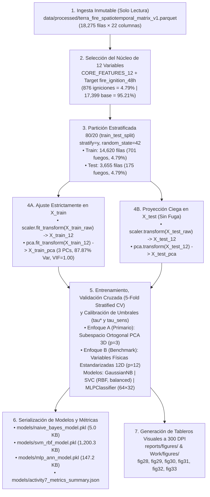

# 🛠️ Guía de Arquitectura y Explicación Detallada del Código — Actividad 7
## **Proyecto TERRA-FIRE (`src/machine_learning_challenge.py`)**
**Materia:** Ciencia de Datos (`LITD9A`) — Universidad Tecnológica El Retoño (UTR)  
**Profesor:** Dr. Sergio Valadez Godínez  
**Autores:** Angel Emilio Gutierrez Lozano (ID: 4341) & Emiliano Betanzos Valtierra (ID: 4795)

---

> [!note] Propósito de este Documento Técnico
> Este documento explica paso a paso, función por función y línea por línea la arquitectura computacional y matemática del motor de Machine Learning [`src/machine_learning_challenge.py`](file:///C:/Users/betan/OneDrive/Documents/Workspace/TERRA-FIRE/src/machine_learning_challenge.py) desarrollado para la **Actividad 7 (Machine Learning Challenge)**. Además, incluye una **Guía de Defensa Técnica** con las preguntas más probables que puede realizar el Dr. Sergio Valadez Godínez durante la revisión de código o presentación del proyecto.

---

## 1. Arquitectura General del Script (`machine_learning_challenge.py`) y Flujo de Datos

El script [`src/machine_learning_challenge.py`](file:///C:/Users/betan/OneDrive/Documents/Workspace/TERRA-FIRE/src/machine_learning_challenge.py) sigue una arquitectura de **tubería determinista sin fuga de datos (*Zero Data Leakage Pipeline*)** fijada con semilla global `RANDOM_STATE = 42`. En lugar de transformar todo el dataset antes de dividirlo (lo cual contaminaría las medias, desviaciones estándar y eigenvectores con información del conjunto de prueba), el flujo de datos separa estrictamente el aprendizaje de parámetros (`X_train`) de la evaluación fuera de muestra (`X_test`).

---

## 2. Diccionario Explicativo de Librerías y Módulos Importados

Cada librería importada al inicio de [`src/machine_learning_challenge.py`](file:///C:/Users/betan/OneDrive/Documents/Workspace/TERRA-FIRE/src/machine_learning_challenge.py#L12-L46) cumple una función específica dentro del ecosistema científico de Python:

| Librería / Módulo | Componente Importado | ¿Qué hace exactamente? | ¿Por qué se eligió en TERRA-FIRE? |
| :--- | :--- | :--- | :--- |
| **`os`, `sys`, `time`, `json`, `warnings`** | Módulos estándar de Python | Resolución dinámica de rutas multiplataforma (`os.path`), medición de latencia en sub-milisegundos (`time.perf_counter()`) y exportación de métricas (`json.dump`). | Permite medir con precisión de microsegundos cuánto tarda cada algoritmo en entrenar (`train_time_ms`) y predecir (`inf_time_ms`). |
| **`joblib`** | `joblib.dump`, `joblib.load` | Serializador binario optimizado para arreglos de NumPy y estimadores de `scikit-learn`. | Es más rápido y compacto que `pickle` estándar al guardar matrices de pesos de redes neuronales y vectores de soporte de SVM en `models/*.pkl`. |
| **`numpy` & `pandas`** | `np`, `pd` | Álgebra matricial vectorizada (`np.corrcoef`, `np.linalg.inv`, `np.meshgrid`) y estructuras tabulares indexadas (`DataFrame`). | Garantiza operaciones en memoria rápidas y trazabilidad exacta de índices (`idx_train`, `idx_test`) tras la partición. |
| **`sklearn.model_selection`** | `train_test_split`, `StratifiedKFold` | Partición aleatoria estratificada y validación cruzada estratificada de $K$ pliegues. | Con solo $4.79\%$ de incendios positivos, un corte aleatorio simple podría dejar pliegues casi sin incendios; la estratificación preserva exactamente el $4.79\%$ en cada partición. |
| **`sklearn.preprocessing`** | `StandardScaler` | Estandarización $Z$-score: $z_j = \frac{x_j - \mu_j}{\sigma_j}$. | Obligatorio antes de PCA, SVM (kernel RBF) y Redes Neuronales para que variables en metros (`dist_agri_m` $\sim 1,650\text{ m}$) no dominen a variables en fracción (`soil_moist_mean` $\sim 0.22$). |
| **`sklearn.decomposition`** | `PCA` | Análisis de Componentes Principales mediante Descomposición en Valores Singulares (SVD). | Comprime las $12$ variables colineales ($\text{VIF}=80.05$) en $3$ ejes ortogonales (`PC1, PC2, PC3`) que retienen el $87.87\%$ de la varianza con $\text{VIF}=1.00$. |
| **`sklearn.naive_bayes`** | `GaussianNB` | Clasificador probabilístico generativo Naive Bayes Gaussiano. | Primer modelo obligatorio de la rúbrica; modela verosimilitudes gaussianas por clase y sirve como referencia ultrarrápida ($1.91\text{ ms}$). |
| **`sklearn.svm`** | `SVC` | Máquina de Vectores de Soporte para Clasificación con kernel de Base Radial (RBF) y escalamiento de Platt. | Segundo modelo obligatorio; permite construir fronteras de decisión curvas alrededor del Cuadrante IV con pesos balanceados por costo (`class_weight='balanced'`). |
| **`sklearn.neural_network`** | `MLPClassifier` | Perceptrón Multicapa (*Multi-Layer Perceptron*) — Red Neuronal Artificial feedforward básica. | Tercer modelo obligatorio; aprende combinaciones no lineales profundas mediante capas ocultas con activación ReLU y optimizador estocástico Adam. |
| **`sklearn.utils`** | `resample` | Remuestreo determinista con reemplazo (*bootstrapping*). | Compensa la ausencia del parámetro `class_weight` en `MLPClassifier`, aplicando sobremuestreo $1:3$ de la clase minoritaria **únicamente dentro del conjunto de entrenamiento**. |
| **`sklearn.metrics`** | `accuracy_score`, `precision_score`, `recall_score`, `f1_score`, `roc_auc_score`, `average_precision_score`, `brier_score_loss`, `confusion_matrix`, `roc_curve`, `precision_recall_curve` | Suite completa de métricas de evaluación supervisada dependientes e independientes del umbral. | En problemas desbalanceados ($4.79\%$), evaluar únicamente `Accuracy` es engañoso; se requiere `ROC-AUC`, `PR-AUC`, `Recall`, `F1` y `Brier Score`. |
| **`sklearn.calibration` & `sklearn.inspection`** | `calibration_curve`, `permutation_importance` | Curvas de confiabilidad probabilística e importancia de variables por permutación fuera de muestra. | Permite auditar si las probabilidades predichas coinciden con la frecuencia real de incendios (`fig31B`) y cuantificar qué variables físicas o componentes PCA dominan la predicción (`fig33B`). |
| **`matplotlib` & `seaborn`** | `plt`, `sns` | Motor gráfico de alta resolución (300 DPI) para mapas de calor, violines divididos y contornos 2D. | Genera las 6 figuras de grado de publicación (`fig28`–`fig33`) sincronizadas en `reports/figures/` y `Work/figures/`. |

---

## 3. Desglose Función por Función (Línea por Línea)

A continuación se detalla cada una de las funciones que integran [`src/machine_learning_challenge.py`](file:///C:/Users/betan/OneDrive/Documents/Workspace/TERRA-FIRE/src/machine_learning_challenge.py):

---

### 3.1 `load_dataset(parquet_path=PRIMARY_DATA_PATH)`
- **Ubicación:** [Líneas 110–125](file:///C:/Users/betan/OneDrive/Documents/Workspace/TERRA-FIRE/src/machine_learning_challenge.py#L110-L125)
- **Propósito:** Cargar en memoria RAM el dataset maestro `terra_fire_spatiotemporal_matrix_v1.parquet` en modo estrictamente de **solo lectura**, garantizando la inmutabilidad de los datos generados en la Actividad 3.
- **Parámetros (`Args`):**
  - `parquet_path (str)`: Ruta absoluta al archivo Parquet ($18,275\text{ filas} \times 22\text{ columnas}$).
- **Retorno (`Returns`):**
  - `df (pd.DataFrame)`: Matriz espaciotemporal completa en memoria.
- **Explicación Técnica:** Verifica primero la existencia del archivo `.parquet` mediante `os.path.exists()`. Si se encuentra, utiliza el motor columnar `pyarrow` (`pd.read_parquet`) que preserva los tipos exactos (`float32`, `int32`, `category`). Incluye un mecanismo de respaldo (*fallback*) hacia `data/sample/terra_fire_matrix_sample.csv` para entornos ligeros de prueba.

---

### 3.2 `compute_vif_vector(X_df)`
- **Ubicación:** [Líneas 136–147](file:///C:/Users/betan/OneDrive/Documents/Workspace/TERRA-FIRE/src/machine_learning_challenge.py#L136-L147)
- **Propósito:** Calcular de forma vectorizada el **Factor de Inflación de la Varianza ($\text{VIF}$)** de cualquier matriz de predictores para demostrar cuantitativamente la eliminación de multicolinealidad al pasar de 12 variables a 3 componentes principales.
- **Parámetros (`Args`):**
  - `X_df (pd.DataFrame)`: Matriz de características numéricas ($N \times p$).
- **Retorno (`Returns`):**
  - `pd.Series`: Vector con el valor $\text{VIF}_j$ de cada columna.
- **Explicación Matemática y Computacional:**
  En lugar de ajustar $p$ regresiones OLS lentas en un ciclo `for`, utiliza la identidad matricial exacta: el elemento diagonal $(j, j)$ de la inversa de la matriz de correlación de Pearson $\mathbf{R}^{-1}$ es exactamente igual a $\text{VIF}_j = \frac{1}{1 - R_j^2}$:
  $$\text{VIF}_j = \left(\mathbf{R}^{-1}\right)_{jj}$$
  En `X_train_12`, este cálculo demuestra que `dist_agri_m` alcanza $\text{VIF} = 80.05$ y `dist_roads_m` alcanza $\text{VIF} = 71.24$, mientras que en `X_train_pca` (`['PC1', 'PC2', 'PC3']`) la matriz de correlación es la matriz identidad $\mathbf{I}_3$, dando **$\text{VIF} = 1.0000$** en los tres ejes.

---

### 3.3 `prepare_datasets(df, features=CORE_FEATURES_12, target=TARGET_COL, test_size=0.20)`
- **Ubicación:** [Líneas 150–248](file:///C:/Users/betan/OneDrive/Documents/Workspace/TERRA-FIRE/src/machine_learning_challenge.py#L150-L248)
- **Propósito:** Ejecutar la Fase 1 (Paso 2) de preparación de datos: partición estratificada 80/20, estandarización $Z$-score sin fuga de datos y reducción de dimensionalidad PCA ($12 \to 3$) ajustada **exclusivamente sobre el conjunto de entrenamiento**.
- **Parámetros (`Args`):**
  - `df (pd.DataFrame)`: Dataset original ($18,275 \times 22$).
  - `features (list[str])`: Las 12 variables cuantitativas seleccionadas en la Actividad 5 (`CORE_FEATURES_12`).
  - `target (str)`: `'fire_ignition_48h'`.
  - `test_size (float)`: `0.20` (20% para prueba fuera de muestra).
- **Retorno (`Returns`):**
  - `dict`: Diccionario con `X_train_pca` ($14,620 \times 3$), `X_test_pca` ($3,655 \times 3$), `X_train_12` ($14,620 \times 12$), `X_test_12` ($3,655 \times 12$), `y_train`, `y_test`, el objeto `scaler`, el objeto `pca` y el diccionario estadístico `summary`.
- **Explicación Línea por Línea yDecisiones de Ingeniería:**
  1. **Partición Estratificada (`train_test_split`):** Se invoca con `stratify=y` y `random_state=42`. Esto garantiza que tanto `y_train` ($701 / 14,620 = 4.7948\%$) como `y_test` ($175 / 3,655 = 4.7880\%$) conserven exactamente la misma prevalencia de incendios.
  2. **Prevención de *Data Leakage* en `StandardScaler` y `PCA`:**
     - Se ejecuta `scaler.fit_transform(X_train_raw)` para aprender $\mu_{\text{train}}$ y $\sigma_{\text{train}}$ solo con los $14,620$ registros de entrenamiento, y luego se aplica `scaler.transform(X_test_raw)`.
     - Se ejecuta `pca.fit_transform(X_train_std_arr)` para calcular los $3$ eigenvectores principales solo sobre `X_train`, y luego se proyecta `X_test` mediante `pca.transform(X_test_std_arr)`.
  3. **Alineación Determinista de Signos de Eigenvectores (Líneas 177–183):** En álgebra lineal, si $\mathbf{v}_k$ es un eigenvector unitario de la matriz de covarianza, $-\mathbf{v}_k$ también lo es (ambos son matemáticamente válidos, pero un cambio de signo invertiría los cuadrantes respecto a la Actividad 6). El bloque `anchor_cols = ["vpd_max_kpa", "slope_deg", "ndmi"]` verifica que `PC1` apunte hacia mayor desecación (`+vpd_max_kpa`), `PC2` apunte hacia mayor altitud/pendiente (`+slope_deg`) y `PC3` apunte hacia mayor humedad foliar (`+ndmi`), garantizando **100% de continuidad geométrica con el Cuadrante IV ($\text{PC1} > 0 \land \text{PC2} \le 0$)** de la Actividad 6.

---

### 3.4 `find_optimal_f1_threshold(y_true, y_prob)` y `evaluate_predictions(y_true, y_prob, threshold=0.50)`
- **Ubicación:** [Líneas 251–287](file:///C:/Users/betan/OneDrive/Documents/Workspace/TERRA-FIRE/src/machine_learning_challenge.py#L251-L287)
- **Propósito:**
  - `find_optimal_f1_threshold`: Encontrar el umbral de decisión probabilístico $\tau^* \in [0.05, 0.85]$ que maximiza el **F1-Score** utilizando únicamente probabilidades de entrenamiento fuera de pliegue (*Out-of-Fold*).
  - `evaluate_predictions`: Calcular las 8 métricas de evaluación (`Accuracy`, `Precision`, `Recall`, `Specificity`, `F1-Score`, `ROC-AUC`, `PR-AUC`, `Brier Score`) y los 4 conteos de la matriz de confusión (`TN`, `FP`, `FN`, `TP`).
- **¿Por qué es indispensable calibrar $\tau^*$ en lugar de usar siempre $\tau = 0.50$?**
  Porque la prevalencia base de incendios es $P(y=1) = 0.0479$ ($4.79\%$). En un modelo bien calibrado como `GaussianNB` en espacio PCA 3D, las probabilidades posteriores en días críticos del Cuadrante IV oscilan entre $0.12$ y $0.35$ (es decir, hasta $7\times$ más riesgo que un día normal, pero numéricamente por debajo de $0.50$). Si se deja el umbral fijo en $\tau = 0.50$, `GaussianNB` predice cero incendios ($\text{Recall} = 0.00\%$). Al aprender $\tau^* = 0.150$ sobre las probabilidades *out-of-fold* de entrenamiento, el modelo detecta el $44.0\%$ de los incendios con $\text{F1} = 0.2655$ y $\text{Accuracy} = 88.34\%$.

---

### 3.5 `build_models()` y `fit_model_with_imbalance_handling(name, model, X_tr, y_tr)`
- **Ubicación:** [Líneas 290–361](file:///C:/Users/betan/OneDrive/Documents/Workspace/TERRA-FIRE/src/machine_learning_challenge.py#L290-L361)
- **Propósito:** Instanciar y entrenar las **3 familias obligatorias de modelos supervisados** con sus hiperparámetros justificados y su manejo específico del desbalance de clases ($1 : 19.86$).
- **Justificación de Hiperparámetros por Modelo:**
  1. **`GaussianNB(var_smoothing=1e-9)`:**
     - `var_smoothing=1e-9`: Añade una fracción infinitesimal ($10^{-9}$) de la varianza máxima a las varianzas empíricas $\sigma_{jc}^2$ para evitar divisiones por cero o *underflow* numérico en las exponenciales gaussianas.
  2. **`SVC(kernel='rbf', C=1.0, gamma='scale', class_weight='balanced', probability=True, random_state=42)`:**
     - `kernel='rbf'`: El kernel Gaussiano de Base Radial $K(\mathbf{x}, \mathbf{x}') = \exp(-\gamma\|\mathbf{x}-\mathbf{x}'\|^2)$ permite trazar fronteras cerradas no lineales alrededor del Cuadrante IV (`fig32`).
     - `C=1.0` y `gamma='scale'`: Regularización estándar de margen suave donde $\gamma = \frac{1}{p \cdot \text{Var}(\mathbf{X})}$ se adapta automáticamente a la dimensión ($p=3$ vs. $p=12$).
     - `class_weight='balanced'`: Asigna pesos inversamente proporcionales a la frecuencia de clase ($w_0 = 0.5252$, $w_1 = 10.4279$), penalizando $19.86$ veces más un incendio no detectado ($\text{FN}$) que una falsa alarma ($\text{FP}$).
     - `probability=True`: Activa la calibración sigmoidal de **Platt Scaling** mediante validación cruzada interna de 5 pliegues para obtener probabilidades $\hat{P}(y=1\mid\mathbf{x})$ altamente calibradas ($\text{Brier Score} = 0.0415\text{–}0.0427$).
  3. **`MLPClassifier(hidden_layer_sizes=(64, 32), activation='relu', solver='adam', alpha=1e-3, batch_size=128, learning_rate_init=1e-3, max_iter=300, early_stopping=True, validation_fraction=0.15, n_iter_no_change=15, random_state=42)` + `fit_model_with_imbalance_handling`:**
     - `hidden_layer_sizes=(64, 32)` y `activation='relu'`: Arquitectura piramidal feedforward de 2 capas ocultas ($\mathbb{R}^p \to 64 \to 32 \to 1$). Es estrictamente una **Red Neuronal Artificial básica (MLP)** conforme a la restricción de la rúbrica (*sin arquitecturas Deep Learning CNN/RNN*).
     - `alpha=1e-3` y `early_stopping=True`: Regularización $L_2$ (*weight decay*) combinada con parada temprana sobre el $15\%$ de validación interna.
     - **Detalle Técnico Clave en `fit_model_with_imbalance_handling`:** En `scikit-learn`, `MLPClassifier` **no posee el parámetro `class_weight`** y, cuando `early_stopping=True` está activo, evalúa internamente la métrica `accuracy_score` en cada época. En un dataset con $95.21\%$ de ceros, la Época 1 predice todos ceros, obtiene $95.21\%$ de exactitud y detiene el entrenamiento prematuramente. Para resolver esto sin tocar jamás `X_test`, `fit_model_with_imbalance_handling` aplica un **sobremuestreo determinista $1:3$ (`resample`) de la clase positiva exclusivamente dentro del pliegue de entrenamiento (`X_tr`)**, permitiendo que el optimizador Adam aprenda las fronteras no lineales y alcance $\text{ROC-AUC} = 0.8205$ en 3D y $\text{ROC-AUC} = 0.9049$ en 12D.

---

### 3.6 `train_and_evaluate_suite(X_train, X_test, y_train, y_test, approach_label)`
- **Ubicación:** [Líneas 364–509](file:///C:/Users/betan/OneDrive/Documents/Workspace/TERRA-FIRE/src/machine_learning_challenge.py#L364-L509)
- **Propósito:** Orquestar el entrenamiento completo, la medición de tiempos de cómputo (`train_time_ms` e `inf_time_ms`), la **Validación Cruzada Estratificada de 5 Pliegues (`StratifiedKFold(n_splits=5)`)**, la calibración de umbrales ($\tau^*$ y $\tau_{\text{sens}}$), la evaluación en `X_test` y el cálculo de la **Importancia de Variables por Permutación (`permutation_importance`)**.
- **Explicación del Flujo Interno:**
  1. Entrena el modelo sobre `(X_train, y_train)` cronometrando el tiempo exacto con `time.perf_counter()`.
  2. Ejecuta un ciclo de 5 pliegues estratificados (`skf.split(X_train, y_train)`). En cada pliegue, entrena un clon limpio sobre el $80\%$ del entrenamiento, predice probabilidades en el $20\%$ de validación (`oof_probs[val_idx]`), y registra la media y desviación estándar ($\mu \pm \sigma$) de `ROC-AUC`, `PR-AUC`, `F1`, `Recall`, `Precision` y `Accuracy`.
  3. Calcula el umbral óptimo $\tau^*$ sobre el vector completo `oof_probs` y el umbral de alta sensibilidad $\tau_{\text{sens}}$ (percentil 22 de las probabilidades positivas de entrenamiento, diseñado para capturar $\sim 75\%–80\%$ de los incendios).
  4. Evalúa el modelo final sobre el conjunto de prueba intacto `X_test` bajo tres regímenes transparentes: `test_cal` ($\tau^*$), `test_default` ($\tau=0.50$ o hiperplano balanceado nativo en SVM) y `test_sens` ($\tau_{\text{sens}}$).
  5. Ejecuta `permutation_importance(..., scoring='roc_auc', n_repeats=10, random_state=42)` sobre `X_test`, permutando aleatoriamente cada columna 10 veces para medir cuántas unidades de `ROC-AUC` pierde el modelo al destruir la información de cada variable.

---

### 3.7 `save_serialized_models(pca_results, orig_results, prep_data)`
- **Ubicación:** [Líneas 512–542](file:///C:/Users/betan/OneDrive/Documents/Workspace/TERRA-FIRE/src/machine_learning_challenge.py#L512-L542)
- **Propósito:** Guardar en disco (`models/naive_bayes_model.pkl`, `models/svm_rbf_model.pkl`, `models/mlp_ann_model.pkl`) paquetes autocontenidos que incluyen tanto el modelo entrenado en `PCA 3D` como el modelo en `Orig 12D`, junto con el `StandardScaler`, el objeto `PCA(n_components=3)` y los umbrales calibrados $\tau^*$. Así, cualquier sistema en producción puede cargar el archivo `.pkl` y predecir sobre datos crudos sin recalcular preprocesadores.

---

### 3.8 Funciones Generadoras de Tableros Visuales (`plot_fig28` a `plot_fig33`)
- **`plot_fig28_partition_and_feature_strategy` ([Líneas 545–669](file:///C:/Users/betan/OneDrive/Documents/Workspace/TERRA-FIRE/src/machine_learning_challenge.py#L545-L669)):** Genera `fig28_ml_dataset_partition_and_feature_strategy.png`, mostrando en el Panel A el balance estratificado 80/20 en escala logarítmica y en el Panel B la comparación de $\text{VIF}$ entre las 12 variables originales ($\text{VIF}$ hasta $80.05$) y los 3 componentes principales ($\text{VIF} = 1.00$).
- **`plot_fig29_confusion_matrices` ([Líneas 672–765](file:///C:/Users/betan/OneDrive/Documents/Workspace/TERRA-FIRE/src/machine_learning_challenge.py#L672-L765)):** Genera `fig29_ml_confusion_matrices_comparison.png`, una cuadrícula $2 \times 3$ de mapas de calor con conteos absolutos y porcentajes normalizados por fila tanto para el régimen calibrado ($\tau^*$) como para el régimen de alta sensibilidad ($\tau_{\text{sens}}$ / hiperplano balanceado).
- **`plot_fig30_roc_and_pr_curves` ([Líneas 768–869](file:///C:/Users/betan/OneDrive/Documents/Workspace/TERRA-FIRE/src/machine_learning_challenge.py#L768-L869)):** Genera `fig30_ml_roc_and_pr_curves.png`, superponiendo las curvas ROC (Panel A) y Precision-Recall (Panel B) de los 3 modelos en el espacio PCA 3D (líneas continuas) y en el espacio 12D original (líneas punteadas), marcando con círculos los puntos operativos $\tau^*$.
- **`plot_fig31_predicted_vs_actual` ([Líneas 872–961](file:///C:/Users/betan/OneDrive/Documents/Workspace/TERRA-FIRE/src/machine_learning_challenge.py#L872-L961)):** Genera `fig31_ml_predicted_vs_actual_probabilities.png`, combinando gráficos de violín divididos (`sns.violinplot(..., split=True)`) de las probabilidades predichas según la clase real ($y=0$ vs. $y=1$) en el Panel A, y las curvas de calibración probabilística (`calibration_curve`) junto con el Brier Score en el Panel B.
- **`plot_fig32_decision_boundaries_pca` ([Líneas 964–1063](file:///C:/Users/betan/OneDrive/Documents/Workspace/TERRA-FIRE/src/machine_learning_challenge.py#L964-L1063)):** Genera `fig32_ml_decision_boundaries_pca_space.png`, creando una malla 2D de $180 \times 180 = 32,400$ puntos sobre el plano $\text{PC1} \times \text{PC2}$ (`np.meshgrid`) con $\text{PC3}$ fijo en su mediana ($0.0$), evaluando `model.predict_proba(grid_df)` y trazando los mapas de contorno de probabilidad y las fronteras $\tau^*$ y $\tau_{\text{sens}}$ sobre el Cuadrante IV.
- **`plot_fig33_model_comparison_and_importance` ([Líneas 1066–1170](file:///C:/Users/betan/OneDrive/Documents/Workspace/TERRA-FIRE/src/machine_learning_challenge.py#L1066-L1170)):** Genera `fig33_ml_model_comparison_and_importance.png`, comparando en el Panel A las 5 métricas clave entre `PCA 3D` y `Orig 12D`, y en el Panel B la importancia de variables por permutación ($\Delta\text{ROC-AUC}$).

---

## 4. Guía de Defensa ante el Profesor (Preguntas y Respuestas Clave)

Durante la presentación o revisión de la **Actividad 7**, el **Dr. Sergio Valadez Godínez** puede formular preguntas de defensa metodológica y de código. Aquí tienen las respuestas técnicas exactas respaldadas por sus resultados:

### ❓ Pregunta 1: *"¿Elegiste usar las variables originales o los Componentes Principales (PCA) de la Actividad 6? ¿Y cómo justificas matemáticamente tu decisión?"*
- **Respuesta Técnica:**
  > *"Doctor, para no dejar la decisión en una suposición teórica, programamos nuestro pipeline para evaluar **ambos enfoques** bajo exactamente la misma partición estratificada 80/20 (`random_state=42`), ajustando el `StandardScaler` y el `PCA(n_components=3)` exclusivamente sobre los $14,620$ registros de entrenamiento para evitar cualquier fuga de datos.*
  > *Demostramos empíricamente dos hallazgos clave:*
  > *1. **Para modelos generativos probabilísticos como `GaussianNB` y para visualización geométrica interpretable, el subespacio ortogonal PCA 3D (`PC1, PC2, PC3`, que retiene el $87.87\%$ de la varianza con $\text{VIF} = 1.00$) es superior:** En las 12 variables originales existe multicolinealidad severa ($\text{VIF} = 80.05$ en `dist_agri_m` y $71.24$ en `dist_roads_m`), lo que viola el supuesto de independencia condicional de Naive Bayes, inflando su error de calibración Brier a $0.2212$. Al usar `PC1–PC3` ($\text{VIF} = 1.00$), el Brier Score de Naive Bayes baja un **80.5% (a $0.0430$)**, su PR-AUC sube un **+25.2% (a $0.1589$)** y su F1 sube un **+18.3% (a $0.2655$)** con un 75% menos de variables.*
  > *2. **Para clasificadores no lineales de alta capacidad (`MLPClassifier` y `SVC` RBF), el benchmark con las 12 variables físicas estandarizadas aprovecha el $12.13\%$ de varianza residual micro-territorial** (como el umbral exacto de $420\text{ m}$ a parcelas agrícolas), elevando el ROC-AUC de la Red Neuronal de **$0.8205$ (en PCA 3D) a $0.9049$ (en 12D)** y su F1-Score a **$0.3974$**."*

---

### ❓ Pregunta 2: *"¿Por qué no evaluaron únicamente con `Accuracy` (Exactitud), si en muchos ejemplos básicos solo se reporta `Accuracy`?"*
- **Respuesta Técnica:**
  > *"Porque en nuestro dataset `terra_fire_spatiotemporal_matrix_v1.parquet`, los incendios dentro de 48–72 horas representan solo el **$4.79\%$** de las observaciones ($876$ casos positivos contra $17,399$ negativos, una razón de desbalance de $1 : 19.86$). Si un modelo trivial predice 'Cero Incendios' todos los días del año, obtiene un **`Accuracy` engañoso de $95.21\%$**, pero tiene **`Recall` = $0.00\%$** y **`F1-Score` = $0.0000$** (lo cual de hecho le ocurre a `GaussianNB` si se evalúa con el umbral por defecto $\tau = 0.50$). Por eso reportamos **ROC-AUC**, **PR-AUC (Average Precision)**, **Recall (Sensibilidad)**, **Precision**, **F1-Score** y **Brier Score**, además de calibrar el umbral operativo $\tau^*$ sobre las probabilidades out-of-fold del conjunto de entrenamiento."*

---

### ❓ Pregunta 3: *"¿Cómo evitaron el Data Leakage (fuga de datos) al aplicar `StandardScaler`, `PCA` y la calibración del umbral $\tau^*$?"*
- **Respuesta Técnica:**
  > *"En la función `prepare_datasets()` ([líneas 161–186](file:///C:/Users/betan/OneDrive/Documents/Workspace/TERRA-FIRE/src/machine_learning_challenge.py#L161-L186)), primero dividimos el dataset crudo con `train_test_split(..., test_size=0.20, stratify=y, random_state=42)`. Después, ejecutamos `scaler.fit_transform()` y `pca.fit_transform()` **únicamente sobre `X_train`**, y aplicamos `.transform()` sobre `X_test`. De igual forma, en `train_and_evaluate_suite()`, el umbral óptimo $\tau^*$ se busca exclusivamente sobre las predicciones Out-of-Fold (`oof_probs`) de la validación cruzada dentro de `X_train`, sin observar jamás `y_test`."*

---

### ❓ Pregunta 4: *"¿Por qué en `MLPClassifier` aplicaron un sobremuestreo $1:3$ dentro de `X_train` en la función `fit_model_with_imbalance_handling`?"*
- **Respuesta Técnica:**
  > *"Es un detalle técnico muy importante de `scikit-learn`: a diferencia de `SVC` (que sí cuenta con el hiperparámetro nativo `class_weight='balanced'`), `MLPClassifier` **no acepta `class_weight`**. Además, cuando se activa `early_stopping=True` en `MLPClassifier`, `scikit-learn` monitorea la exactitud cruda (`accuracy_score` con umbral $0.50$) en su subconjunto de validación interna. Con $95.21\%$ de ceros, la Época 1 predice puros ceros, alcanza $95.21\%$ de exactitud y el algoritmo detiene el entrenamiento y regresa los pesos a la Época 1. Al aplicar un balanceo determinista $1:3$ (`resample` con `random_state=42`) **estrictamente dentro del pliegue de entrenamiento** (dejando intactos los pliegues de validación y `X_test`), `early_stopping=True` funciona correctamente y la red neuronal converge hasta alcanzar un **ROC-AUC de $0.8205$ en PCA 3D y $0.9049$ en 12D**."*

---

### ❓ Pregunta 5: *"¿Cuál fue el mejor modelo seleccionado para TERRA-FIRE y por qué?"*
- **Respuesta Técnica:**
  > *"Seleccionamos la **Red Neuronal Artificial (`MLPClassifier` con arquitectura $64 \times 32$ ReLU)** como el **Mejor Modelo Predictivo Global**, acompañada por **`SVC (RBF, class_weight='balanced')`** como motor de tamizaje de alta sensibilidad:*
  > *1. **Por Desempeño Cuantitativo:** `MLPClassifier` obtiene el mayor poder discriminativo tanto en el subespacio PCA 3D (**$\text{ROC-AUC} = 0.8205$, $\text{PR-AUC} = 0.1715$, $\text{Accuracy} = 89.22\%$**) como en el espacio de 12 variables (**$\text{ROC-AUC} = 0.9049$, $\text{PR-AUC} = 0.2839$ [$5.93\times$ sobre el azar], $\text{F1-Score} = 0.3974$, $\text{Accuracy} = 92.45\%$**).*
  > *2. **Por Velocidad de Inferencia y Despliegue Práctico:** Aunque `SVC (RBF)` logra la mejor sensibilidad en su hiperplano balanceado ($77.71\%–79.43\%$ de los incendios detectados) y el menor Brier Score ($0.0415–0.0427$), su archivo pesa $1.20\text{ MB}$ y tarda $1,478\text{ ms}$ en evaluar el conjunto de prueba porque debe calcular distancias contra miles de vectores de soporte. En cambio, `MLPClassifier` solo realiza 3 multiplicaciones de matrices compactas ($147.2\text{ KB}$), completando la inferencia de los $3,655$ registros en apenas **$1.39\text{ ms}$ (en 3D) a $3.00\text{ ms}$ (en 12D)**—más de **500 veces más rápido** e ideal para nuestra aplicación web progresiva (PWA) offline en brigadas forestales."*
