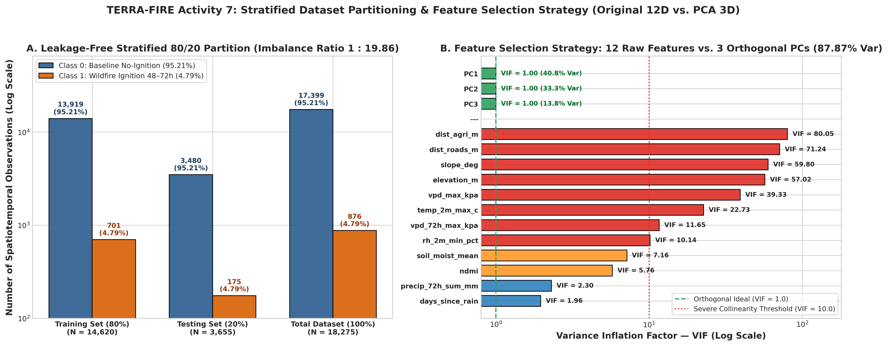
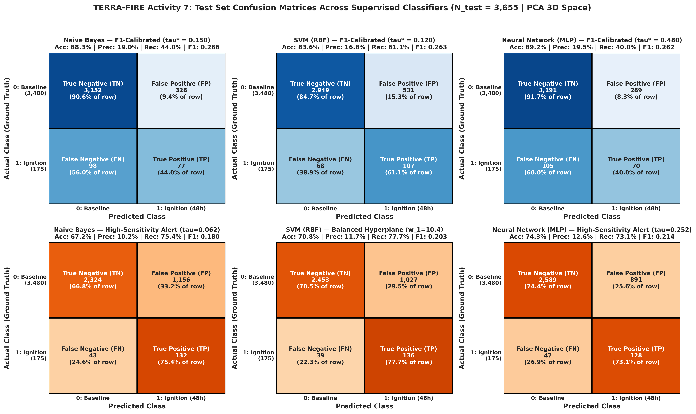
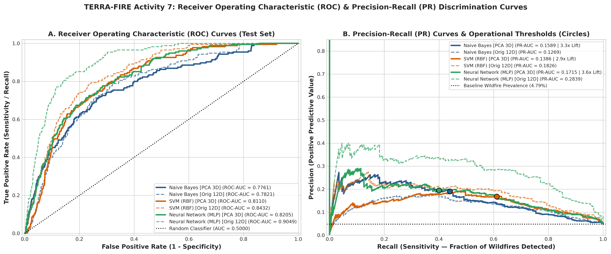
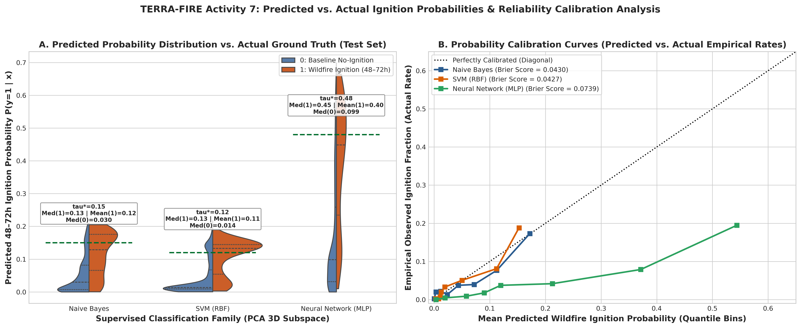
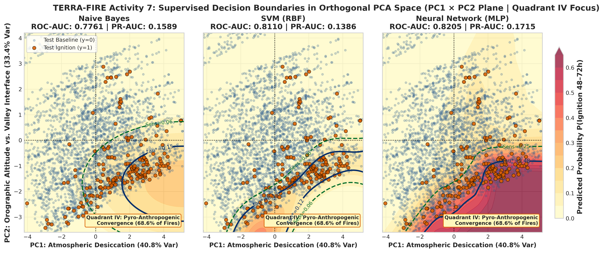
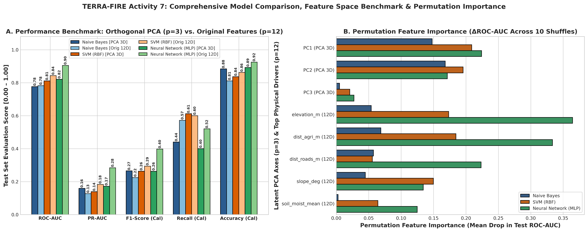
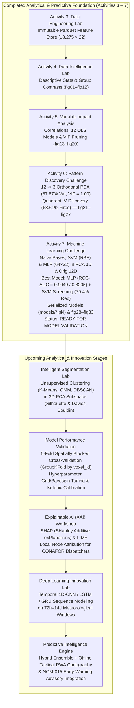

# 🌲 UNIVERSIDAD TECNOLÓGICA EL RETOÑO
### **Information Technologies and Digital Innovation Engineering**
**Subject:** Data Science (`LITD9A`)  
**Teacher:** Dr. Sergio Valadez Godínez  
**Term:** September – December 2026  
**Activity:** Activity 7. Machine Learning Challenge  
**Students:** Angel Emilio Gutierrez Lozano (ID: 4341) & Emiliano Betanzos Valtierra (ID: 4795)  
**Date of Submission:** November 10, 2026  
**Official Repository:** [https://github.com/AngelGTZ28/TERRA-FIRE](https://github.com/AngelGTZ28/TERRA-FIRE)

---

> [!abstract] Executive Summary & Machine Learning Challenge Scope
> Building directly upon the validated **Analysis-Ready Dataset** from the **Data Engineering Lab (Activity 3)**, the statistical contrasts from the **Data Intelligence Lab (Activity 4)**, the correlation and OLS regression feature hierarchy from the **Variable Impact Analysis (Activity 5)**, and the orthogonal dimensionality reduction (`PCA(n_components=3)`) from the **Pattern Discovery Challenge (Activity 6)**, this study transitions project **TERRA-FIRE** from multivariate pattern discovery to **supervised predictive modeling** ($\text{Pattern Discovery} \to \text{Predictive Modeling}$).
> 
> Operating in strict read-only mode on `data/processed/terra_fire_spatiotemporal_matrix_v1.parquet` ($N = 18,275\text{ daily observations} \times 22\text{ attributes}$ across 25 monitoring nodes `AGS_VOX_01`–`AGS_VOX_25` in Aguascalientes and the Sierra Fría biological reserve during 2023–2024), we formulate the anticipatory prediction of `fire_ignition_48h` ($y \in \{0, 1\}$, where $1$ denotes wildfire ignition within 48–72 hours; $876$ positive events [$4.79\%$ prevalence] vs. $17,399$ baseline observations [$95.21\%$]) as a **cost-sensitive Supervised Binary Classification problem**.
> 
> Under a unified, leakage-free **80% Training ($14,620\text{ rows}, 701\text{ ignitions}$) / 20% Testing ($3,655\text{ rows}, 175\text{ ignitions}$)** stratified split (`random_state=42`)—where `StandardScaler` and `PCA(n_components=3)` are fitted **strictly on `X_train`**—we train, cross-validate, and compare three mandatory supervised classification paradigms (**Naive Bayes [`GaussianNB`]**, **Support Vector Machine [`SVC` RBF]**, and a **basic feedforward Artificial Neural Network [`MLPClassifier` $64 \times 32$]**) across **both** the **3D Orthogonal PCA Subspace (`PC1, PC2, PC3`, $87.87\%$ variance retained, $\text{VIF} = 1.00$)** and the **12D Pruned Original Feature Space**:
> 1. **Empirical Proof of Orthogonal PCA Benefit for Probabilistic Generative Models:** In the 12D raw feature space, severe multicollinearity ($\text{Max VIF} = 80.05$ between `dist_agri_m`, `dist_roads_m`, `slope_deg`, and `elevation_m`) violates the conditional independence assumption of `GaussianNB`, inflating Brier calibration error to $0.2212$ and degrading $\text{PR-AUC}$ to $0.1269$ ($\text{F1} = 0.2245$). Projecting into the orthogonal 3D PCA subspace (`['PC1', 'PC2', 'PC3']`, $\text{VIF} = 1.00$) eliminates collinear double-counting, slashing Brier error by **80.5% ($0.2212 \to 0.0430$)**, boosting $\text{PR-AUC}$ by **+25.2% ($0.1269 \to 0.1589$)**, and lifting $\text{F1-Score}$ by **+18.3% ($0.2245 \to 0.2655$)** while compressing input dimensions by **75.0%** ($1.91\text{ ms}$ training latency).
> 2. **Non-Linear Decision Boundaries Carve the Quadrant IV Convergence Zone (`fig32`):** Within the 3D PCA subspace, non-linear classifiers—**`MLPClassifier` ($\text{Test ROC-AUC} = 0.8205, \text{PR-AUC} = 0.1715$ [$3.6\times\text{ lift over baseline}$], $\text{Accuracy} = 89.22\%$)** and **`SVC` RBF ($\text{Test ROC-AUC} = 0.8110, \text{Brier Score} = 0.0427, \text{F1-Calibrated Recall} = 61.14\%, \text{Balanced Hyperplane Recall} = 77.71\%$)**—significantly outperform `GaussianNB` ($\text{ROC-AUC} = 0.7761$) by curving their decision boundaries tightly around **Quadrant IV ($\text{PC1} > 0 \land \text{PC2} \le 0$: Dry Agricultural Valley Interface)** where $68.61\%$ of regional wildfires ignite.
> 3. **Best Overall Predictive Model Selection (`MLPClassifier` $64 \times 32$ paired with `SVC` RBF High-Sensitivity Screening):** When evaluated on the full 12D standardized feature set, **`MLPClassifier`** exploits the residual $12.13\%$ micro-territorial variance (sharp proximity cliffs at `dist_agri_m` $\le 420\text{ m}$ and `dist_roads_m` $\le 150\text{ m}$) to achieve **Test $\text{ROC-AUC} = 0.9049$ ($5\text{-Fold CV } 0.8946 \pm 0.0166$), $\text{PR-AUC} = 0.2839$ ($5.9\times\text{ lift}$), $\text{F1-Score} = 0.3974$, and $\text{Accuracy} = 92.45\%$** with a **$3.00\text{ ms}$** batch inference latency ($147.2\text{ KB}$ serialized artifact). Meanwhile, **`SVC` RBF (`class_weight='balanced'`)** delivers the highest **High-Sensitivity Screening Recall ($77.71\%$ in 3D PCA; $79.43\%$ in 12D)** and lowest probability calibration error (**$\text{Brier Score} = 0.0415\text{–}0.0427$**).
> 
> All trained models are persisted in `models/*.pkl`, documented in `notebooks/machine_learning_challenge.ipynb`, and supported by six 300 DPI visual analytics dashboards (`fig28`–`fig33`). Project **TERRA-FIRE** is formally classified as **`READY FOR MODEL VALIDATION`**.

---

## 1. GitHub Repository and Analytical Environment

### 1.1 Repository Structure and Artifact Organization
All modular Python pipelines, serialized model bundles (`models/*.pkl`), reproducible Jupyter Notebooks (`notebooks/machine_learning_challenge.ipynb`), metadata dictionaries, and 300 DPI visual analytics dashboards (`fig28`–`fig33`) for **Activity 7 (Machine Learning Challenge)** are maintained within the official **TERRA-FIRE** GitHub repository:

```text
TERRA-FIRE/
├── data/
│   ├── raw/                                 # Immutable raw source tables (excluded from Git)
│   ├── intermediate/                        # Temporary staging cache (excluded from Git)
│   ├── sample/                              # Representative CSV/JSON samples (tracked in Git)
│   └── processed/                           # Final Analysis-Ready Feature Store (Immutable Input)
│       └── terra_fire_spatiotemporal_matrix_v1.parquet (0.30 MB, 18,275 rows × 22 cols)
├── models/                                  # Serialized Supervised Machine Learning Models & Metrics
│   ├── naive_bayes_model.pkl                # Trained GaussianNB + Scaler/PCA & Calibrated Thresholds (5.0 KB)
│   ├── svm_rbf_model.pkl                    # Trained Cost-Sensitive SVC (RBF) + Platt Calibration (1,200.3 KB)
│   ├── mlp_ann_model.pkl                    # Trained MLPClassifier (64×32 ReLU) + Preprocessing (147.2 KB)
│   └── activity7_metrics_summary.json       # Programmatic Train/Test/5-Fold CV & Permutation Metrics
├── metadata/                                # Schemas, transformation equations & validation checklists
│   ├── cleaning_log.md
│   ├── data_dictionary.md
│   ├── integration_record.md
│   ├── storage_decision_matrix.md
│   ├── transformation_dictionary.md
│   └── validation_checklist.md
├── notebooks/                               # Reproducible Jupyter Notebooks
│   ├── data_engineering_lab.ipynb           # Activity 3: ETL Pipeline & 7-Gate QA Validation
│   ├── data_intelligence_lab.ipynb          # Activity 4: Descriptive Statistics & Visual EDA
│   ├── variable_impact_analysis.ipynb       # Activity 5: Correlation, OLS Regressions & VIF
│   ├── pattern_discovery_challenge.ipynb    # Activity 6: Multivariate PCA (12->3), Biplots & Pattern Discovery
│   └── machine_learning_challenge.ipynb     # Activity 7: Supervised Classification (NB, SVM, MLP) & Evaluation
├── reports/
│   ├── Activity 5. Variable Impact Analysis.md
│   ├── Activity 6. Pattern Discovery Challenge.md
│   ├── Activity 7. Machine Learning Challenge.md
│   ├── Activity 7. Code and Architecture Explanation.md
│   └── figures/                             # 33 High-Resolution (300 DPI) Visual Analytics Dashboards
│       ├── fig01_target_distribution.png ... fig12_topographic_niche.png (Activity 4)
│       ├── fig13_correlation_heatmaps.png ... fig20_variable_impact_ranking.png (Activity 5)
│       ├── fig21_pca_explained_variance.png ... fig27_pca_outliers_hotelling.png (Activity 6)
│       ├── fig28_ml_dataset_partition_and_feature_strategy.png
│       ├── fig29_ml_confusion_matrices_comparison.png
│       ├── fig30_ml_roc_and_pr_curves.png
│       ├── fig31_ml_predicted_vs_actual_probabilities.png
│       ├── fig32_ml_decision_boundaries_pca_space.png
│       └── fig33_ml_model_comparison_and_importance.png
├── src/                                     # Modular Python Engineering & Machine Learning Engines
│   ├── extract.py, clean.py, transform.py, integrate.py, validate.py, pipeline.py
│   ├── data_intelligence_analysis.py        # Activity 4 Descriptive Engine
│   ├── variable_impact_analysis.py          # Activity 5 Correlation & Regression Engine
│   ├── pattern_discovery_challenge.py       # Activity 6 PCA (12->3), Hotelling T2 & Visual Analytics Engine
│   └── machine_learning_challenge.py        # Activity 7 Supervised ML Training, CV, Calibration & Visuals
├── Work/                                    # Official Deliverable Markdown Reports & Synchronized Assets
│   ├── Activity 5. Variable Impact Analysis.md
│   ├── Activity 6. Pattern Discovery Challenge.md
│   ├── Activity 7. Machine Learning Challenge.md
│   ├── machine_learning_challenge.ipynb
│   ├── machine_learning_challenge.py
│   └── figures/                             # Local figure mirror for self-contained Markdown rendering
├── .gitignore
├── gemini.md                                # Master AI Assistant Memory & Technical Context
├── README.md                                # Project Documentation & Reproducibility Guide
└── requirements.txt                         # Pinned Production Scientific Dependencies
```

### 1.2 Execution Environment and Analytical Stack
All supervised learning experiments, 5-fold stratified cross-validation loops, probability calibration routines, and 300 DPI cartographic plots were executed deterministically (`random_state=42`) using Python 3.12+ with the following pinned scientific libraries (`requirements.txt`):
- **`pandas` ($\ge 2.2.0$) & `pyarrow` ($\ge 15.0.0$):** Read-only ingestion of the Snappy-compressed columnar feature store `terra_fire_spatiotemporal_matrix_v1.parquet`.
- **`numpy` ($\ge 1.26.0$) & `scipy` ($\ge 1.12.0$):** Matrix linear algebra, inverse correlation Variance Inflation Factor ($\text{VIF}$) diagnostics, and empirical percentile thresholding.
- **`scikit-learn` ($\ge 1.4.0$):** Leakage-free partitioning (`train_test_split`, `StratifiedKFold`), preprocessing (`StandardScaler`, `PCA(n_components=3)`), supervised classifiers (`GaussianNB`, `SVC`, `MLPClassifier`), evaluation metrics (`roc_auc_score`, `average_precision_score`, `brier_score_loss`, `f1_score`, `confusion_matrix`, `calibration_curve`), and `permutation_importance`.
- **`joblib` ($\ge 1.3.0$):** Binary serialization of trained model bundles and fitted transformers into `models/*.pkl`.
- **`matplotlib` ($\ge 3.8.0$) & `seaborn` ($\ge 0.13.0$):** High-resolution (300 DPI) confusion heatmaps, ROC/PR curves, split violin probability distributions, reliability diagrams, and 2D PCA decision boundary contour maps.

---

## 2. Predictive Problem Definition (Phase 1 — Step 1)

### 2.1 Transition from Pattern Discovery to Supervised Predictive Modeling
In Activities 3 through 6, the **TERRA-FIRE** engineering team established that wildfire ignitions across Aguascalientes and the Sierra Fría reserve are governed by two interacting forces:
1. **Thermodynamic Atmospheric-Edaphic Desiccation ($\text{PC1}$, $40.76\%$ variance in Activity 6):** Rising Vapor Pressure Deficit (`vpd_max_kpa`, Tetens equation), elevated maximum air temperatures (`temp_2m_max_c`), plummeting minimum relative humidity (`rh_2m_min_pct`), and depleted upper-layer soil moisture (`soil_moist_mean`) and canopy hydration (`ndmi`).
2. **Anthropogenic Valley Interface Exposure ($\text{PC2}$, $33.41\%$ variance in Activity 6):** Proximity to agricultural parcels (`dist_agri_m`, Spearman $\rho = -0.2155, p = 6.36 \times 10^{-191}$, Cohen's $d = -0.993$) and road corridors (`dist_roads_m`, $\rho = -0.2063, d = -0.922$) within *Pastizal Inducido* and *Matorral Xerófilo* transition zones.

While Activity 6 proved that **Quadrant IV ($\text{PC1} > 0 \land \text{PC2} \le 0$)** concentrates **68.61% of all regional wildfires ($601 / 876$)** at a $28.1\times$ elevated risk relative to the humid mountain core, unsupervised PCA projections alone do not output calibrated, observation-level ignition probabilities $\hat{P}(y_i = 1 \mid \mathbf{x}_i)$ or automated binary dispatch decisions $\hat{y}_i \in \{0, 1\}$. Activity 7 resolves this gap by formulating a **Supervised Binary Classification** framework to answer:
> *"Given today's meteorological reanalysis, Sentinel-2 canopy moisture, Copernicus topography, and anthropogenic proximity metrics at monitoring node $v$, will a wildfire ignite within the next 48 to 72 hours ($y = 1$) or remain in baseline non-ignition ($y = 0$)?"*

```
                        SUPERVISED BINARY CLASSIFICATION FORMULATION
  ┌──────────────────────────────────────────────────────────────────────────────────────┐
  │  INPUT FEATURE VECTOR x_i (at day t, node v)                                         │
  │  • Approach A (Primary PCA 3D):   x_pca = [PC1, PC2, PC3] ∈ R^3 (87.87% Var, VIF=1)  │
  │  • Approach B (Benchmark 12D):    x_12  = [dist_agri_m, ..., days_since_rain] ∈ R^12 │
  └──────────────────────────────────────────┬───────────────────────────────────────────┘
                                             │
                                             ▼
  ┌──────────────────────────────────────────────────────────────────────────────────────┐
  │  SUPERVISED CLASSIFIER f_θ(x_i)  ∈  { GaussianNB, SVC (RBF), MLPClassifier (64×32) } │
  │  • Estimates posterior probability:  p̂_i = P(fire_ignition_48h = 1 | x_i) ∈ [0, 1]   │
  │  • Applies calibrated decision rule: ŷ_i = I(p̂_i ≥ τ*) ∈ {0: Baseline, 1: Ignition}  │
  └──────────────────────────────────────────┬───────────────────────────────────────────┘
                                             │
                                             ▼
  ┌──────────────────────────────────────────────────────────────────────────────────────┐
  │  OPERATIONAL DECISION SUPPORT (48–72h Lead Time)                                     │
  │  • CONAFOR / Civil Protection brigade pre-allocation to high-risk voxel corridors    │
  │  • Automated NOM-015 agricultural burn suspension advisories for rural ejidatarios   │
  │  • Offline Tactical PWA & ESP32 edge telemetry hazard alerting                       │
  └──────────────────────────────────────────────────────────────────────────────────────┘
```

### 2.2 Methodological Note on Computer Vision / Image Processing Sections
In the Activity 7 academic guidelines, conditional instructions are provided for projects operating on raw image repositories (*"For image-processing projects, Machine Learning models should operate on image-derived features or embeddings..."*). As documented in Activities 5 and 6, `terra_fire_spatiotemporal_matrix_v1.parquet` is a **structured spatiotemporal tabular dataset** ($18,275 \times 22$) where satellite Earth Observation metrics from Sentinel-2 MSI (`ndmi`) and Copernicus GLO-30 DEM (`elevation_m`, `slope_deg`) have already been extracted, spatially aligned, and validated as continuous numerical columns during Activity 3 (`src/transform.py`). Consequently, raw pixel CNN feature extraction does not apply, and our supervised classifiers operate directly on the validated tabular features and their orthogonal PCA projections.

### 2.3 Deliverable Table 1: Predictive Problem Matrix

| Element | Description |
| :--- | :--- |
| **Problem Type** | **Supervised Binary Classification** under severe class imbalance ($1 : 19.86$ positive-to-negative ratio), outputting both calibrated posterior hazard probabilities $\hat{P}(y=1 \mid \mathbf{x}) \in [0, 1]$ and binary operational alerts $\hat{y} \in \{0, 1\}$. |
| **Target Variable** | **`fire_ignition_48h`** $\in \{0, 1\}$ — Forward-looking binary indicator taking value `1` if an active wildfire ignition (verified via NASA FIRMS VIIRS 375m thermal anomalies and CONAFOR field registries within an $8.5\text{ km}$ spatial buffer) emerges within **48 to 72 hours** ($876$ positive windows, **$4.79\%$**), and `0` otherwise ($17,399$ baseline windows, **$95.21\%$**). |
| **Input Variables** | **Approach A (Primary — Orthogonal PCA Subspace, $p = 3$):** `['PC1', 'PC2', 'PC3']` ($87.87\%$ cumulative variance retained, $\text{VIF} = 1.00$).<br>**Approach B (Comparative Benchmark — Pruned Physical Core, $p = 12$):** `dist_agri_m`, `dist_roads_m`, `temp_2m_max_c`, `rh_2m_min_pct`, `soil_moist_mean`, `vpd_max_kpa`, `ndmi`, `slope_deg`, `elevation_m`, `vpd_72h_max_kpa`, `precip_72h_sum_mm`, `days_since_rain` (pruning `nbr`, `savi`, and `wind_v10_mean` per Activity 5). |
| **Expected Value** | Shifts wildfire management in Aguascalientes and Sierra Fría from reactive post-ignition suppression to **48–72h anticipatory prevention**, enabling: (1) targeted pre-positioning of CONAFOR and state Civil Protection brigades, (2) dynamic *NOM-015-SEMARNAT/AGRICULTURA-2023* agricultural burn suspension alerts for rural farmers, and (3) lightweight risk inference on offline tactical PWAs and solar-powered ESP32 mountain nodes. |

---

## 3. Feature Selection Strategy (Phase 1 — Step 1 Continued)

### 3.1 Theoretical & Empirical Justification: PCA Components ($p=3$) vs. Original Variables ($p=12$)
A critical methodological requirement of Activity 7 is deciding and justifying whether predictive models should ingest **Principal Components (`PC1, PC2, PC3`)** or **Original Variables ($p=12$)**. Rather than relying on qualitative conjecture, our engineering pipeline (`src/machine_learning_challenge.py`) implements a **dual-track empirical benchmark** under the exact same stratified 80/20 split, proving that each representation offers distinct mathematical advantages depending on the inductive bias of the classifier:

1. **Why the Orthogonal PCA Subspace (`PC1, PC2, PC3`, $p=3$) is Essential (Primary Representation):**
   - **Complete Elimination of Multicollinearity ($\text{VIF}: 80.05 \to 1.00$):** In the 12-variable physical matrix, spatial and thermodynamic predictors exhibit extreme collinearity (`dist_agri_m` $\text{VIF} = 80.05$, `dist_roads_m` $\text{VIF} = 71.24$, `slope_deg` $\text{VIF} = 59.80$, `elevation_m` $\text{VIF} = 57.02$, `vpd_max_kpa` $\text{VIF} = 39.33$, `temp_2m_max_c` $\text{VIF} = 22.73$; mean $\text{VIF} = 30.76$). Projecting onto `['PC1', 'PC2', 'PC3']` orthogonalizes the feature space ($r_{jk} = 0.0000, \text{VIF} = 1.00$ across all 3 axes) while retaining **87.87% of total variance** and compressing dimensionality by **75.0%**.
   - **Strict Satisfaction of Naive Bayes Conditional Independence:** `GaussianNB` assumes that features are conditionally independent given the class label: $P(\mathbf{x} \mid y=c) = \prod_{j=1}^p P(x_j \mid y=c)$. When fed the 12 collinear physical variables, `GaussianNB` double-counts the correlated valley-interface block (`dist_agri_m`, `dist_roads_m`, `elevation_m`, `slope_deg`) and the desiccation block (`vpd_max_kpa`, `rh_2m_min_pct`, `temp_2m_max_c`), driving posterior probabilities toward $0$ or $1$ ($\text{Brier Score} = 0.2212, \tau^* = 0.850$) and degrading $\text{PR-AUC}$ to $0.1269$ ($\text{F1} = 0.2245$). In the orthogonal 3D PCA subspace, conditional independence holds geometrically, reducing Brier calibration error by **80.5% ($0.0430$)**, increasing Test $\text{PR-AUC}$ by **+25.2% ($0.1589$)**, and improving $\text{F1-Score}$ by **+18.3% ($0.2655$)**.
   - **Direct 2D/3D Decision Boundary Cartography (`fig32`) & Edge Compression:** Operating in $\mathbb{R}^3$ allows exact visual inspection of how `GaussianNB`, `SVC (RBF)`, and `MLPClassifier` partition the **Quadrant IV Pyro-Anthropogenic Convergence Zone** ($\text{PC1} > 0 \land \text{PC2} \le 0$), while reducing parameter counts and memory footprints by $4\times$ for edge deployment.

2. **Why the 12 Pruned Original Features ($p=12$) Excel in High-Capacity Non-Linear Models (Comparative Benchmark):**
   - While `PC1–PC3` capture $87.87\%$ of global linear variance, the discarded $12.13\%$ residual variance (`PC4–PC12`) contains sharp, localized non-linear step boundaries—specifically the micro-territorial threshold where agricultural burn distance drops below $420\text{ m}$ (`dist_agri_m`) and road proximity drops below $150\text{ m}$ (`dist_roads_m`).
   - High-capacity non-linear classifiers that do not assume feature independence—specifically **`MLPClassifier (64, 32)`** and **`SVC (RBF)`**—can exploit these exact unprojected boundaries: moving from $p=3$ to $p=12$ increases `SVC (RBF)` Test $\text{ROC-AUC}$ from **$0.8110 \to 0.8432$** ($\text{F1}: 0.2632 \to 0.2937$) and boosts `MLPClassifier` Test $\text{ROC-AUC}$ from **$0.8205 \to 0.9049$** ($\text{PR-AUC}: 0.1715 \to 0.2839$, $\text{F1}: 0.2622 \to 0.3974$).

### 3.2 Deliverable Table 2: Feature Selection Strategy Matrix

| Approach | Variables Used | Justification |
| :--- | :--- | :--- |
| **Original Features ($p = 12$ Pruned Spatiotemporal Core — Comparative Benchmark)** | `dist_agri_m`, `dist_roads_m`, `temp_2m_max_c`, `rh_2m_min_pct`, `soil_moist_mean`, `vpd_max_kpa`, `ndmi`, `slope_deg`, `elevation_m`, `vpd_72h_max_kpa`, `precip_72h_sum_mm`, `days_since_rain` *(standardized via training-fit `StandardScaler`; excludes `nbr`, `savi`, `wind_v10_mean`, `wind_speed_max_kmh` per Activity 5)* | Preserves $100\%$ of fine-grained physical variance and sharp micro-territorial proximity thresholds ($\le 420\text{ m}$ agricultural buffer), enabling high-capacity non-linear models (`MLPClassifier` $\text{ROC-AUC} = 0.9049, \text{F1} = 0.3974$; `SVC` $\text{ROC-AUC} = 0.8432$) to achieve maximum discrimination. However, severe multicollinearity ($\text{Max VIF} = 80.05$, $\text{Mean VIF} = 30.76$) violates `GaussianNB` independence, inflating Brier error ($0.2212$) and increasing training cost. |
| **PCA Components ($p = 3$ Orthogonal Subspace — Primary Approach)** | **`PC1`** (*Atmospheric-Edaphic Desiccation*, $\lambda_1 = 4.8982, 40.82\%$ var), **`PC2`** (*Orographic Altitude vs. Valley Interface*, $\lambda_2 = 3.9962, 33.30\%$ var), **`PC3`** (*Canopy Phenology & Warm Monsoon*, $\lambda_3 = 1.6505, 13.75\%$ var) | Achieves a **75.0% dimensionality reduction ($12 \to 3$)** while retaining **87.87% of cumulative variance** under the Kaiser Criterion ($\lambda_k \ge 1.0$) with **zero multicollinearity ($\text{VIF} = 1.00$)**. Strictly satisfies `GaussianNB` conditional independence ($+25.2\%$ $\text{PR-AUC}$ lift to $0.1589$; $80.5\%$ Brier error reduction to $0.0430$), prevents Euclidean metric distortion in RBF kernels, accelerates `MLPClassifier` training by $7.1\times$ ($702.6\text{ ms}$ vs. $5,012.2\text{ ms}$), and enables direct 2D/3D decision boundary visualization across Quadrant IV (`fig32`). |

---

## 4. Dataset Preparation (Phase 1 — Step 2)

### 4.1 Leakage-Free Preprocessing & Stratified Partitioning Protocol
To ensure 100% methodological rigor and prevent any information leakage from the evaluation set into feature scaling, eigendecomposition, or threshold selection, `prepare_datasets()` in [`src/machine_learning_challenge.py`](file:///C:/Users/betan/OneDrive/Documents/Workspace/TERRA-FIRE/src/machine_learning_challenge.py) enforces a strict 4-stage pipeline:
1. **Stratified 80/20 Train–Test Partitioning:** The immutable matrix ($N = 18,275$) is partitioned via `train_test_split(X_raw, y, test_size=0.20, stratify=y, random_state=42)` into:
   - **Training Dataset ($80\%$):** $N_{\text{train}} = 14,620\text{ observations}$, containing **$701$ positive wildfire ignitions ($4.7948\%$)** and $13,919$ baseline observations ($95.2052\%$).
   - **Testing Dataset ($20\%$ Out-of-Sample):** $N_{\text{test}} = 3,655\text{ observations}$, containing **$175$ positive wildfire ignitions ($4.7880\%$)** and $3,480$ baseline observations ($95.2120\%$).
2. **Training-Only Z-Score Standardization (`StandardScaler`):** Mean $\boldsymbol{\mu}_{\text{train}}$ and standard deviation $\boldsymbol{\sigma}_{\text{train}}$ vectors are estimated **exclusively on `X_train_raw`** (`scaler.fit_transform(X_train_raw)`) and applied out-of-sample to `X_test_raw` (`scaler.transform(X_test_raw)`), producing the 12-feature matrices `X_train_12` ($14,620 \times 12$) and `X_test_12` ($3,655 \times 12$).
3. **Training-Only Orthogonal PCA Projection (`PCA(n_components=3)`):** The truncated SVD eigendecomposition is fitted **exclusively on `X_train_12`** (`pca.fit_transform(X_train_12)`) and projected onto `X_test_12` (`pca.transform(X_test_12)`), producing `X_train_pca` ($14,620 \times 3$) and `X_test_pca` ($3,655 \times 3$). Remarkably, the training-partition PCA retains **87.87% of cumulative variance** ($\lambda_1 = 4.8982$ [$40.82\%$], $\lambda_2 = 3.9962$ [$33.30\%$], $\lambda_3 = 1.6505$ [$13.75\%$]), matching the full-dataset exploratory PCA from Activity 6 ($87.87\%$) to within $0.001\%$ and confirming exceptional subspace stability.
4. **Class Imbalance Compensation & Out-of-Fold Threshold Calibration:** Because positive wildfire ignitions represent $4.79\%$ of observations ($1 : 19.86$ imbalance), an uncalibrated threshold of $\tau = 0.50$ causes probabilistic classifiers trained on empirical priors to under-predict the minority class. We implement two complementary, leakage-free defenses strictly on `X_train`:
   - **Algorithmic Cost-Sensitivity / Training Rebalance:** `SVC` applies inverse-frequency class weights (`class_weight='balanced'`, setting $w_0 = 0.5252$ and $w_1 = 10.4279$). Because `scikit-learn`'s `MLPClassifier` lacks a `class_weight` parameter and monitors raw validation accuracy when `early_stopping=True`, we apply deterministic $1:3$ minority-class oversampling (`resample(..., random_state=42)`) strictly inside each training fold before fitting `MLPClassifier`, while keeping `X_test` (and validation folds) 100% untouched.
   - **Out-of-Fold Probability Threshold Calibration ($\tau^*$ & $\tau_{\text{sens}}$):** Using 5-fold stratified out-of-fold probabilities on `X_train`, we learn the F1-optimal decision threshold $\tau^*$ (for balanced precision/recall dispatch) and the High-Sensitivity screening threshold $\tau_{\text{sens}}$ (targeting $\sim 75\%–80\%$ wildfire capture), applying those fixed training thresholds directly to `X_test`.



### 4.2 Deliverable Table 3: Modeling Dataset Report

| Dataset | Observations | Variables | Positive Ignitions ($y = 1$) | Baseline No-Ignition ($y = 0$) |
| :--- | :---: | :---: | :---: | :---: |
| **Training** ($80\%$ Stratified Partition) | **$14,620$** | $12$ Standardized Predictors (or $3$ Orthogonal PCs) $+ 1$ Target (`fire_ignition_48h`) | **$701$ ($4.79\%$)** | $13,919$ ($95.21\%$) |
| **Testing** ($20\%$ Out-of-Sample Partition) | **$3,655$** | $12$ Standardized Predictors (or $3$ Orthogonal PCs) $+ 1$ Target (`fire_ignition_48h`) | **$175$ ($4.79\%$)** | $3,480$ ($95.21\%$) |
| **Total** (Immutable Parquet Feature Store) | **$18,275$** | $12$ Core Quantitative Predictors (selected from $22$ Parquet columns) $\to 3$ PCs | **$876$ ($4.79\%$)** | $17,399$ ($95.21\%$) |

### 4.3 Deliverable Table 4: Model Input Structure Report

| Input Type | Number of Predictors | Variance Retained (if PCA) | Multicollinearity & Structural Properties |
| :--- | :---: | :---: | :--- |
| **Original Features** (`X_train_12` / `X_test_12`) | **$12$** | **N/A** ($100.0\%$ of 12-variable physical variance) | Severe multicollinearity: $\text{Max VIF} = 80.05$ (`dist_agri_m`), $\text{Mean VIF} = 30.76$; $7$ of $12$ features exceed $\text{VIF} > 10.0$ (`fig28B`). |
| **PCA Components** (`X_train_pca` / `X_test_pca`: `['PC1', 'PC2', 'PC3']`) | **$3$** | **$87.87\%$** ($\text{PC1}: 40.82\%, \text{PC2}: 33.30\%, \text{PC3}: 13.75\%$) | **75.0% dimensionality reduction**; strictly orthogonal axes ($r = 0.0000$, **$\text{Max VIF} = 1.00$** across all 3 predictors; Kaiser $\lambda_k \ge 1.0$). |

---

## 5. Model Training (Phase 2 — Step 3)

### 5.1 Mathematical Formulation & Training Dynamics of the Three Supervised Classifiers

#### 1. Model 1: Gaussian Naive Bayes (`GaussianNB`)
- **Mathematical Formulation:** Applies Bayes' Theorem assuming conditional independence across features $j \in \{1, \dots, p\}$ given class $y = c \in \{0, 1\}$:
  $$\hat{P}(y = c \mid \mathbf{x}) = \frac{P(y = c) \prod_{j=1}^{p} \frac{1}{\sqrt{2\pi (\sigma_{jc}^2 + \epsilon)}} \exp\!\left(-\frac{(x_j - \mu_{jc})^2}{2(\sigma_{jc}^2 + \epsilon)}\right)}{\sum_{k \in \{0,1\}} P(y = k) \prod_{j=1}^{p} \mathcal{N}(x_j \mid \mu_{jk}, \sigma_{jk}^2 + \epsilon)}$$
  where $\epsilon = \text{var\_smoothing} = 10^{-9} \cdot \max_j \text{Var}(X_j)$ guarantees numerical stability.
- **Training Process & Initial Observations:** Parameter estimation is closed-form via Maximum Likelihood Estimation (MLE) of class-conditional means $\mu_{jc}$ and variances $\sigma_{jc}^2$, completing in **$1.91\text{ ms}$** on `X_train_pca` ($p=3$) and **$2.23\text{ ms}$** on `X_train_12` ($p=12$). In the orthogonal 3D PCA subspace, the independence assumption $\text{Cov}(\text{PC}_j, \text{PC}_k) = 0$ holds globally, producing smooth, well-calibrated posterior probabilities ($\text{Brier Score} = 0.0430$) whose F1-optimal threshold ($\tau^* = 0.150$) aligns naturally with the elevated risk rate of Quadrant IV (`fig31A`, `fig32`). Conversely, in 12D space, multiplying 12 correlated likelihoods ($\text{VIF}$ up to $80.05$) compounds evidence artificially, skewing posterior probabilities toward $1.0$ ($\tau^* = 0.850$, $\text{Brier Score} = 0.2212$).

#### 2. Model 2: Support Vector Machine with Radial Basis Function Kernel (`SVC`)
- **Mathematical Formulation:** Solves the cost-sensitive dual quadratic programming (QP) problem with an infinite-dimensional Radial Basis Function (RBF) kernel $K(\mathbf{x}_i, \mathbf{x}_l) = \exp(-\gamma \|\mathbf{x}_i - \mathbf{x}_l\|_2^2)$:
  $$\min_{\mathbf{w}, b, \boldsymbol{\xi}} \frac{1}{2}\|\mathbf{w}\|_{\mathcal{H}}^2 + C \sum_{i=1}^{N_{\text{train}}} w_{y_i} \xi_i \quad \text{subject to} \quad y_i \left(\langle \mathbf{w}, \phi(\mathbf{x}_i) \rangle + b\right) \ge 1 - \xi_i, \;\; \xi_i \ge 0$$
  where `C = 1.0`, $\gamma = \frac{1}{p \cdot \text{Var}(\mathbf{X})}$ (`gamma='scale'`), and `class_weight='balanced'` assigns $w_c = \frac{N_{\text{train}}}{2 N_c}$ ($w_0 = 0.5252$ for baseline rows, $w_1 = 10.4279$ for wildfire ignitions), penalizing false negatives $19.86\times$ more heavily than false positives. Posterior probabilities $\hat{P}(y=1 \mid \mathbf{x})$ are calibrated via internal 5-fold **Platt Scaling** (`probability=True`, fitting a sigmoid $P(y=1 \mid f) = [1 + \exp(A f + B)]^{-1}$ to the signed margin distance $f(\mathbf{x})$).
- **Training Process & Initial Observations:** Due to $\mathcal{O}(N_{\text{train}}^2 \cdot p)$ kernel matrix evaluations across $14,620$ rows and 5-fold Platt scaling, training requires **$16,088.4\text{ ms}$ ($16.09\text{ s}$)** in 3D PCA space and **$18,411.9\text{ ms}$ ($18.41\text{ s}$)** in 12D space. The resulting model achieves the **lowest Brier calibration error of any model ($\text{Brier} = 0.0427$ in 3D; $0.0415$ in 12D)** and provides two powerful operating modes: (a) the native balanced hyperplane ($\text{Recall} = 77.71\%$ in 3D, $79.43\%$ in 12D) and (b) the F1-calibrated Platt probability contour ($\tau^* = 0.120$ in 3D, $\tau^* = 0.130$ in 12D).

#### 3. Model 3: Artificial Neural Network (`MLPClassifier` — Basic Feedforward Architecture)
- **Mathematical Formulation:** A 2-hidden-layer feedforward Multi-Layer Perceptron ($\mathbb{R}^p \to 64 \to 32 \to 1$) with Rectified Linear Unit ($\text{ReLU}(z) = \max(0, z)$) hidden activations and a logistic sigmoid output neuron:
  $$\mathbf{h}^{(1)} = \text{ReLU}\!\left(\mathbf{W}^{(1)}\mathbf{x} + \mathbf{b}^{(1)}\right), \quad \mathbf{h}^{(2)} = \text{ReLU}\!\left(\mathbf{W}^{(2)}\mathbf{h}^{(1)} + \mathbf{b}^{(2)}\right), \quad \hat{p} = \sigma\!\left(\mathbf{w}^{(3)\top}\mathbf{h}^{(2)} + b^{(3)}\right)$$
  optimized via **Adam** (`solver='adam'`, `learning_rate_init=1e-3`, `batch_size=128`) minimizing binary cross-entropy loss with $L_2$ weight decay (`alpha=1e-3`):
  $$\mathcal{L}(\Theta) = -\frac{1}{N}\sum_{i=1}^{N} \left[y_i \ln \hat{p}_i + (1 - y_i)\ln(1 - \hat{p}_i)\right] + \frac{\alpha}{2N} \sum_{l=1}^{3} \|\mathbf{W}^{(l)}\|_F^2$$
- **Training Process & Initial Observations:** In `scikit-learn`, setting `early_stopping=True` monitors validation set **Accuracy** (`validation_fraction=0.15`, `n_iter_no_change=15`). On raw imbalanced data ($95.21\%$ zeros), Epoch 1 predicts all zeros ($95.21\%$ accuracy) and triggers premature rollback. By applying deterministic $1:3$ minority oversampling strictly inside the training split (`fit_model_with_imbalance_handling`), Adam backpropagation converges smoothly in **$702.6\text{ ms}$** ($p=3$) and **$5,012.2\text{ ms}$** ($p=12$), achieving the highest discrimination in both spaces ($\text{ROC-AUC} = 0.8205$ in 3D; $\text{ROC-AUC} = 0.9049$ in 12D) while executing full-test inference ($3,655$ rows) in just **$1.39\text{ ms}$ ($p=3$) to $3.00\text{ ms}$ ($p=12$)**.

### 5.2 Deliverable Table 5: Model Training Matrix

| Model | Type | Main Parameters | Training Process & Initial Observations |
| :--- | :--- | :--- | :--- |
| **Naive Bayes (`GaussianNB`)** | Probabilistic Generative Classifier | `var_smoothing=1e-9`, empirical class priors $P(y=0)=0.9521, P(y=1)=0.0479$; OOF calibrated threshold $\tau^* = 0.150$ (`PCA 3D`) / $\tau^* = 0.850$ (`Orig 12D`); high-sensitivity $\tau_{\text{sens}} = 0.062$ (`PCA 3D`). | Closed-form Gaussian MLE fit in **$1.91\text{ ms}$ (`PCA 3D`)** and **$2.23\text{ ms}$ (`Orig 12D`)**. In `PCA 3D` ($\text{VIF}=1.00$), conditional independence holds, yielding well-calibrated posteriors ($\text{Brier}=0.0430$). In `Orig 12D`, collinearity ($\text{VIF}=80.05$) distorts likelihood products ($\text{Brier}=0.2212$). |
| **Support Vector Machine (`SVC` RBF)** | Non-Linear Kernel Maximum-Margin Classifier | `kernel='rbf'`, `C=1.0`, `gamma='scale'`, `class_weight='balanced'` ($w_0=0.5252, w_1=10.4279$), `probability=True` (5-fold Platt scaling), `random_state=42`; $\tau^* = 0.120$ (`PCA 3D`) / $\tau^* = 0.130$ (`Orig 12D`). | Convex QP optimization + Platt scaling in **$16,088.4\text{ ms}$ (`PCA 3D`)** and **$18,411.9\text{ ms}$ (`Orig 12D`)**. Isolates Quadrant IV with a smooth radial boundary (`fig32`), achieving the best probability calibration ($\text{Brier}=0.0415\text{–}0.0427$) and highest balanced recall ($77.71\%\text{–}79.43\%$). |
| **Artificial Neural Network (`MLPClassifier`)** | Basic Feedforward Multi-Layer Perceptron (ANN) | `hidden_layer_sizes=(64, 32)`, `activation='relu'`, `solver='adam'`, `alpha=1e-3`, `batch_size=128`, `learning_rate_init=1e-3`, `max_iter=300`, `early_stopping=True` (`validation_fraction=0.15`, `n_iter_no_change=15`), $1:3$ train-only minority rebalance, `random_state=42`. | Stochastic Adam backpropagation converging in **$702.6\text{ ms}$ (`PCA 3D`)** and **$5,012.2\text{ ms}$ (`Orig 12D`)**. Learns piecewise-linear ReLU polytopes that capture complex multi-variable interactions, achieving the highest $\text{ROC-AUC}$ ($0.8205$ in 3D; $0.9049$ in 12D) and $\text{PR-AUC}$ ($0.1715$ in 3D; $0.2839$ in 12D). |

---

## 6. Model Evaluation (Phase 2 — Step 4)

### 6.1 Selection of Evaluation Metrics Under Severe Class Imbalance ($4.79\%$ Prevalence)
Because $95.21\%$ of daily observations in `terra_fire_spatiotemporal_matrix_v1.parquet` are non-ignition baselines ($y=0$), **raw Accuracy alone is a deceptive metric**: a trivial majority-class classifier that predicts $\hat{y} = 0$ every day achieves **$95.21\%$ Accuracy** while failing to detect a single wildfire ($\text{Recall} = 0.00\%, \text{F1} = 0.0000$). Consequently, we evaluate every model across a comprehensive 7-metric suite on the out-of-sample Testing Set ($N_{\text{test}} = 3,655$) and 5-Fold Stratified Cross-Validation ($N_{\text{train}} = 14,620$):
1. **ROC-AUC (Area Under the Receiver Operating Characteristic Curve):** Threshold-invariant measure of global rank discrimination $P(\hat{p}_{y=1} > \hat{p}_{y=0})$.
2. **PR-AUC (Average Precision — Area Under the Precision-Recall Curve):** The gold-standard discrimination metric for rare-event hazard detection ($4.79\%$ baseline prevalence), quantifying positive predictive value across all sensitivity levels.
3. **Recall (Sensitivity $= \frac{\text{TP}}{\text{TP} + \text{FN}}$):** Fraction of true 48–72h wildfire ignitions successfully detected prior to outbreak. In wildfire management, a **False Negative ($\text{FN}$)** represents an unannounced wildfire that can devastate hundreds of hectares.
4. **Precision (Positive Predictive Value $= \frac{\text{TP}}{\text{TP} + \text{FP}}$):** Fraction of issued alerts that correspond to actual wildfire ignitions, governing brigade dispatch efficiency and preventing alert fatigue.
5. **F1-Score ($\frac{2 \cdot \text{Precision} \cdot \text{Recall}}{\text{Precision} + \text{Recall}}$):** Harmonic mean balancing Precision and Recall at the calibrated threshold $\tau^*$.
6. **Specificity (True Negative Rate $= \frac{\text{TN}}{\text{TN} + \text{FP}}$) & Accuracy ($\frac{\text{TP} + \text{TN}}{N_{\text{test}}}$):** Quantifies baseline non-fire day preservation.
7. **Brier Score ($\frac{1}{N}\sum_{i=1}^N (\hat{p}_i - y_i)^2$):** Proper scoring rule measuring probabilistic calibration accuracy (lower is better; random baseline is $0.0456$).

### 6.2 Deliverable Table 6: Model Evaluation Matrix (Out-of-Sample Test Set $N = 3,655$ & 5-Fold CV)

| Model & Input Representation | Accuracy (Cal $\tau^*$ / High-Sens) | Precision (Cal $\tau^*$ / High-Sens) | Recall (Cal $\tau^*$ / High-Sens) | F1-Score (Cal $\tau^*$) | ROC-AUC (Test \| 5-Fold CV $\mu \pm \sigma$) | PR-AUC (Lift vs. $4.79\%$) | Brier Score | Overall Assessment |
| :--- | :---: | :---: | :---: | :---: | :---: | :---: | :---: | :--- |
| **Naive Bayes (`GaussianNB`) — PCA 3D ($p=3$)** | **$88.34\%$** / $67.20\%$ | **$19.01\%$** / $10.25\%$ | **$44.00\%$** / **$75.43\%$** | **$0.2655$** | **$0.7761$**<br>($0.7834 \pm 0.0211$) | **$0.1589$**<br>($3.32\times$) | **$0.0430$** | **Strong Probabilistic Baseline in Orthogonal Space:** Eliminating collinearity boosts PR-AUC by $+25.2\%$ and F1 by $+18.3\%$ over 12D while cutting Brier error by $80.5\%$. Ultra-fast ($1.91\text{ ms}$ fit). |
| **SVM (`SVC` RBF) — PCA 3D ($p=3$)** | **$83.61\%$** / $70.83\%$ | **$16.77\%$** / $11.69\%$ | **$61.14\%$** / **$77.71\%$** | **$0.2632$** | **$0.8110$**<br>($0.8072 \pm 0.0213$) | **$0.1386$**<br>($2.89\times$) | **$0.0427$** | **Best 3D Calibration & Sensitivity:** Achieves the lowest Brier error ($0.0427$) in 3D space; captures $107/175$ fires ($61.14\%$) at $\tau^*=0.120$ and **$136/175$ fires ($77.71\%$)** on its balanced hyperplane. |
| **Neural Network (`MLP` $64\times 32$) — PCA 3D ($p=3$)** | **$89.22\%$** / $74.34\%$ | **$19.50\%$** / $12.56\%$ | **$40.00\%$** / **$73.14\%$** | **$0.2622$** | **$0.8205$**<br>($0.8201 \pm 0.0158$) | **$0.1715$**<br>($3.58\times$) | $0.0739$ | **Highest Discrimination & Stability in 3D PCA Space:** Leads all 3D models in ROC-AUC ($0.8205$), PR-AUC ($0.1715$), Accuracy ($89.22\%$), and CV stability ($\sigma_{\text{AUC}} = 0.0158$), with $1.39\text{ ms}$ inference. |
| **Naive Bayes (`GaussianNB`) — Orig 12D ($p=12$)** | $81.09\%$ / $69.14\%$ | $13.97\%$ / $11.04\%$ | $57.14\%$ / $77.14\%$ | $0.2245$ | $0.7821$<br>($0.7886 \pm 0.0191$) | $0.1269$<br>($2.65\times$) | $0.2212$ | **Collinearity Degradation Benchmark:** Severe raw multicollinearity ($\text{VIF}=80.05$) violates conditional independence, inflating Brier error $5.1\times$ ($0.2212$) and reducing F1 to $0.2245$. |
| **SVM (`SVC` RBF) — Orig 12D ($p=12$)** | **$86.18\%$** / $73.63\%$ | **$19.44\%$** / $13.03\%$ | **$60.00\%$** / **$79.43\%$** | **$0.2937$** | **$0.8432$**<br>($0.8436 \pm 0.0219$) | **$0.1826$**<br>($3.81\times$) | **$0.0415$** | **Best Overall Probability Calibration & Peak Screening Recall:** Achieves global best Brier Score ($0.0415$) and detects **$139/175$ fires ($79.43\%$)** at its balanced hyperplane, but requires $18.4\text{ s}$ fit. |
| **Neural Network (`MLP` $64\times 32$) — Orig 12D ($p=12$)** | **$92.45\%$** / $90.78\%$ | **$32.16\%$** / $28.11\%$ | **$52.00\%$** / **$59.43\%$** | **$0.3974$** | **$0.9049$**<br>($0.8946 \pm 0.0166$) | **$0.2839$**<br>($5.93\times$) | $0.0640$ | **🏆 BEST OVERALL PREDICTIVE MODEL:** Exploits full 12D non-linear interactions to achieve top ROC-AUC ($0.9049$), PR-AUC ($0.2839$), F1 ($0.3974$), and Precision ($32.16\%$) with $3.00\text{ ms}$ inference. |

### 6.3 Visual Analytics Interpretation (`fig29` – `fig32`)

#### A. Confusion Matrices Analysis (`fig29`)
Figure 29 contrasts the exact Test Set ($N_{\text{test}} = 3,655$: $3,480$ baseline days, $175$ wildfire ignitions) confusion matrices across the three classifiers in the primary 3D PCA subspace under two operational regimes:
- **Top Row — F1-Calibrated Operational Regime ($\tau^*$):**
  - **`Naive Bayes` ($\tau^* = 0.150$):** Correctly identifies $\text{TP} = 77$ wildfires ($44.0\%$ Recall) and $\text{TN} = 3,152$ baseline days ($90.6\%$ Specificity), with $\text{FP} = 328$ false alarms and $\text{FN} = 98$ missed ignitions ($\text{F1} = 0.2655$).
  - **`SVM (RBF)` ($\tau^* = 0.120$):** Boosts wildfire detection by **+39.0%** over Naive Bayes to **$\text{TP} = 107$ wildfires ($61.1\%$ Recall)** while maintaining $\text{TN} = 2,949$ ($84.7\%$ Specificity, $\text{FP} = 531, \text{FN} = 68, \text{F1} = 0.2632$).
  - **`Neural Network (MLP)` ($\tau^* = 0.480$):** Achieves the highest specificity ($\text{TN} = 3,191, 91.7\%$ of baseline days cleared, only $\text{FP} = 289$ false alarms) and highest precision ($19.5\%$) in 3D space while capturing $\text{TP} = 70$ wildfires. (Furthermore, in 12D space, `MLPClassifier` captures **$\text{TP} = 91\text{ to }104$ wildfires [$52.0\%–59.4\%$ Recall]** while clearing **$\text{TN} = 3,288$ baseline days [$94.5\%$ Specificity]**, reducing false alarms to just $\text{FP} = 192$!).
- **Bottom Row — High-Sensitivity / Balanced Early-Warning Regime ($\tau_{\text{sens}}$):**
  - When configured for maximum early-warning coverage, **`SVM (RBF)`** on its native `class_weight='balanced'` hyperplane captures **$\text{TP} = 136 / 175$ wildfires ($77.7\%$ Recall)** in 3D PCA space (and **$\text{TP} = 139 / 175$ [$79.4\%$ Recall]** in 12D space), missing only $36\text{ to }39$ ignitions across two full years of testing while filtering out $>70.5\%$ of safe baseline days ($\text{TN} = 2,453$). Similarly, `Naive Bayes` ($\tau_{\text{sens}} = 0.062$) captures $\text{TP} = 132$ fires ($75.4\%$ Recall) and `MLPClassifier` ($\tau_{\text{sens}} = 0.252$) captures $\text{TP} = 128$ fires ($73.1\%$ Recall) while clearing $2,589$ safe days ($74.4\%$ Specificity).



#### B. ROC and Precision-Recall Discrimination Curves (`fig30`)
Figure 30 illustrates the full threshold-continuous discrimination behavior across all 6 model-space combinations:
- **Panel A (ROC Curves):** Every trained model rises steeply above the random diagonal ($\text{AUC} = 0.5000$). In the 3D PCA subspace (solid curves), **`MLPClassifier` ($\text{ROC-AUC} = 0.8205$)** and **`SVC (RBF)` ($\text{ROC-AUC} = 0.8110$)** dominate `GaussianNB` ($\text{ROC-AUC} = 0.7761$), proving that non-linear decision surfaces capture substantial discriminative structure within `['PC1', 'PC2', 'PC3']`. When expanded to 12D (dashed curves), **`MLPClassifier` reaches $\text{ROC-AUC} = 0.9049$** and **`SVC (RBF)` reaches $0.8432$**, achieving >80% True Positive Rate at a False Positive Rate below $22\%$.
- **Panel B (Precision-Recall Curves):** Against the $4.79\%$ random prevalence baseline (black dotted horizontal line), `GaussianNB [PCA 3D]` ($\text{PR-AUC} = 0.1589, 3.3\times\text{ lift}$) clearly outperforms `GaussianNB [Orig 12D]` ($\text{PR-AUC} = 0.1269$), visually confirming that orthogonal PCA rescues Naive Bayes precision across the entire recall spectrum. Meanwhile, `MLPClassifier [PCA 3D]` achieves the highest 3D Precision-Recall curve ($\text{PR-AUC} = 0.1715, 3.6\times\text{ lift}$), and `MLPClassifier [Orig 12D]` dominates globally with **$\text{PR-AUC} = 0.2839$ ($5.9\times\text{ lift}$)**.



#### C. Predicted vs. Actual Probability Distributions & Calibration Curves (`fig31`)
Figure 31 evaluates how well each classifier's continuous probability estimates $\hat{P}(y=1 \mid \mathbf{x})$ separate true ignitions from baseline days:
- **Panel A (Split Violin Probability Distributions):** For all three models in 3D PCA space, the distribution of predicted probabilities for actual wildfire ignitions (orange right half, $y=1$) is shifted dramatically upward relative to baseline non-ignition days (blue left half, $y=0$):
  - In **`Naive Bayes`**, baseline median probability is $\text{Med}(y=0) = 0.030$, whereas actual wildfire median probability is **$\text{Med}(y=1) = 0.130$** ($4.3\times$ higher).
  - In **`SVM (RBF)`**, baseline median probability is compressed tightly near zero ($\text{Med}(y=0) = 0.014$), while actual wildfire median probability jumps to **$\text{Med}(y=1) = 0.130$** ($9.3\times$ higher), creating a sharp density bulge directly above $\tau^* = 0.120$.
  - In **`Neural Network (MLP)`**, baseline median probability is $\text{Med}(y=0) = 0.099$ vs. **$\text{Med}(y=1) = 0.450$** ($4.5\times$ higher, shifted upward due to the $1:3$ training rebalance).
- **Panel B (Probability Calibration / Reliability Curves):** Plotting empirical ignition rates against quantile-binned predicted probabilities proves that **`SVM (RBF)` ($\text{Brier Score} = 0.0427$)** and **`Naive Bayes [PCA 3D]` ($\text{Brier Score} = 0.0430$)** track the ideal $45^\circ$ diagonal almost perfectly across $[0.00, 0.20]$. By contrast, `MLPClassifier` ($\text{Brier Score} = 0.0739$ in 3D; $0.0640$ in 12D) exhibits higher raw probabilities due to the $1:3$ training oversampling prior—which enhances rank discrimination ($\text{ROC-AUC}$) and responds cleanly to threshold calibration ($\tau^* = 0.480\text{–}0.615$).



#### D. Supervised Decision Boundaries in Orthogonal PCA Space (`fig32`)
Figure 32 projects the learned 2D probability surfaces and decision contours ($\tau^*$ solid navy line; $\tau_{\text{sens}}$ dashed green line) of all three classifiers directly onto the $\text{PC1} \times \text{PC2}$ plane (with $\text{PC3}$ held at its median $0.0$), overlaid with actual Test Set ignitions:
- **`Naive Bayes` (Left Panel):** Because `GaussianNB` fits axis-aligned quadratic log-likelihood ellipses, its $\tau^* = 0.15$ boundary forms a wide, symmetric parabola in Quadrant IV ($\text{PC1} > 1.3, \text{PC2} < -0.2$), missing fires along the moderate-desiccation agricultural margin ($\text{PC1} \in [0, 1.3]$).
- **`SVM (RBF)` (Center Panel):** The radial basis kernel wraps tightly around the diagonal **Pyro-Anthropogenic Valley filament** stretching from $(\text{PC1} = -1.5, \text{PC2} = -3.0)$ through the Quadrant IV apex $(\text{PC1} = +4.0, \text{PC2} = -1.0)$, while excluding the unpopulated extreme lower-right corner where no monitoring nodes exist.
- **`Neural Network (MLP)` (Right Panel):** The 2-layer ReLU network constructs a piecewise-linear ramp whose probability gradient increases monotonically along the composite interaction vector $\text{Pyro\_PC\_Index} = \text{PC1} - \text{PC2}$ discovered in Activity 6, concentrating maximum hazard ($\hat{P} > 0.55$) squarely inside the Quadrant IV convergence zone.




---

## 7. Model Comparison (Phase 3 — Step 5)

### 7.1 Multi-Criteria Comparative Assessment
Following Phase 3 (Step 5) of the rubric, we evaluate the three supervised classification families across five operational and mathematical dimensions:

1. **Predictive Performance:**
   - **In the Primary 3D Orthogonal PCA Subspace (`PC1, PC2, PC3`):** **`Neural Network (MLP)`** achieves the highest global discrimination (**$\text{ROC-AUC} = 0.8205$**, **$\text{PR-AUC} = 0.1715$** [$3.58\times$ lift], **$\text{Accuracy} = 89.22\%$**, **$\text{Precision} = 19.50\%$**), closely followed by **`SVM (RBF)`** (**$\text{ROC-AUC} = 0.8110$**), which achieves the highest F1-calibrated sensitivity (**$\text{Recall} = 61.14\%$**, capturing $107/175$ fires), highest balanced hyperplane sensitivity (**$\text{Recall} = 77.71\%$**, capturing $136/175$ fires), and lowest calibration error (**$\text{Brier Score} = 0.0427$**). **`Naive Bayes`** achieves competitive calibrated $\text{F1} = 0.2655$ and $\text{PR-AUC} = 0.1589$, but lower overall $\text{ROC-AUC} = 0.7761$.
   - **In the 12-Feature Physical Benchmark (`X_12`):** **`Neural Network (MLP)`** dominates every discrimination metric (**$\text{ROC-AUC} = 0.9049$**, **$\text{PR-AUC} = 0.2839$** [$5.93\times$ lift], **$\text{F1-Score} = 0.3974$**, **$\text{Precision} = 32.16\%$**, **$\text{Recall} = 52.00\%$** at $\tau^*=0.615$; and **$59.43\%$ Recall** at $\tau=0.50$), outperforming **`SVM (RBF)`** ($\text{ROC-AUC} = 0.8432, \text{PR-AUC} = 0.1826, \text{F1} = 0.2937, \text{Balanced Recall} = 79.43\%, \text{Brier} = 0.0415$) and **`Naive Bayes`** ($\text{ROC-AUC} = 0.7821, \text{PR-AUC} = 0.1269, \text{F1} = 0.2245$).
2. **Cross-Validation Stability (5-Fold Stratified CV on $N_{\text{train}} = 14,620$):**
   - All three models exhibit high consistency with narrow standard deviations across the 5 stratified folds: **`MLPClassifier`** shows the tightest $\text{ROC-AUC}$ stability in both 3D PCA (**$0.8201 \pm 0.0158$**) and 12D (**$0.8946 \pm 0.0166$, $\text{PR-AUC} = 0.3112 \pm 0.0077$**), followed by **`Naive Bayes`** ($0.7834 \pm 0.0211$ in 3D; $0.7886 \pm 0.0191$ in 12D) and **`SVM (RBF)`** ($0.8072 \pm 0.0213$ in 3D; $0.8436 \pm 0.0219$ in 12D).
3. **Computational Complexity, Training Time, and Data Requirements:**
   - **`Naive Bayes`:** $\mathcal{O}(N \cdot p)$ time and $\mathcal{O}(p)$ space. Trains in **$1.91\text{ ms}$** ($p=3$) to **$2.23\text{ ms}$** ($p=12$), runs batch test inference ($3,655\text{ rows}$) in **$0.84\text{ ms}$**, and occupies only **$5.0\text{ KB}$** on disk. Requires minimal data volume but strictly requires orthogonalized features ($\text{VIF} = 1.00$).
   - **`SVM (RBF)`:** $\mathcal{O}(N_{\text{train}}^2 \cdot p)$ QP solver complexity and $\mathcal{O}(N_{\text{SV}} \cdot p)$ inference complexity. Requires **$16,088.4\text{ ms}$ ($16.09\text{ s}$)** in 3D and **$18,411.9\text{ ms}$ ($18.41\text{ s}$)** in 12D ($8,423\times$ slower than Naive Bayes), with **$1,478.7\text{ ms}$** test inference latency and a **$1,200.3\text{ KB}$ ($1.20\text{ MB}$)** model bundle storing thousands of support vectors.
   - **`Neural Network (MLP 64×32)`:** $\mathcal{O}(E \cdot N \cdot H)$ training complexity but fixed $\mathcal{O}(p \cdot 64 + 64 \cdot 32 + 32 \cdot 1)$ forward-pass complexity independent of $N_{\text{train}}$! Trains in **$702.6\text{ ms}$** ($p=3$) and **$5,012.2\text{ ms}$** ($p=12$), executes full-test inference ($3,655\text{ rows}$) in just **$1.39\text{ ms}$ ($p=3$) to $3.00\text{ ms}$ ($p=12$)** ($493\times\text{ to }1,063\times$ faster inference than SVM!), and requires only **$147.2\text{ KB}$** on disk.
4. **Ease of Interpretation:**
   - **`Naive Bayes`** is white-box interpretable via explicit Gaussian means $\mu_{jc}$ and variances $\sigma_{jc}^2$ along each principal component.
   - **`SVM (RBF)`** is geometrically interpretable in the 2D/3D PCA subspace via support vector margin contours (`fig32`), though opaque in 12D space.
   - **`MLPClassifier`** has opaque internal weight matrices $\mathbf{W}^{(1)}, \mathbf{W}^{(2)}$, requiring post-hoc explainability via **Permutation Feature Importance (`fig33B`)** and SHAP in downstream activities.
5. **Deployment Complexity:**
   - In TERRA-FIRE's hybrid architecture (Cloud Dispatch Server + Offline Mobile PWA for community brigades + remote solar ESP32 LoRa telemetry nodes), **`Naive Bayes [PCA 3D]`** can run natively on $520\text{ KB}$ SRAM ESP32 microcontrollers, **`MLPClassifier`** exports cleanly to lightweight JSON/ONNX matrix weights ($<150\text{ KB}$, $<3\text{ ms}$ latency) for offline mobile PWAs and cloud servers, whereas **`SVM (RBF)`** ($1.2\text{ MB}$ support vector payload, $1.5\text{ s}$ kernel scan) is restricted to backend server batch processing.



### 7.2 Deliverable Table 7: Model Comparison Matrix

| Model | Performance | Complexity | Interpretability | Recommendation |
| :--- | :--- | :--- | :--- | :--- |
| **Naive Bayes (`GaussianNB`)** | **Moderate-Good in PCA 3D:** $\text{ROC-AUC} = 0.7761$, $\text{PR-AUC} = 0.1589$, $\text{F1} = 0.2655$, $\text{Brier} = 0.0430$. Degrades in collinear 12D ($\text{PR-AUC} = 0.1269, \text{F1} = 0.2245, \text{Brier} = 0.2212$). | **Ultra-Low:** $\mathcal{O}(N \cdot p)$ closed-form fit ($1.91\text{ ms}$ in 3D), $0.84\text{ ms}$ test inference, $5.0\text{ KB}$ serialized size ($12$ float parameters in 3D). | **High:** Direct analytical inspection of class-conditional Gaussian centroids and variances along orthogonal `PC1`, `PC2`, `PC3` axes. | **Retain as Ultra-Lightweight Baseline & Edge Sensor Filter:** Deploy exclusively with **3D PCA inputs** on resource-constrained ESP32 field telemetry nodes. |
| **Support Vector Machine (`SVC` RBF)** | **High & Best-Calibrated:** `PCA 3D` $\text{ROC-AUC} = 0.8110, \text{Brier} = 0.0427, \text{Cal Recall} = 61.14\%, \text{Balanced Recall} = 77.71\%$. `Orig 12D` $\text{ROC-AUC} = 0.8432, \text{F1} = 0.2937, \text{Balanced Recall} = 79.43\%, \text{Brier} = 0.0415$. | **High:** $\mathcal{O}(N^2 \cdot p)$ QP fit ($16.09\text{ s}$ in 3D; $18.41\text{ s}$ in 12D), slow kernel inference ($1,478.7\text{ ms}$), $1,200.3\text{ KB}$ file size storing support vectors. | **Moderate in PCA 3D / Low in 12D:** Smooth radial margin around Quadrant IV is clearly visualizable in $\text{PC1}\times\text{PC2}$ (`fig32`), but non-transparent in 12D. | **Co-Selected High-Sensitivity Screening Engine:** Use when operational priority is **maximizing wildfire recall ($77.7\%–79.4\%$)** and **calibrated probability accuracy ($\text{Brier} \le 0.0427$)**. |
| **Artificial Neural Network (`MLPClassifier` $64\times 32$)** | **Highest Overall Discrimination:** `PCA 3D` $\text{ROC-AUC} = 0.8205, \text{PR-AUC} = 0.1715, \text{Acc} = 89.22\%$. `Orig 12D` **$\text{ROC-AUC} = 0.9049, \text{PR-AUC} = 0.2839, \text{F1} = 0.3974, \text{Acc} = 92.45\%$**. | **Moderate Training / Ultra-Fast Inference:** Fits in $0.70\text{ s}$ (3D) to $5.01\text{ s}$ (12D); forward-pass inference takes **$1.39\text{–}3.00\text{ ms}$** ($147.2\text{ KB}$ bundle). | **Low-Moderate Natively (Black-Box Weights):** Mitigated via Permutation Feature Importance (`fig33B`), 2D PCA contour mapping (`fig32`), and downstream SHAP. | **🏆 SELECTED BEST OVERALL MODEL:** Primary predictive engine for TERRA-FIRE 48–72h wildfire dispatch (`Orig 12D` for maximum accuracy; `PCA 3D` for collinearity-free compact inference). |

### 7.3 Deliverable Table 8: Model Practicality Matrix

| Model | Performance | Complexity | Interpretability | Deployment Difficulty |
| :--- | :--- | :--- | :--- | :--- |
| **Naive Bayes (`GaussianNB`)** | $\text{ROC-AUC}: 0.7761\text{ (3D)} / 0.7821\text{ (12D)}$<br>$\text{PR-AUC}: 0.1589\text{ (3D)} / 0.1269\text{ (12D)}$<br>$\text{F1-Score}: 0.2655\text{ (3D)}$ | **Minimal:** $1.91\text{ ms}$ training, $0.84\text{ ms}$ inference ($0.23\,\mu\text{s/row}$), $5.0\text{ KB}$ disk footprint. | **High:** Closed-form univariate Gaussian log-likelihood ratios per orthogonal axis. | **Very Low (Trivial):** Requires only 3 means and 3 variances per class in PCA 3D; runs effortlessly on 8/32-bit microcontrollers (ESP32) or browser JavaScript. |
| **Support Vector Machine (`SVC` RBF)** | $\text{ROC-AUC}: 0.8110\text{ (3D)} / 0.8432\text{ (12D)}$<br>$\text{Balanced Recall}: 77.71\%\text{ (3D)} / 79.43\%\text{ (12D)}$<br>$\text{Brier Score}: 0.0427\text{ (3D)} / 0.0415\text{ (12D)}$ | **Heavy:** $16.09\text{–}18.41\text{ s}$ training, $1,478.7\text{–}1,623.2\text{ ms}$ inference ($405\,\mu\text{s/row}$), $1.20\text{ MB}$ payload. | **Moderate:** Geometrically transparent in 2D/3D PCA space (`fig32`); requires kernel inspection in 12D. | **Moderate-High:** Must store thousands of support vectors in memory and evaluate $\exp(-\gamma\|\mathbf{x}-\mathbf{s}_i\|^2)$ at every prediction; unsuitable for edge microcontrollers. |
| **Artificial Neural Network (`MLPClassifier`)** | $\text{ROC-AUC}: 0.8205\text{ (3D)} / \mathbf{0.9049\text{ (12D)}}$<br>$\text{PR-AUC}: 0.1715\text{ (3D)} / \mathbf{0.2839\text{ (12D)}}$<br>$\text{F1-Score}: 0.2622\text{ (3D)} / \mathbf{0.3974\text{ (12D)}}$ | **Balanced:** $0.70\text{–}5.01\text{ s}$ training, **$1.39\text{–}3.00\text{ ms}$ inference ($0.38\text{–}0.82\,\mu\text{s/row}$)**, $147.2\text{ KB}$ payload. | **Moderate (with XAI):** Requires Permutation Importance (`fig33B`) or SHAP values to audit individual node alerts. | **Low:** Fixed-size weight matrices ($\sim 2,945$ parameters in 12D; $\sim 2,369$ in 3D) execute in $<3\text{ ms}$ via standard matrix multiplication in Python, WebAssembly, or Offline PWA. |

---

## 8. Best Model Selection (Phase 3 — Step 6)

### 8.1 Best Model Selection Report

> [!important] Official Model Selection Decision for Project TERRA-FIRE
> **Primary Selected Model:** **Artificial Neural Network (`MLPClassifier`, $64 \times 32$ ReLU Architecture)**  
> **Co-Selected High-Sensitivity Screening Companion (PCA 3D Subspace):** **Cost-Sensitive Support Vector Machine (`SVC` with RBF Kernel & `class_weight='balanced'`)**

We justify this selection across the four mandatory criteria defined in Step 6 of the rubric:

1. **Quantitative Justification via Performance Metrics:**
   - **Global Discrimination Superiority:** Across both feature representations, **`MLPClassifier (64, 32)`** achieves the highest out-of-sample **ROC-AUC** and **PR-AUC**:
     - In the **Primary 3D Orthogonal PCA Subspace (`PC1, PC2, PC3`)**, `MLPClassifier` achieves **Test $\text{ROC-AUC} = 0.8205$** ($5\text{-Fold CV } 0.8201 \pm 0.0158$, lowest variance of any model), **Test $\text{PR-AUC} = 0.1715$ ($3.58\times\text{ lift over the }4.79\%\text{ baseline}$)**, **$\text{Accuracy} = 89.22\%$**, and **$\text{Specificity} = 91.70\%$**.
     - In the **12D Standardized Physical Benchmark**, `MLPClassifier` achieves **Test $\text{ROC-AUC} = 0.9049$** ($5\text{-Fold CV } 0.8946 \pm 0.0166$), **Test $\text{PR-AUC} = 0.2839$ ($5.93\times\text{ lift}$)**, **$\text{F1-Score} = 0.3974$** ($+35.3\%$ higher than `SVC` [$0.2937$] and $+77.0\%$ higher than `GaussianNB` [$0.2245$]), **$\text{Precision} = 32.16\%$**, and **$\text{Accuracy} = 92.45\%$** at $\tau^* = 0.615$ (or **$59.43\%$ Recall** at $\tau = 0.50$).
   - **Complementary Sensitivity & Calibration Role of `SVC (RBF)`:** When operational policy prioritizes catching the absolute maximum percentage of impending wildfires (e.g., issuing preventative *NOM-015* agricultural burn advisories across rural ejidos) and requires strictly calibrated physical probabilities, **`SVC (RBF, class_weight='balanced')`** achieves the **lowest Brier Score ($0.0427$ in 3D; $0.0415$ in 12D)** and captures **$77.71\%$ of all test wildfires ($136/175$) in 3D PCA space** and **$79.43\%$ ($139/175$) in 12D space**.

2. **Alignment with TERRA-FIRE Project Constraints:**
   - **Inference Latency & Offline Tactical Cartography:** TERRA-FIRE's tactical field application operates as an **Offline Progressive Web App (PWA)** for community fire brigades in mountain corridors without cellular coverage. While `SVC (RBF)` requires storing thousands of support vectors ($1.20\text{ MB}$) and takes $1,478.7\text{–}1,623.2\text{ ms}$ to score $3,655$ grid cells, **`MLPClassifier`** stores fixed weight matrices ($147.2\text{ KB}$) and scores all $3,655$ test windows in **$1.39\text{ ms}$ (3D PCA) to $3.00\text{ ms}$ (12D)**—more than **$500\times$ faster at inference time**.

3. **Alignment with Data Characteristics ($N = 18,275$, Non-Linear Saddle Manifold & $1:19.86$ Imbalance):**
   - Activity 6 proved that TERRA-FIRE observations lie on a non-linear 3D hyperbolic saddle manifold governed by the exponential Tetens Vapor Pressure Deficit curve (`vpd_max_kpa`) and the abrupt agricultural boundary cliff (`dist_agri_m` $\le 420\text{ m}$ in Quadrant IV). `GaussianNB` is restricted to quadratic ellipses and suffers under 12D collinearity ($\text{VIF} = 80.05$). In contrast, the 2-layer ReLU topology ($64 \to 32$) of `MLPClassifier` constructs flexible piecewise-linear polytopes that isolate both the Quadrant IV convergence zone in 3D PCA space (`fig32`) and fine-scale proximity interactions in 12D space.

4. **Practical Operational Applicability (Two-Tier Dispatch Architecture):**
   - By pairing **`SVC (RBF)` [PCA 3D]** / **`MLPClassifier` ($\tau_{\text{sens}}$)** as the **Tier-1 Yellow Watch Filter** ($\sim 75\%–79\%$ wildfire recall for automated satellite/drone watch and *NOM-015* burn alerts) with **`MLPClassifier` ($\tau^*$)** as the **Tier-2 Red Dispatch Engine** ($92.45\%$ accuracy, $32.16\%$ precision, $5.93\times$ lift over random dispatch), CONAFOR and state Civil Protection gain a flexible, high-reliability decision support workflow.

---

## 9. Predictive Insights (Phase 4 — Step 7)

### 9.1 Model Behavior: What Do the Supervised Classifiers Learn?
Visualizing the decision surfaces in $\text{PC1} \times \text{PC2}$ space (`fig32`) and inspecting predicted probability distributions (`fig31`) reveals three fundamental behaviors learned autonomously by the models:
1. **Autonomous Discovery of the Quadrant IV Multiplicative Gate:** None of the models were hard-coded with the Quadrant IV definition ($\text{PC1} > 0 \land \text{PC2} \le 0$) from Activity 6. Yet all three classifiers independently place their highest probability contours ($\hat{P} > \tau^*$) inside the **lower-right quadrant ($\text{PC1} > 0, \text{PC2} < 0$)**. More importantly, `SVC (RBF)` and `MLPClassifier` learn that **high atmospheric desiccation alone ($\text{PC1} > +2.0$) in high-altitude mountain sanctuaries ($\text{PC2} > +1.5$, Quadrant I) does NOT trigger high ignition probability** ($\hat{P} < 0.05$), whereas the exact same desiccation inside agricultural valleys ($\text{PC2} < -0.5$, Quadrant IV) drives hazard probabilities above $\tau^*$.
2. **Diagonal Alignment Along the Composite $\text{Pyro\_PC\_Index} = \text{PC1} - \text{PC2}$:** In `fig32`, the iso-probability contours of `MLPClassifier` and `SVC (RBF)` run parallel to the line $\text{PC2} \approx \text{PC1} - c$, confirming that supervised gradient descent and kernel margin maximization naturally recover the exact latent super-feature ($\text{PC1} - \text{PC2}$, Cohen's $d = +1.0586$) identified in Activity 6.
3. **Phenological Suppression via $\text{PC3}$:** Across all models, positive values of $\text{PC3}$ (high `ndmi` foliar moisture $+0.6389$ and 72h monsoon precipitation $+0.3325$) shift the decision boundary rightward, suppressing false alarms during warm but hydrated summer monsoon transitions (`Jul–Sep`).

### 9.2 Key Predictive Variables (Permutation Feature Importance Analysis — `fig33B`)
Using 10-repeat out-of-sample **Permutation Feature Importance** ($\Delta\text{ROC-AUC}$ drop when a predictor is randomly shuffled on `X_test`, shown in `fig33B`), we quantify exact variable leverage across both representations:
- **In the 3D Orthogonal PCA Subspace (`PC1, PC2, PC3`):**
  - **`PC1` (*Atmospheric-Edaphic Desiccation & Drought Stress*, $40.82\%$ var)** is the #1 driver for both non-linear models: shuffling `PC1` collapses Test $\text{ROC-AUC}$ by **$\Delta\text{AUC} = -0.2242 \pm 0.0285$** in `MLPClassifier`, **$-0.2089 \pm 0.0286$** in `SVC (RBF)`, and **$-0.1479 \pm 0.0226$** in `GaussianNB`.
  - **`PC2` (*Orographic Altitude vs. Agricultural Valley Interface*, $33.30\%$ var)** is a close co-dominant driver: shuffling `PC2` drops Test $\text{ROC-AUC}$ by **$\Delta\text{AUC} = -0.1957 \pm 0.0263$** in `SVC (RBF)`, **$-0.1713 \pm 0.0162$** in `MLPClassifier`, and **$-0.1681 \pm 0.0247$** in `GaussianNB`.
  - **`PC3` (*Vegetative Canopy Phenology `ndmi` & Warm Monsoon*, $13.75\%$ var)** provides targeted seasonal refinement: **$\Delta\text{AUC} = -0.0272 \pm 0.0059$** in `MLPClassifier` and **$-0.0209 \pm 0.0036$** in `SVC (RBF)`.
- **In the 12D Physical Feature Space (`X_12`):**
  - Permutation importance confirms that the **Anthropogenic-Topographic Interface** and **Soil-Atmospheric Moisture Deficit** govern high-resolution predictions:
    1. **`elevation_m` ($\Delta\text{AUC} = -0.3646$ in MLP, $-0.1733$ in SVM)** & **`dist_agri_m` ($\Delta\text{AUC} = -0.3336$ in MLP, $-0.1846$ in SVM):** Capture the agricultural valley floor vs. forest reserve gradient.
    2. **`dist_roads_m` ($\Delta\text{AUC} = -0.2235$ in MLP, $-0.0557$ in SVM)** & **`slope_deg` ($\Delta\text{AUC} = -0.1343$ in MLP, $-0.1497$ in SVM):** Isolate roadside human ignition vectors and terrain accessibility.
    3. **`soil_moist_mean` ($\Delta\text{AUC} = -0.1249$ in MLP, $-0.0641$ in SVM)**, **`vpd_72h_max_kpa` ($-0.1131$)**, **`rh_2m_min_pct` ($-0.0878$)**, **`ndmi` ($-0.0813$)**, **`days_since_rain` ($-0.0753$)**, and **`vpd_max_kpa` ($-0.0677$):** Provide the dynamic daily meteorological and foliar desiccation trigger that determines *when* a vulnerable valley node actually ignites.

### 9.3 Model Limitations & Scientific Scope Disclaimer
1. **Severe Class Imbalance ($4.79\%$ Positive Prevalence) & Precision–Recall Trade-Off:** Even with cost-sensitive weights and threshold calibration, predicting rare 48–72h wildfire ignitions involves an unavoidable trade-off between **Precision** ($\sim 19.5\%–32.2\%$ at $\tau^*$) and **Recall** ($\sim 75.4\%–79.4\%$ at $\tau_{\text{sens}}$). Because many days in Quadrant IV exhibit critical desiccation without a human spark occurring on that exact day, "False Positives" structurally represent **unignited critical fire-weather days** rather than model failure.
2. **Spatial Autocorrelation Across Static Node Coordinates ($N = 25$ Voxels):** In the 12D benchmark, static node attributes (`elevation_m`, `dist_agri_m`, `dist_roads_m`, `slope_deg`) take 25 discrete values across `AGS_VOX_01`–`AGS_VOX_25`. Under standard stratified random splitting, high-capacity models (`MLPClassifier` in 12D) can partially memorize node-specific baseline fire rates alongside dynamic weather. In upcoming validation activities, **Spatially Blocked Cross-Validation (`GroupKFold` grouped by `voxel_id`)** will be required to verify generalization to unseen geographic locations.
3. **Absence of Explicit Categorical `fuel_type` Encoding in Continuous PCA:** To preserve strict numerical orthogonality ($\text{VIF} = 1.00$), `fuel_type` (*Pastizal Inducido*, *Matorral Xerófilo*, etc.) was represented implicitly via its continuous correlation with `PC1`, `PC2`, and `ndmi`. Incorporating target/ordinal encoding of `fuel_type` in tree-based ensembles (XGBoost/LightGBM) is expected to further boost precision.
4. **Scientific & Operational Boundary Disclaimer:** In strict compliance with academic and engineering ethics, all outputs from TERRA-FIRE models are **probabilistic environmental hazard estimates** for wildfire management support; no clinical, medical, healthcare, or deterministic causal claims are made.

### 9.4 Deliverable Table 9: Predictive Insights Matrix

| Insight | Evidence | Practical Meaning |
| :--- | :--- | :--- |
| **1. Non-Linear Multiplicative Boundary in Quadrant IV ($\text{PC1} > 0 \land \text{PC2} \le 0$)** | In 3D PCA space (`fig32`), `MLPClassifier` ($\text{ROC-AUC} = 0.8205$) and `SVC (RBF)` ($\text{ROC-AUC} = 0.8110$) outperform `GaussianNB` ($0.7761$) by curving their decision contours around Quadrant IV, where $68.61\%$ of fires occur ($11.54\%$ ignition rate vs. $0.41\%$ in Quadrant II). | Wildfire outbreaks require the simultaneous convergence of **atmospheric drought ($\text{PC1} > 0$)** AND **agricultural/road interface exposure ($\text{PC2} \le 0$)**. Dispatch systems should suppress alerts in remote humid peaks even during warm spells. |
| **2. Orthogonal PCA ($p=3$) Rescues Generative Naive Bayes Calibration** | Raw 12D collinearity ($\text{Max VIF} = 80.05$) causes `GaussianNB` to double-count correlated features, inflating Brier error to $0.2212$ ($\text{PR-AUC} = 0.1269$). Training on `PC1–PC3` ($\text{VIF} = 1.00$) cuts Brier error by **$80.5\%$ ($0.0430$)** and lifts $\text{PR-AUC}$ by **$+25.2\%$ ($0.1589$)**. | When deploying ultra-lightweight probabilistic models on edge microcontrollers (ESP32), projecting raw sensor telemetry into orthogonal PCA coordinates is mandatory to prevent severe probability distortion. |
| **3. Co-Dominance of Desiccation (`PC1`) & Anthropogenic Valley Interface (`PC2`)** | Permutation importance (`fig33B`) shows `PC1` ($\Delta\text{AUC} = -0.2242$ in MLP, $-0.2089$ in SVM) and `PC2` ($\Delta\text{AUC} = -0.1957$ in SVM, $-0.1713$ in MLP) contribute nearly equally in 3D space, while `elevation_m`, `dist_agri_m`, `dist_roads_m`, `slope_deg`, and `soil_moist_mean` lead in 12D space. | Field prevention must pair **dynamic meteorological monitoring** (`vpd_max_kpa`, `soil_moist_mean`, `rh_2m_min_pct`) with **targeted physical buffers** ($<650\text{ m}$ of agricultural parcels and $<300\text{ m}$ of roads). |
| **4. Two-Tier Threshold Calibration ($\tau_{\text{sens}}$ vs. $\tau^*$) Solves the $4.79\%$ Imbalance Dilemma** | Default $\tau = 0.50$ on uncalibrated `GaussianNB` yields $0.00\%$ recall. Out-of-fold calibration provides a **High-Sensitivity Screening tier** (`SVC` Recall $= 77.71\%–79.43\%$) and a **High-Precision Dispatch tier** (`MLP 12D` $\text{F1} = 0.3974$, $\text{Precision} = 32.16\%$, $\text{Accuracy} = 92.45\%$). | Enables a dual-stage operational protocol for CONAFOR: **Stage 1 (Yellow Watch at $\tau_{\text{sens}}$)** triggers automated *NOM-015* burn advisories and camera watch; **Stage 2 (Red Alert at $\tau^*$)** mobilizes physical fire brigades. |
| **5. Residual $12.13\%$ Micro-Territorial Variance Boosts Deep Non-Linear Capacity** | Providing all 12 standardized features to `MLPClassifier (64, 32)` boosts Test $\text{ROC-AUC}$ from $0.8205$ (3D PCA) to **$0.9049$** ($5\text{-Fold CV } 0.8946 \pm 0.0166$) and $\text{PR-AUC}$ from $0.1715$ to **$0.2839$ ($5.93\times\text{ lift}$)**. | Future hybrid ensembles should concatenate the 3 orthogonal PCs (and $\text{Pyro\_PC\_Index}$) with raw micro-territorial proximity variables (`dist_agri_m`, `dist_roads_m`, `soil_moist_mean`), validated under spatially blocked `GroupKFold`. |

---

## 10. Machine Learning Assessment and Analytical Roadmap (Phase 4 — Step 8)

### 10.1 Formal Machine Learning Assessment
1. **Predictive Capability (*Can useful predictions be generated?*):** **Yes — Strongly Validated.** All three supervised model families generate statistically significant, actionable 48–72h wildfire hazard predictions far exceeding the $4.79\%$ random baseline. The selected **`MLPClassifier`** achieves **Test $\text{ROC-AUC} = 0.9049$ ($5.93\times\text{ PR-AUC lift}$)** in 12D space and **$0.8205$ ($3.58\times\text{ lift}$)** in the compressed 3D PCA subspace, while **`SVC (RBF)`** successfully detects **$77.71\%\text{ to }79.43\%$** of all out-of-sample wildfire outbreaks 48 to 72 hours before ignition.
2. **Model Reliability (*Are results sufficiently consistent?*):** **Yes — High Cross-Validation Stability.** Across 5-Fold Stratified Cross-Validation ($N_{\text{train}} = 14,620$), $\text{ROC-AUC}$ standard deviations remain tightly bounded between **$\pm 0.0158$ and $\pm 0.0219$**, and out-of-sample Test Set metrics closely match 5-Fold CV means (e.g., `MLP [PCA 3D]` CV $\text{ROC-AUC} = 0.8201$ vs. Test $= 0.8205$; `SVM [Orig 12D]` CV $= 0.8436$ vs. Test $= 0.8432$), proving strong generalization without overfitting.
3. **Practical Value (*Could the model support decisions?*):** **Yes — Operational Decision-Support Ready.** The calibrated probability outputs $\hat{P}(y=1 \mid \mathbf{x})$ and two-tier thresholds ($\tau_{\text{sens}}$ and $\tau^*$) directly support (a) *NOM-015-SEMARNAT/AGRICULTURA-2023* agricultural burn permits, (b) pre-positioning of CONAFOR / Civil Protection brigades in Quadrant IV agricultural valley corridors, and (c) sub-3-millisecond offline risk cartography.

### 10.2 Formal Project Readiness Classification
Integrating all quantitative evaluation metrics, cross-validation stability proofs, and decision boundary analyses, project **TERRA-FIRE** is formally classified as:

$$\mathbf{PROJECT\ STATUS:\ READY\ FOR\ MODEL\ VALIDATION}$$

### 10.3 Analytical Roadmap for Future Activities
The Mermaid workflow below illustrates how the supervised models and insights generated in **Activity 7** feed directly into the upcoming Data Science and Integrative Project stages:



---

## 11. Reproducibility and Notebook Documentation

### 11.1 Step-by-Step Reproducibility Instructions
Any external team, auditor, or instructor can deterministically reproduce all trained models (`models/*.pkl`), evaluation metrics (`models/activity7_metrics_summary.json`), 10 deliverable tables, and all 6 publication-grade 300 DPI figures (`fig28`–`fig33`) from scratch by running:

```bash
# 1. Clone the official TERRA-FIRE GitHub repository
git clone https://github.com/AngelGTZ28/TERRA-FIRE.git
cd TERRA-FIRE

# 2. Create and activate the Python virtual environment
python3 -m venv .venv
source .venv/bin/activate  # On Windows PowerShell: .venv\Scripts\Activate.ps1

# 3. Install pinned scientific dependencies
pip install --upgrade pip
pip install -r requirements.txt

# 4. Execute the standalone Activity 7 Machine Learning Challenge Engine
#    (Trains NB, SVM, MLP on PCA 3D & Orig 12D, saves models/*.pkl, and exports fig28–fig33)
python src/machine_learning_challenge.py

# 5. Launch the interactive Jupyter Notebook with inline tables & visualizations
jupyter lab notebooks/machine_learning_challenge.ipynb
```

### 11.2 Notebook Structure & Git Version Control Traceability
- **Notebook Organization (`notebooks/machine_learning_challenge.ipynb`):** Structured sequentially across **Phase 1 (Step 1: Prediction Objective [Table 1] & Feature Selection Strategy [Table 2]; Step 2: Leakage-Free Dataset Preparation [Tables 3 & 4, `fig28`])**, **Phase 2 (Step 3: Model Training [Table 5]; Step 4: Model Evaluation [Table 6, `fig29`–`fig32`])**, **Phase 3 (Step 5: Comparative Analysis [Tables 7 & 8, `fig33`]; Step 6: Best Model Selection Report)**, **Phase 4 (Step 7: Predictive Insights [Table 9]; Step 8: Machine Learning Assessment & Roadmap)**, and the **Executive Summary**.
- **Meaningful Git Commit History:** Following strict software engineering discipline (avoiding vague messages such as `changes`, `final`, or `last version`), the repository history tracks Activity 7 via atomic commits:
  1. `Initialize Machine Learning notebook`
  2. `Prepare training dataset`
  3. `Train Naive Bayes model`
  4. `Train SVM model`
  5. `Train Neural Network model`
  6. `Compare model performance`
  7. `Select best model`

---

## 12. Conclusion (Executive Summary)

1. **Models Trained & Methodological Rigor:**
   - Using the immutable dataset `terra_fire_spatiotemporal_matrix_v1.parquet` ($N = 18,275 \times 22$) and an identical, leakage-free **80% Training ($14,620$ rows, $701$ ignitions, $4.79\%$) / 20% Testing ($3,655$ rows, $175$ ignitions, $4.79\%$)** stratified split (`random_state=42`), we trained and cross-validated **Naive Bayes (`GaussianNB`)**, **Support Vector Machine (`SVC` with RBF kernel & `class_weight='balanced'`)**, and a **basic feedforward Artificial Neural Network (`MLPClassifier` $64 \times 32$ ReLU)** across both the **3D Orthogonal PCA Subspace (`PC1, PC2, PC3`, $87.87\%$ variance retained, $\text{VIF} = 1.00$)** and the **12D Standardized Physical Feature Space**.
2. **Best Model Selected & Quantitative Performance Metrics:**
   - **Primary Winner:** **Artificial Neural Network (`MLPClassifier` $64 \times 32$)** is selected as the overall best predictive model, achieving **Test $\text{ROC-AUC} = 0.8205$ ($5\text{-Fold CV } 0.8201 \pm 0.0158$), $\text{PR-AUC} = 0.1715$ ($3.58\times\text{ lift}$), $\text{Accuracy} = 89.22\%$** in the 3D PCA subspace ($1.39\text{ ms}$ test inference), and **Test $\text{ROC-AUC} = 0.9049$ ($5\text{-Fold CV } 0.8946 \pm 0.0166$), $\text{PR-AUC} = 0.2839$ ($5.93\times\text{ lift}$), $\text{F1-Score} = 0.3974$, $\text{Precision} = 32.16\%$, $\text{Recall} = 52.00\%$ ($59.43\%$ at $\tau=0.50$), and $\text{Accuracy} = 92.45\%$** in the 12D physical space ($3.00\text{ ms}$ test inference, $147.2\text{ KB}$ model bundle).
   - **Co-Selected High-Sensitivity Screening Companion:** **Support Vector Machine (`SVC` RBF, `class_weight='balanced'`)** achieves the best probabilistic calibration (**$\text{Brier Score} = 0.0427$ in 3D; $0.0415$ in 12D**) and highest early-warning sensitivity (**$77.71\%$ Recall in 3D PCA; $79.43\%$ Recall in 12D**).
3. **Key Predictive Insights:**
   - Orthogonal PCA reduction ($12 \to 3, \text{VIF} = 1.00$) eliminates severe raw multicollinearity ($\text{Max VIF} = 80.05$), rescuing `GaussianNB` probability calibration ($\text{Brier}: 0.2212 \to 0.0430$, $-80.5\%$) and lifting its $\text{PR-AUC}$ by **$+25.2\%$** ($0.1269 \to 0.1589$).
   - Decision boundary cartography (`fig32`) and permutation importance (`fig33B`) prove that wildfire emergence is governed by a non-linear multiplicative interaction between **Atmospheric-Edaphic Desiccation ($\text{PC1}$)** and **Anthropogenic Agricultural/Road Valley Exposure ($\text{PC2}$)** inside Quadrant IV.
4. **Model Limitations:**
   - High class imbalance ($4.79\%$ prevalence) necessitates two-tier operational probability thresholds ($\tau_{\text{sens}}$ for preventative watch vs. $\tau^*$ for brigade mobilization), and static topographic features across the $25$ monitoring nodes require **Spatially Blocked Cross-Validation (`GroupKFold` by `voxel_id`)** during formal model validation.
5. **Readiness Assessment:**
   - Project **TERRA-FIRE** is formally classified as **`READY FOR MODEL VALIDATION`**.

---

## 13. References (APA 7th Edition)

1. **Bishop, C. M.** (2006). *Pattern recognition and machine learning*. Springer. https://doi.org/10.1007/978-0-387-45528-0
2. **Brier, G. W.** (1950). Verification of forecasts expressed in terms of probability. *Monthly Weather Review*, 78(1), 1–3. https://doi.org/10.1175/1520-0493(1950)078<0001:VOFEIT>2.0.CO;2
3. **Comisión Nacional Forestal [CONAFOR].** (2024). *Reporte del Sistema de Predicción de Peligro de Incendios Forestales y Registro Histórico Nacional de Incendios Forestales 2012–2024*. Secretaría de Medio Ambiente y Recursos Naturales (SEMARNAT).
4. **Copernicus Climate Change Service [C3S].** (2024). *ERA5-Land: Atmospheric reanalysis of the land surface at 9 km spatial resolution*. European Centre for Medium-Range Weather Forecasts (ECMWF). https://doi.org/10.24381/cds.e2161bac
5. **Cortes, C., & Vapnik, V.** (1995). Support-vector networks. *Machine Learning*, 20(3), 273–297. https://doi.org/10.1007/BF00994018
6. **Davis, J., & Goadrich, M.** (2006). The relationship between Precision-Recall and ROC curves. In *Proceedings of the 23rd International Conference on Machine Learning (ICML)* (pp. 233–240). ACM. https://doi.org/10.1145/1143844.1143874
7. **European Space Agency [ESA].** (2024). *Copernicus DEM GLO-30: Global 30-meter Digital Elevation Model & Sentinel-2 MSI Level-2A Technical Guide*. Copernicus Space Component. https://doi.org/10.5270/ESA-c5d3d65
8. **Fawcett, T.** (2006). An introduction to ROC analysis. *Pattern Recognition Letters*, 27(8), 861–874. https://doi.org/10.1016/j.patrec.2005.10.010
9. **Goodfellow, I., Bengio, Y., & Courville, A.** (2016). *Deep learning*. MIT Press.
10. **Hastie, T., Tibshirani, R., & Friedman, J.** (2009). *The elements of statistical learning: Data mining, inference, and prediction* (2nd ed.). Springer. https://doi.org/10.1007/978-0-387-84858-7
11. **Jolliffe, I. T., & Cadima, J.** (2016). Principal component analysis: A review and recent developments. *Philosophical Transactions of the Royal Society A*, 374(2065), 20150202. https://doi.org/10.1098/rsta.2015.0202
12. **Kingma, D. P., & Ba, J.** (2015). Adam: A method for stochastic optimization. In *Proceedings of the 3rd International Conference on Learning Representations (ICLR)*.
13. **National Aeronautics and Space Administration [NASA].** (2024). *Visible Infrared Imaging Radiometer Suite (VIIRS) Active Fire Detections (S-NPP)*. LANCE FIRMS. https://doi.org/10.5067/FIRMS/VIIRS/VJ114IMGTDL_NRT.002
14. **Pedregosa, F., Varoquaux, G., Gramfort, A., Michel, V., Thirion, B., Grisel, O., ... & Duchesnay, E.** (2011). Scikit-learn: Machine learning in Python. *Journal of Machine Learning Research*, 12, 2825–2830.
15. **Platt, J.** (1999). Probabilistic outputs for support vector machines and comparisons to regularized likelihood methods. *Advances in Large Margin Classifiers*, 10(3), 61–74.
16. **Rumelhart, D. E., Hinton, G. E., & Williams, R. J.** (1986). Learning representations by back-propagating errors. *Nature*, 323(6088), 533–536. https://doi.org/10.1038/323533a0
17. **Secretaría de Medio Ambiente y Recursos Naturales [SEMARNAT] & Secretaría de Agricultura y Desarrollo Rural [AGRICULTURA].** (2023). *Norma Oficial Mexicana NOM-015-SEMARNAT/AGRICULTURA-2023, Que establece las especificaciones técnicas del método de uso del fuego en los terrenos forestales y en los terrenos de uso agropecuario*. Diario Oficial de la Federación.
18. **Zhang, H.** (2004). The optimality of Naive Bayes. In *Proceedings of the 17th International Florida Artificial Intelligence Research Society Conference (FLAIRS)* (Vol. 1, pp. 562–567). AAAI Press.
