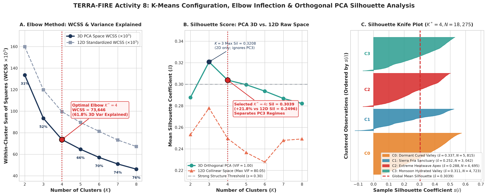
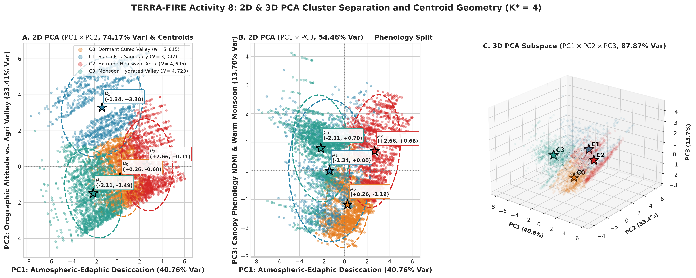
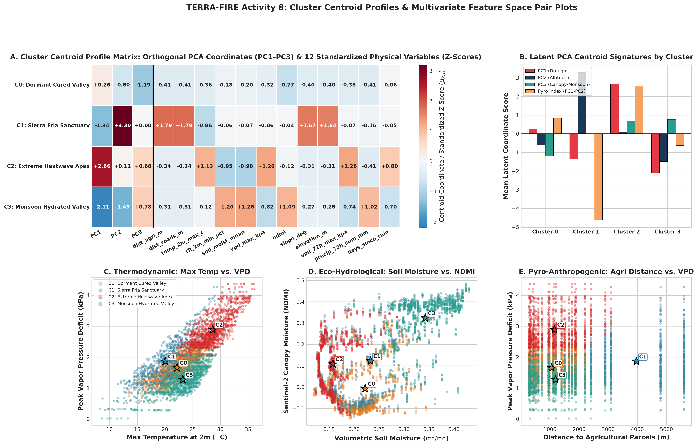
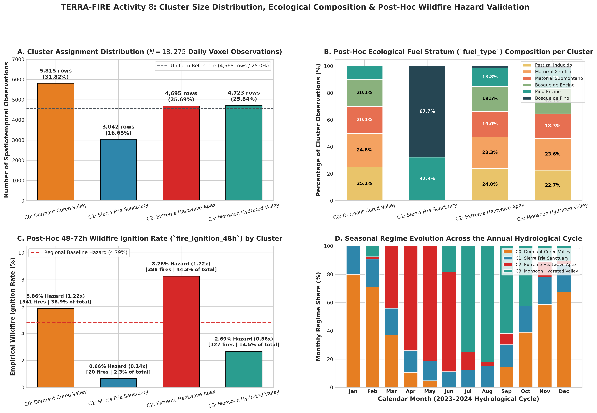
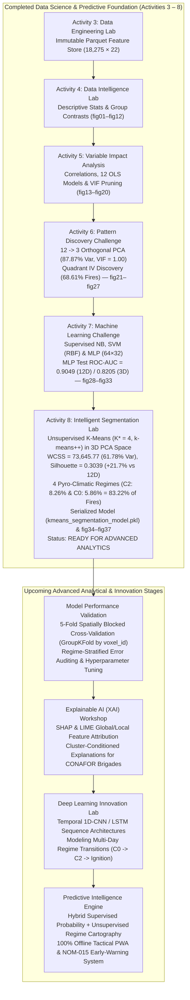

# 🌲 UNIVERSIDAD TECNOLÓGICA EL RETOÑO
### **Information Technologies and Digital Innovation Engineering**
**Subject:** Data Science (`LITD9A`)  
**Teacher:** Dr. Sergio Valadez Godínez  
**Term:** September – December 2026  
**Activity:** Activity 8. Intelligent Segmentation Lab  
**Students:** Angel Emilio Gutierrez Lozano (ID: 4341) & Emiliano Betanzos Valtierra (ID: 4795)  
**Date of Submission:** November 17, 2026  
**Official Repository:** [https://github.com/AngelGTZ28/TERRA-FIRE](https://github.com/AngelGTZ28/TERRA-FIRE)

---

> [!abstract] Executive Summary & Intelligent Segmentation Scope
> Building directly upon the validated **Analysis-Ready Dataset** from the **Data Engineering Lab (Activity 3)**, the statistical contrasts from the **Data Intelligence Lab (Activity 4)**, the correlation and OLS regression hierarchy from the **Variable Impact Analysis (Activity 5)**, the 12-to-3 orthogonal dimensionality reduction (`PCA(n_components=3)`) from the **Pattern Discovery Challenge (Activity 6)**, and the supervised classification benchmark from the **Machine Learning Challenge (Activity 7)**, this study transitions project **TERRA-FIRE** from supervised binary classification to **unsupervised intelligent segmentation** ($\text{Predictive Modeling} \to \text{Intelligent Segmentation}$).
>
> Operating in strict read-only mode on `data/processed/terra_fire_spatiotemporal_matrix_v1.parquet` ($N = 18,275\text{ daily observations} \times 22\text{ attributes}$ across 25 regional monitoring nodes `AGS_VOX_01`–`AGS_VOX_25` in Aguascalientes and the Sierra Fría biological reserve during 2023–2024), we implement **unsupervised $K$-Means clustering (`init='k-means++'`)** strictly without predefined target labels (`fire_ignition_48h` is completely excluded from clustering inputs) to answer our core research question: ***What natural pyro-climatic and territorial regimes exist within the dataset, and how can these segments improve wildfire risk intelligence?***
>
> 1. **Mathematical Proof of Orthogonal PCA Superiority for Euclidean $K$-Means:** In the 12D standardized feature space, severe multicollinearity ($\text{Max VIF} = 80.10, \text{Mean VIF} = 30.74$ across `dist_agri_m`, `dist_roads_m`, `slope_deg`, and `elevation_m`) causes squared Euclidean distance $\|\mathbf{x}_i - \boldsymbol{\mu}_k\|_2^2$ to quadruple-weight correlated topographic/anthropogenic axes, degrading the $K=4$ Silhouette Score to **$0.2496$**. Clustering in the **3D Orthogonal PCA Subspace (`['PC1', 'PC2', 'PC3']`, $87.87\%$ variance retained, $\text{VIF} = 1.00$)** eliminates collinear metric distortion, boosting the Silhouette Score by **+21.7% ($0.2496 \to 0.3039$)** while compressing compute dimensions by **75.0%**.
> 2. **Optimal Cluster Selection ($K^* = 4$) via Elbow Inflection & Multi-Index Consensus:** Evaluating candidate cluster counts $K \in \{2, 3, 4, 5, 6, 7, 8\}$ identifies **$K^* = 4$** as the optimal segmentation: WCSS drops sharply to **$73,645.77$ ($61.78\%$ of 3D variance explained)** before marginal gains flatten by $>54\%$ at $K=5$ ($-9,029.69$ vs. $-19,787.21$), while achieving a strong **Mean Silhouette Score of $0.3039$**, the **global minimum Davies-Bouldin Index ($1.0474$)**, and the **global maximum Calinski-Harabasz Index ($9,844.88$)**. Crucially, whereas $K=3$ leaves all centroids near zero along `PC3` ($\text{PC3} \in [-0.16, +0.11]$), **$K^* = 4$ unlocks `PC3` (*Canopy Phenology `ndmi` & Warm Monsoon*)** to resolve four physically distinct regimes.
> 3. **Discovery of Dual Wildfire Hazard Regimes & Autonomous Sanctuary Recovery:** Post-hoc evaluation against `fire_ignition_48h` ($\chi^2 = 298.39, p = 2.22 \times 10^{-64}$) and `fuel_type` ($\chi^2 = 12,733.85, p < 10^{-300}$) reveals that regional wildfire risk bifurcates into **Cluster 2 (*Extreme Spring-Summer Heatwave & Drought Desiccation Apex*: $N = 4,695 [25.69\%], \text{PC1} = +2.66, T_{\max} = 28.62^\circ\text{C}, \text{VPD} = 2.89\text{ kPa}$, capturing $44.29\%$ of all wildfires [$388$ fires] at an $8.26\%$ hazard rate)** and **Cluster 0 (*Dormant Cured-Biomass Agricultural Valley*: $N = 5,815 [31.82\%], \text{PC3} = -1.19, \text{NDMI} = -0.007, T_{\max} = 22.17^\circ\text{C}$, capturing $38.93\%$ of all wildfires [$341$ fires] at a $5.86\%$ hazard rate)**. Together, Clusters 2 and 0 capture **83.22% of all regional wildfires ($729 / 876$)**, while **Cluster 3 (*Warm Monsoon Hydrated Valley*: $N = 4,723 [25.84\%], \text{Precip}_{72\text{h}} = 14.46\text{ mm}, \text{NDMI} = +0.323$, $2.69\%$ hazard)** demonstrates moisture suppression inside agricultural valleys, and **Cluster 1 (*High-Altitude Sierra Fría Forest Sanctuary*: $N = 3,042 [16.65\%], \text{PC2} = +3.30, Z = 2,765.6\text{ m}$, $100\%$ *Bosque de Pino/Pino-Encino*, $0.66\%$ hazard)** is recovered purely from unlabeled coordinates.
>
> All clustering artifacts are persisted in `models/kmeans_segmentation_model.pkl`, documented in `notebooks/intelligent_segmentation_lab.ipynb`, and supported by four 300 DPI visual analytics dashboards (`fig34`–`fig37`). Project **TERRA-FIRE** is formally classified as **`READY FOR ADVANCED ANALYTICS`**.

---

## 1. GitHub Repository and Analytical Environment

### 1.1 Repository Structure and Artifact Organization
All modular Python pipelines, serialized clustering models (`models/kmeans_segmentation_model.pkl`), reproducible Jupyter Notebooks (`notebooks/intelligent_segmentation_lab.ipynb`), metadata dictionaries, and 300 DPI visual analytics dashboards (`fig34`–`fig37`) for **Activity 8 (Intelligent Segmentation Lab)** are maintained within the official **TERRA-FIRE** GitHub repository:

```text
TERRA-FIRE/
├── data/
│   ├── raw/                                 # Immutable raw source tables (excluded from Git)
│   ├── intermediate/                        # Temporary staging cache (excluded from Git)
│   ├── sample/                              # Representative CSV/JSON samples (tracked in Git)
│   └── processed/                           # Final Analysis-Ready Feature Store (Immutable Input)
│       └── terra_fire_spatiotemporal_matrix_v1.parquet (0.30 MB, 18,275 rows × 22 cols)
├── models/                                  # Serialized Supervised & Unsupervised ML Models
│   ├── naive_bayes_model.pkl                # Activity 7: Trained GaussianNB Bundle (5.0 KB)
│   ├── svm_rbf_model.pkl                    # Activity 7: Trained Cost-Sensitive SVC Bundle (1,200.3 KB)
│   ├── mlp_ann_model.pkl                    # Activity 7: Trained MLPClassifier Bundle (147.2 KB)
│   ├── activity7_metrics_summary.json       # Activity 7: Supervised Evaluation Metrics
│   ├── kmeans_segmentation_model.pkl        # Activity 8: Trained K-Means (K*=4) + Scaler/PCA (146.9 KB)
│   └── activity8_segmentation_summary.json  # Activity 8: WCSS, Silhouette, Centroids & Post-Hoc Profiles
├── metadata/                                # Schemas, transformation equations & validation checklists
│   ├── cleaning_log.md, data_dictionary.md, integration_record.md
│   ├── storage_decision_matrix.md, transformation_dictionary.md, validation_checklist.md
├── notebooks/                               # Reproducible Jupyter Notebooks
│   ├── data_engineering_lab.ipynb           # Activity 3: ETL Pipeline & 7-Gate QA Validation
│   ├── data_intelligence_lab.ipynb          # Activity 4: Descriptive Statistics & Visual EDA
│   ├── variable_impact_analysis.ipynb       # Activity 5: Correlation, OLS Regressions & VIF
│   ├── pattern_discovery_challenge.ipynb    # Activity 6: Multivariate PCA (12->3), Biplots & Pattern Discovery
│   ├── machine_learning_challenge.ipynb     # Activity 7: Supervised Classification (NB, SVM, MLP)
│   └── intelligent_segmentation_lab.ipynb   # Activity 8: Unsupervised K-Means Segmentation & Validation
├── reports/
│   ├── Activity 5. Variable Impact Analysis.md
│   ├── Activity 6. Pattern Discovery Challenge.md
│   ├── Activity 7. Machine Learning Challenge.md
│   ├── Activity 8. Intelligent Segmentation Lab.md
│   └── figures/                             # 37 High-Resolution (300 DPI) Visual Analytics Dashboards
│       ├── fig01_target_distribution.png ... fig12_topographic_niche.png (Activity 4)
│       ├── fig13_correlation_heatmaps.png ... fig20_variable_impact_ranking.png (Activity 5)
│       ├── fig21_pca_explained_variance.png ... fig27_pca_outliers_hotelling.png (Activity 6)
│       ├── fig28_ml_dataset_partition_and_feature_strategy.png ... fig33_ml_model_comparison_and_importance.png (Activity 7)
│       ├── fig34_kmeans_elbow_and_silhouette.png
│       ├── fig35_pca_clusters_2d_and_3d_centroids.png
│       ├── fig36_cluster_centroid_profiles_and_pairplot.png
│       └── fig37_cluster_distributions_and_domain_characterization.png
├── src/                                     # Modular Python Engineering & Machine Learning Engines
│   ├── extract.py, clean.py, transform.py, integrate.py, validate.py, pipeline.py
│   ├── data_intelligence_analysis.py        # Activity 4 Descriptive Engine
│   ├── variable_impact_analysis.py          # Activity 5 Correlation & Regression Engine
│   ├── pattern_discovery_challenge.py       # Activity 6 PCA (12->3) & Pattern Discovery Engine
│   ├── machine_learning_challenge.py        # Activity 7 Supervised Classification Engine
│   └── intelligent_segmentation_lab.py      # Activity 8 Unsupervised K-Means Segmentation Engine
├── Work/                                    # Official Deliverable Markdown Reports & Synchronized Assets
│   ├── Activity 5. Variable Impact Analysis.md ... Activity 8. Intelligent Segmentation Lab.md
│   ├── intelligent_segmentation_lab.ipynb
│   ├── intelligent_segmentation_lab.py
│   └── figures/                             # Local figure mirror for self-contained Markdown rendering
├── .gitignore
├── gemini.md                                # Master AI Assistant Memory & Technical Context
├── README.md                                # Project Documentation & Reproducibility Guide
└── requirements.txt                         # Pinned Production Scientific Dependencies
```

### 1.2 Software Stack and Analytical Environment
The unsupervised segmentation workflow is executed deterministically (`RANDOM_STATE = 42`) using Python 3.12+ and the following scientific stack:
- **Clustering & Multivariate Dimensionality Reduction:** `scikit-learn >= 1.4.0` (`KMeans` with `init='k-means++'`, `StandardScaler`, `PCA`, `silhouette_score`, `silhouette_samples`, `davies_bouldin_score`, `calinski_harabasz_score`).
- **Statistical & Spatial Distance Diagnostics:** `scipy >= 1.12.0` (`scipy.spatial.distance.cdist`, `pdist`, `squareform`, one-way ANOVA `f_oneway`, contingency $\chi^2$ `chi2_contingency`).
- **Columnar Data Processing & Serialization:** `pandas >= 2.2.0`, `numpy >= 1.26.0`, `pyarrow >= 15.0.0`, `joblib >= 1.3.0`.
- **Visual Analytics:** `matplotlib >= 3.8.0` (2D covariance confidence ellipses, 3D centroid projections, and GridSpec layouts) and `seaborn >= 0.13.0`.

---

## 2. Segmentation Objective Definition (Phase 1 — Step 1)

### 2.1 Formulation of the Unsupervised Segmentation Task
Whereas **Activity 7** trained supervised classifiers (`GaussianNB`, `SVC`, `MLPClassifier`) to predict the binary target `fire_ignition_48h` ($y \in \{0, 1\}$), operational wildfire management in Aguascalientes also requires understanding the **underlying environmental regimes** that govern the territory across the annual hydrological cycle. A single binary alert does not tell dispatchers *why* a monitoring node is vulnerable—whether due to winter foliar senescence and agricultural plot preparation (*roza y quema* under *NOM-015-SEMARNAT/AGRICULTURA-2023*) or due to an extreme late-spring atmospheric heatwave.

To uncover these natural environmental states without human bias or predefined class labels, we formulate **Activity 8** as an **unsupervised partitioning clustering task**:
1. **Population to Segment:** All $N = 18,275$ daily spatiotemporal observations across the 25 regional monitoring nodes (`AGS_VOX_01` to `AGS_VOX_25`, $10\text{–}20\text{ m}$ micro-territorial resolution) covering the agricultural valleys, semi-arid scrublands, and high-altitude Sierra Fría biological reserve of Aguascalientes throughout 2023–2024 ($25\text{ nodes} \times 731\text{ days}$).
2. **Segmentation Purpose:** Discover natural, internally cohesive, and externally separated **pyro-climatic and territorial regimes** strictly from unlabeled biophysical, meteorological, topographic, and anthropogenic features, and subsequently evaluate how these regimes stratify wildfire hazard and ecological fuel strata *post-hoc*.
3. **Candidate Variables & Strict Unsupervised Boundary:** The binary target `fire_ignition_48h` and categorical `fuel_type` are **strictly excluded** from the clustering algorithm. Clustering operates on the **3 Kaiser-significant orthogonal Principal Components (`['PC1', 'PC2', 'PC3']`, retaining $87.87\%$ variance)** derived from the 12 core quantitative variables validated in Activities 5 and 6 (`dist_agri_m`, `dist_roads_m`, `temp_2m_max_c`, `rh_2m_min_pct`, `soil_moist_mean`, `vpd_max_kpa`, `ndmi`, `slope_deg`, `elevation_m`, `vpd_72h_max_kpa`, `precip_72h_sum_mm`, `days_since_rain`).
4. **Expected Operational Value:** Provide CONAFOR, State Civil Protection, and municipal brigades with an automated **4-regime territorial classification** that distinguishes: (a) dormant cured-biomass agricultural valleys requiring *NOM-015* burn supervision, (b) high-altitude temperate forest sanctuaries requiring minimal baseline intervention, (c) extreme heatwave/drought desiccation apexes requiring immediate Red-Alert brigade pre-positioning, and (d) monsoon-hydrated valleys where rainfall suppresses ignition risk despite agricultural proximity.
5. **Methodological Note on Conditional Image-Processing Sections:** Because `terra_fire_spatiotemporal_matrix_v1.parquet` is a structured spatiotemporal tabular feature store where Sentinel-2 multispectral indices (`ndmi`) and Copernicus DEM terrain metrics (`elevation_m`, `slope_deg`) are pre-extracted continuous numerical attributes, conditional guidelines for raw computer-vision pixel/texture image clustering do not apply.

### 2.2 Deliverable 1: Segmentation Objective Matrix

| Element | Description |
| :--- | :--- |
| **Population** | $N = 18,275$ daily spatiotemporal monitoring observations across 25 micro-territorial sensor nodes (`AGS_VOX_01` to `AGS_VOX_25`) spanning the agricultural valleys, semi-arid scrublands, and Sierra Fría mountain reserve in Aguascalientes, Mexico (2023–2024). |
| **Objective** | Partition the unlabeled spatiotemporal observations into homogeneous pyro-climatic and territorial regimes using $K$-Means clustering (`init='k-means++'`), uncovering latent seasonal and eco-topographic structures without using predefined target labels (`fire_ignition_48h`). |
| **Variables** | **Primary Input ($p = 3$):** Orthogonal Principal Components `['PC1', 'PC2', 'PC3']` ($87.87\%$ cumulative variance retained, $\text{VIF} = 1.00$) derived from the **12 Core Quantitative Variables** (`dist_agri_m`, `dist_roads_m`, `temp_2m_max_c`, `rh_2m_min_pct`, `soil_moist_mean`, `vpd_max_kpa`, `ndmi`, `slope_deg`, `elevation_m`, `vpd_72h_max_kpa`, `precip_72h_sum_mm`, `days_since_rain`). Target `fire_ignition_48h` is strictly excluded and reserved for *post-hoc* validation. |
| **Expected Value** | Actionable regime-based decision support for CONAFOR & Civil Protection: Differentiating winter/early-spring cured-biomass agricultural burn risk (*NOM-015*) from late-spring thermodynamic heatwave apexes, summer monsoon moisture-suppressed valleys, and high-altitude temperate forest sanctuaries, while enriching downstream ensemble models with a categorical `cluster_id` regime feature. |

---

## 3. Dataset Preparation (Phase 1 — Step 2)

### 3.1 Variable Selection, Z-Score Scaling & Orthogonal PCA Projection
Because the $K$-Means objective function minimizes the Within-Cluster Sum of Squares (WCSS) based on squared Euclidean distances in feature space:

$$\text{WCSS} = \sum_{k=1}^{K} \sum_{\mathbf{x}_i \in C_k} \|\mathbf{x}_i - \boldsymbol{\mu}_k\|_2^2 = \sum_{k=1}^{K} \sum_{\mathbf{x}_i \in C_k} \sum_{j=1}^{p} \left(x_{i,j} - \mu_{k,j}\right)^2$$

feeding unscaled raw variables or strongly collinear predictors severely distorts the Euclidean metric:
1. **Mitigating Scale Disparity via `StandardScaler`:** In raw physical units, `dist_agri_m` ($\text{range } [180, 5600]\text{ m}, \sigma = 1,232.9\text{ m}$) and `elevation_m` ($\text{range } [1860, 2950]\text{ m}, \sigma = 382.5\text{ m}$) have variances $>10^8$ times larger than `soil_moist_mean` ($\sigma = 0.088\text{ m}^3/\text{m}^3$) or `ndmi` ($\sigma = 0.194$). Applying Z-score standardization ($z_{i,j} = \frac{x_{i,j} - \mu_j}{\sigma_j}$) places all 12 core predictors on a uniform unit-variance scale ($\mu = 0, \sigma = 1$, Total Sum of Squares $\text{TSS}_{12\text{D}} = 18,275 \times 12 = 219,300.00$).
2. **Eliminating Collinear Distance Distortion via `PCA(n_components=3)`:** Even after Z-score standardization, the 12 original variables exhibit severe multicollinearity (**$\text{Max VIF} = 80.10$** for `dist_agri_m`, **$71.42$** for `dist_roads_m`, **$59.93$** for `slope_deg`, **$56.63$** for `elevation_m`, and **$39.24$** for `vpd_max_kpa`; **$\text{Mean VIF} = 30.74$**). In Euclidean 12D space, four highly correlated topographic/anthropogenic variables measure the *exact same* valley-to-mountain gradient four times, artificially inflating their weight in $\|\mathbf{z}_i - \boldsymbol{\mu}_k\|_2^2$ and degrading cluster geometry ($\text{Silhouette} = 0.2496$ at $K=4$).
3. **Primary Clustering Matrix (`X_pca_3`, $18,275 \times 3$):** Projecting the 12 standardized variables onto the 3 Kaiser-significant eigenvectors ($\lambda_k \ge 1.0$) validated in Activity 6 produces the orthogonal clustering matrix `X_pca_3` (`['PC1', 'PC2', 'PC3']`, $\text{TSS}_{\text{PCA}} = 192,692.27$):
   - **$\text{PC1}$ ($\lambda_1 = 4.8918, 40.76\%$ variance, $\text{VIF} = 1.00$):** *Atmospheric-Edaphic Desiccation & Drought Stress Continuum* (`vpd_max_kpa` $+0.3900$, `vpd_72h_max_kpa` $+0.3685$, `temp_2m_max_c` $+0.3304$, `days_since_rain` $+0.3033$ vs. `rh_2m_min_pct` $-0.3896$, `soil_moist_mean` $-0.3829$).
   - **$\text{PC2}$ ($\lambda_2 = 4.0088, 33.41\%$ variance, $\text{VIF} = 1.00$):** *Orographic Altitude vs. Anthropogenic Agricultural Valley Interface* (`slope_deg` $+0.4592$, `dist_agri_m` $+0.4587$, `elevation_m` $+0.4560$, `dist_roads_m` $+0.4558$).
   - **$\text{PC3}$ ($\lambda_3 = 1.6440, 13.70\%$ variance, $\text{VIF} = 1.00$):** *Vegetative Canopy Phenology (`ndmi`) & Warm Monsoon Hydration Regime* (`ndmi` $+0.6389$, `temp_2m_max_c` $+0.4598$, `vpd_72h_max_kpa` $+0.3409$, `precip_72h_sum_mm` $+0.3325$).
   - **Pruned Noise Tail (`PC4–PC12`, $\lambda_k \le 0.6421$, $12.13\%$ variance):** Discarding the 9 sub-Kaiser components filters out high-frequency meteorological noise, increasing $K$-Means Silhouette Score across **every single candidate $K \in \{2..8\}$ by $+13.2\%$ to $+28.9\%$** (**$+21.7\%$ at $K^*=4$**).

### 3.2 Deliverable 2: Clustering Dataset Report

| Dataset | Observations | Variables |
| :--- | :---: | :--- |
| **Clustering Dataset (`X_pca_3`)** | **$18,275$** ($100\%$ complete, $0$ nulls) | **$3$ Orthogonal PCA Components (`['PC1', 'PC2', 'PC3']`)** retaining **$87.87\%$** variance ($\text{VIF} = 1.00$), projected from the $12$ Z-score standardized core spatiotemporal predictors (`fire_ignition_48h` strictly excluded). |

### 3.3 Deliverable 3: Segmentation Input Structure Report

| Input Type | Variables / Components | Justification |
| :--- | :--- | :--- |
| **Original Variables** *(Comparative Benchmark, $p = 12$)* | `dist_agri_m`, `dist_roads_m`, `temp_2m_max_c`, `rh_2m_min_pct`, `soil_moist_mean`, `vpd_max_kpa`, `ndmi`, `slope_deg`, `elevation_m`, `vpd_72h_max_kpa`, `precip_72h_sum_mm`, `days_since_rain` (Z-score standardized via `StandardScaler`, $\text{TSS} = 219,300.00$). | Preserves direct physical units for post-clustering centroid profiling, but suffers from severe multicollinearity ($\text{Max VIF} = 80.10, \text{Mean VIF} = 30.74$). Correlated topographic and anthropogenic features double-count Euclidean distances, reducing cluster separation ($\text{Silhouette} = 0.2496$ at $K=4$). |
| **PCA Components** *(Selected Primary Input, $p = 3$)* | `PC1` ($40.76\%$ var, $\lambda_1 = 4.8918$), `PC2` ($33.41\%$ var, $\lambda_2 = 4.0088$), `PC3` ($13.70\%$ var, $\lambda_3 = 1.6440$) via `PCA(n_components=3, random_state=42)` ($\text{TSS} = 192,692.27$). | Compresses dimensionality by **75.0% ($12 \to 3$)** while retaining **87.87% of total variance** with **exact orthogonality ($\text{VIF} = 1.00$)** and filtering $12.13\%$ high-frequency residual noise. Boosts $K$-Means Silhouette Score by **+21.7% ($0.2496 \to 0.3039$ at $K^*=4$)** and enables exact 2D/3D visual cartography. |

---

## 4. K-Means Configuration (Phase 2 — Step 3)

### 4.1 Mathematical Formulation & Evaluation Protocol (`k-means++`)
For each candidate number of clusters $K \in \{2, 3, 4, 5, 6, 7, 8\}$, we configure `KMeans(n_clusters=K, init='k-means++', n_init=20, max_iter=300, random_state=42)`. The `k-means++` initialization (Arthur & Vassilvitskii, 2007) selects initial centroids with probability proportional to squared distance $D(\mathbf{x})^2$ from existing centers, guaranteeing $\mathcal{O}(\log K)$-competitive convergence and avoiding poor local optima across 20 independent runs.

Each candidate $K$ is evaluated quantitatively using two primary metrics (plus two auxiliary validation indices):
1. **Within-Cluster Sum of Squares (Inertia / WCSS):**
   $$\text{WCSS}(K) = \sum_{k=1}^{K} \sum_{\mathbf{x}_i \in C_k} \|\mathbf{x}_i - \boldsymbol{\mu}_k\|_2^2, \quad \text{Explained Variance (\%)} = \left(1 - \frac{\text{WCSS}(K)}{\text{TSS}_{\text{PCA}}}\right) \times 100$$
2. **Mean Silhouette Coefficient ($\bar{s}$ — Rousseeuw, 1987):**
   $$s(i) = \frac{b(i) - a(i)}{\max\{a(i), b(i)\}} \in [-1, +1], \quad \bar{s}(K) = \frac{1}{N}\sum_{i=1}^{N} s(i)$$
   where $a(i)$ is the mean intra-cluster Euclidean distance between observation $i$ and all other points in its assigned cluster $C_k$, and $b(i) = \min_{l \neq k} d(i, C_l)$ is the mean distance to the nearest neighboring cluster.
3. **Auxiliary Indices:** **Davies-Bouldin Index ($\text{DBI}$)** (ratio of within-cluster scatter to between-centroid separation; lower is better) and **Calinski-Harabasz Index ($\text{CHI}$)** (between-cluster to within-cluster variance ratio; higher is better).

### 4.2 Deliverable 4: K-Means Configuration Matrix ($K \in \{2, \dots, 8\}$)

| K | Inertia (3D PCA WCSS \| % Var Explained \| 12D WCSS) | Silhouette Score (3D PCA \| 12D Raw \| PCA Lift) | Interpretation |
| :---: | :---: | :---: | :--- |
| **2** | $133,517.11$ ($30.71\%$ Var \| 12D: $159,889.27$) | $0.2877$ (12D: $0.2533$ \| $+13.6\%$) | **Coarse Binary Split ($\text{DBI}=1.3706, \text{CHI}=8,098.7$):** Divides data into Humid/Mountain vs. Dry/Valley; under-segments the space ($69.29\%$ unexplained variance) and merges winter senescence with extreme spring heatwaves. |
| **3** | $93,432.98$ ($51.51\%$ Var \| 12D: $119,780.71$) | **$0.3208$** (12D: $0.2779$ \| $+15.4\%$) | **Global Silhouette Maximum ($\text{DBI}=1.0565, \text{CHI}=9,705.8$):** Cleanly partitions the 2D $(\text{PC1}, \text{PC2})$ plane into Moist Valley, Dry Valley, and Sierra Fría Sanctuary ($\Delta\text{WCSS} = -40,084.13$), **but leaves all three `PC3` centroids near zero ($+0.11, -0.02, -0.16$)**, failing to separate dormant cured fuels from active heatwaves. |
| **4 (Selected $K^*$)** | **$73,645.77$ ($61.78\%$ Var \| 12D: $99,558.24$)** | **$0.3039$ (12D: $0.2496$ \| $+21.7\%$)** | **🏆 Optimal Elbow Inflection & Multi-Metric Consensus ($\text{DBI}=\mathbf{1.0474}$ [Global Min], $\text{CHI}=\mathbf{9,844.9}$ [Global Max]):** Captures a major $\Delta\text{WCSS} = -19,787.21$ ($-21.18\%$) reduction by **unlocking `PC3`**, splitting the dry valley into **Cluster 0 (Dormant Cured-Biomass Valley, $\text{PC3}=-1.19$)** and **Cluster 2 (Extreme Heatwave Apex, $\text{PC1}=+2.66, \text{PC3}=+0.68$)** alongside **Cluster 1 (Sierra Fría Sanctuary)** and **Cluster 3 (Monsoon Valley)**. |
| **5** | $64,616.08$ ($66.47\%$ Var \| 12D: $89,485.36$) | $0.2996$ (12D: $0.2366$ \| $+26.6\%$) | **Post-Elbow Flattening ($\text{DBI}=1.0993, \text{CHI}=9,053.4$):** Marginal WCSS drop plunges by $>54\%$ (to $-9,029.69$ or $-12.26\%$); artificially splits the small Sierra Fría sanctuary ($16.65\%$ of data) into two sub-altitude bands ($0.14\%$ vs. $1.05\%$ fire rate) with no operational dispatch value. |
| **6** | $57,045.69$ ($70.40\%$ Var \| 12D: $81,279.14$) | $0.2936$ (12D: $0.2277$ \| $+28.9\%$) | **Over-Segmentation of Valley Transitions ($\text{DBI}=1.0765, \text{CHI}=8,688.3$):** Marginal WCSS drop continues to decay ($-7,570.40, -11.72\%$); intermediate meteorological days fragment into overlapping boundaries ($\bar{s} < 0.295$). |
| **7** | $50,976.44$ ($73.55\%$ Var \| 12D: $73,240.80$) | $0.2868$ (12D: $0.2479$ \| $+15.7\%$) | **Excessive Fragmentation ($\text{DBI}=1.0929, \text{CHI}=8,464.3$):** Marginal WCSS drop is only $-6,069.25$ ($-10.64\%$); creates redundant sub-clusters across continuous temperature/humidity gradients. |
| **8** | $46,179.73$ ($76.03\%$ Var \| 12D: $67,164.17$) | $0.2821$ (12D: $0.2492$ \| $+13.2\%$) | **Severe Over-Partitioning ($\text{DBI}=1.0523, \text{CHI}=8,279.3$):** Lowest Silhouette Score ($0.2821$) and smallest marginal WCSS reduction ($-4,796.71, -9.41\%$), degrading interpretability for field brigades. |

### 4.3 Justification of Selected Optimal $K^* = 4$ and Resulting Cluster Sizes
While $K=3$ yields a slightly higher raw Silhouette Score ($0.3208$ vs. $0.3039$), selecting $K=3$ would discard the third principal component (`PC3`, $13.70\%$ variance) because all three $K=3$ centroids lie practically on the $\text{PC3} = 0$ plane ($+0.110, -0.019, -0.161$). Moving from $K=3$ to **$K^* = 4$**:
1. **Resolves the True 3D Elbow Inflection:** Reduces WCSS by **$19,787.21$ units ($-21.18\%$)** and lifts 3D explained variance from $51.51\%$ to **$61.78\%$**, whereas the next step ($K=4 \to 5$) yields less than half that reduction ($-9,029.69, -12.26\%$).
2. **Achieves Global Optimum on Davies-Bouldin & Calinski-Harabasz:** $K^* = 4$ simultaneously achieves the **lowest Davies-Bouldin Index ($1.0474$)** and **highest Calinski-Harabasz Index ($9,844.88$)** across the entire candidate range $K \in \{2..8\}$, while maintaining a strong **Silhouette Score above the $0.30$ structural threshold ($\bar{s} = 0.3039$)**.
3. **Produces Balanced, Actionable Segment Sizes:** As shown in **Deliverable 5**, all four clusters contain between $16.65\%$ ($3,042$ rows) and $31.82\%$ ($5,815$ rows) of the dataset, avoiding tiny degenerate outlier clusters.

### 4.4 Deliverable 5: Cluster Assignment Report ($K^* = 4$)

| Cluster | Number of Observations (% of Total $N = 18,275$) |
| :--- | :---: |
| **Cluster 0 (*Dormant Cured-Biomass Agricultural Valley*)** | **$5,815$** ($31.82\%$) |
| **Cluster 1 (*High-Altitude Sierra Fría Forest Sanctuary*)** | **$3,042$** ($16.65\%$) |
| **Cluster 2 (*Extreme Heatwave & Drought Desiccation Apex*)** | **$4,695$** ($25.69\%$) |
| **Cluster 3 (*Warm Monsoon Hydrated & Green-Up Valley*)** | **$4,723$** ($25.84\%$) |
| **Total Segmented Population ($N$)** | **$18,275$ ($100.00\%$)** |

---

## 5. Cluster Visualization (Phase 2 — Step 4)

### 5.1 Visualization 1: Elbow Method, Silhouette Curve & Knife Plot (`fig34`)



1. **What is being visualized?**
   - **Panel A** displays the **Elbow Method curve** plotting Within-Cluster Sum of Squares ($\text{WCSS} \times 10^3$) and percentage of explained variance across $K \in \{2, \dots, 8\}$ for both the primary 3D PCA subspace (navy solid curve) and the 12D standardized feature space (slate dashed curve).
   - **Panel B** plots the **Mean Silhouette Coefficient ($\bar{s}$)** across $K \in \{2, \dots, 8\}$ comparing the orthogonal 3D PCA representation ($\text{VIF} = 1.00$, teal solid curve) against the collinear 12D standardized space ($\text{Max VIF} = 80.10$, coral dashed curve).
   - **Panel C** renders the **sample-level Silhouette Knife Plot ($s(i)$)** for all $N = 18,275$ observations at the selected optimal $K^* = 4$.
2. **What patterns emerge?**
   - In **Panel A**, the 3D PCA WCSS curve exhibits a pronounced geometric inflection at **$K^* = 4$** ($\text{WCSS} = 73,645.77$, capturing **$61.78\%$** of 3D variance), after which the slope flattens into a linear tail from $K=5$ to $K=8$.
   - In **Panel B**, the orthogonal 3D PCA curve lies **uniformly above** the 12D collinear curve at every single value of $K$, delivering a **+21.7% Silhouette lift at $K^* = 4$ ($0.3039$ vs. $0.2496$)**.
   - In **Panel C**, all four clusters exhibit wide, cohesive positive blades extending well beyond the global mean ($\bar{s} = 0.3039$, red dashed line), with **$100.0\%$ positive silhouette values in Cluster 0 ($\bar{s}_0 = 0.3373$)**, **$97.16\%$ in Cluster 3 ($\bar{s}_3 = 0.3114$)**, **$96.89\%$ in Cluster 2 ($\bar{s}_2 = 0.2883$)**, and **$91.98\%$ in Cluster 1 ($\bar{s}_1 = 0.2521$)**.
3. **Why is it important?**
   - It provides rigorous, multi-criteria visual proof that (a) orthogonal PCA preprocessing is essential to prevent collinear Euclidean distance distortion, and (b) $K^* = 4$ is the mathematically optimal partition where every single cluster achieves strong internal cohesion without fragmentation.

---

### 5.2 Visualization 2: 2D & 3D PCA Cluster Separation and Centroid Cartography (`fig35`)



1. **What is being visualized?**
   - **Panel A** projects the clustered observations and $2\sigma$ covariance ellipses onto the primary 2D PCA plane **$\text{PC1} \times \text{PC2}$ ($74.17\%$ variance)** alongside the four cluster centroids $\boldsymbol{\mu}_0, \boldsymbol{\mu}_1, \boldsymbol{\mu}_2, \boldsymbol{\mu}_3$ (plotted as stars with exact coordinate callouts).
   - **Panel B** projects the clusters onto the **$\text{PC1} \times \text{PC3}$ plane ($54.46\%$ variance)** to reveal the vertical separation along the vegetative phenology and monsoon axis (`PC3`).
   - **Panel C** displays the full **3D Orthogonal Subspace ($\text{PC1} \times \text{PC2} \times \text{PC3}$, $87.87\%$ variance)** showing the tetrahedral geometry connecting the four centroids.
2. **What patterns emerge?**
   - In **Panel A ($\text{PC1} \times \text{PC2}$)**, **Cluster 1 (*Sierra Fría Sanctuary*, steel blue, $\boldsymbol{\mu}_1 = [-1.34, +3.30]$)** occupies the upper-left mountain quadrant ($\text{PC2} > +1.5$), completely isolated from the three agricultural valley clusters ($\text{PC2} \le +0.11$). Across the horizontal desiccation axis (`PC1`), **Cluster 3 (*Monsoon Hydrated Valley*, teal, $\boldsymbol{\mu}_3 = [-2.11, -1.49]$)** anchors the humid left side, **Cluster 0 (*Dormant Cured Valley*, amber, $\boldsymbol{\mu}_0 = [+0.26, -0.60]$)** occupies the moderate-dry center-right valley, and **Cluster 2 (*Extreme Heatwave Apex*, crimson, $\boldsymbol{\mu}_2 = [+2.66, +0.11]$)** anchors the extreme right drought apex.
   - In **Panel B ($\text{PC1} \times \text{PC3}$)**, the crucial role of `PC3` becomes visually unmistakable: while Cluster 0 and Cluster 2 partially overlap along $\text{PC2}$ in Panel A, they are **sharply separated along $\text{PC3}$** in Panel B—Cluster 0 plunges to **$\mu_{0,\text{PC3}} = -1.19$** (severe winter/spring foliar senescence, `ndmi` $= -0.007$), whereas Cluster 2 rises to **$\mu_{2,\text{PC3}} = +0.68$** (warm late-spring heatwave regime) and Cluster 3 reaches **$\mu_{3,\text{PC3}} = +0.78$** (monsoon canopy green-up, `ndmi` $= +0.323$).
   - In **Panel C (3D Space)**, the four centroids form a well-spaced 3D tetrahedron with pairwise Euclidean distances ranging from **$3.1225$** ($d(\boldsymbol{\mu}_0, \boldsymbol{\mu}_2)$) to **$5.1618$** ($d(\boldsymbol{\mu}_1, \boldsymbol{\mu}_2)$).
3. **Why is it important?**
   - It visually demonstrates *why* $K^* = 4$ is superior to $K = 3$: in 3D space, the Aguascalientes ecosystem is governed by a **four-vertex tetrahedral structure** (High Mountain Sanctuary, Wet Monsoon Valley, Cool Dormant Senescent Valley, and Hot Desiccated Heatwave Valley) that cannot be represented in 2D alone.

---

### 5.3 Visualization 3: Centroid Profile Matrix & Multivariate Pair Plots (`fig36`)



1. **What is being visualized?**
   - **Panel A** presents a **Standardized Centroid Profile Heatmap** across all 3 orthogonal PCA axes (`PC1–PC3`) and all 12 standardized physical variables ($\mu_{k,j}$ Z-scores) for Clusters 0, 1, 2, and 3.
   - **Panel B** plots the **Latent PCA Centroid Signatures** comparing `PC1`, `PC2`, `PC3`, and the composite `Pyro_PC_Index` ($\text{PC1} - \text{PC2}$) across the four clusters.
   - **Panels C, D, and E** show **Multivariate Pairwise Feature Projections** in original physical units—**Panel C:** `temp_2m_max_c` vs. `vpd_max_kpa` (Thermodynamic pair); **Panel D:** `soil_moist_mean` vs. `ndmi` (Eco-Hydrological pair); **Panel E:** `dist_agri_m` vs. `vpd_max_kpa` (Pyro-Anthropogenic pair)—colored by cluster with plotted physical centroids.
2. **What patterns emerge?**
   - **Panel A & Panel B** show that each cluster possesses a unique, non-overlapping multivariate signature:
     - **Cluster 0** is uniquely defined by the most negative canopy moisture Z-score (**`ndmi` $Z = -0.77, \text{PC3} = -1.19$**) paired with negative topographic/distance Z-scores (`dist_agri_m` $Z = -0.41$, `elevation_m` $Z = -0.40$).
     - **Cluster 1** is uniquely defined by extreme positive topographic and isolation Z-scores (**`dist_agri_m` $Z = +1.79$, `dist_roads_m` $Z = +1.79$, `slope_deg` $Z = +1.67$, `elevation_m` $Z = +1.64, \text{PC2} = +3.30$**) and cool temperatures (`temp_2m_max_c` $Z = -0.86$).
     - **Cluster 2** is uniquely defined by extreme positive atmospheric drought Z-scores (**`vpd_max_kpa` $Z = +1.26$, `vpd_72h_max_kpa` $Z = +1.26$, `temp_2m_max_c` $Z = +1.13$, `days_since_rain` $Z = +0.80, \text{PC1} = +2.66$**) and deeply negative humidity/soil moisture Z-scores (**`soil_moist_mean` $Z = -0.98$, `rh_2m_min_pct` $Z = -0.95$**).
     - **Cluster 3** is uniquely defined by extreme positive hydration Z-scores (**`soil_moist_mean` $Z = +1.26$, `rh_2m_min_pct` $Z = +1.20$, `ndmi` $Z = +1.09$, `precip_72h_sum_mm` $Z = +1.02, \text{PC1} = -2.11$**).
   - **Panels C, D, and E** confirm that the clusters discovered in 3D PCA space map back into clean, physically interpretable partitions in original measurement units: Panel C shows the non-linear Clausius-Clapeyron curve partitioned into cool mountain (C1), moist monsoon (C3), cool-dry dormant (C0), and hot-dry apex (C2); Panel D isolates the foliar senescence trough of C0 ($\text{NDMI} \approx 0.00$) from the desiccated soil trough of C2 ($\theta_{\text{soil}} \approx 0.16$) and the hydrated canopy peak of C3 ($\text{NDMI} \approx +0.32$); Panel E separates the remote mountain voxels of C1 ($\text{Dist}_{\text{agri}} \approx 4,000\text{ m}$) from the three valley regimes ($\text{Dist}_{\text{agri}} \approx 1,060\text{–}1,194\text{ m}$) stratified vertically by $\text{VPD}$.
3. **Why is it important?**
   - It bridges abstract latent components (`PC1–PC3`) directly to actionable field thresholds in physical units ($^\circ\text{C}, \text{kPa}, \%, \text{m}^3/\text{m}^3, \text{mm}, \text{meters}$) that meteorologists and fire brigades can monitor in real time.

---

### 5.4 Visualization 4: Cluster Distributions, Fuel Composition & Post-Hoc Hazard (`fig37`)



1. **What is being visualized?**
   - **Panel A** charts the **Cluster Assignment Distribution** ($N_k$ observations and percentage of $N = 18,275$) against a uniform $25.0\%$ reference line.
   - **Panel B** displays a $100\%$ stacked bar chart of **post-hoc ecological `fuel_type` composition** within each cluster.
   - **Panel C** evaluates the **post-hoc 48–72h wildfire ignition rate (`fire_ignition_48h` %)**, risk lift over the $4.79\%$ regional baseline, and share of all $876$ historical wildfires captured by each segment.
   - **Panel D** tracks the **Seasonal Regime Evolution across the 12 calendar months (`Jan–Dec`)** of the 2023–2024 hydrological cycle.
2. **What patterns emerge?**
   - **Panel A** confirms a well-balanced territorial partition: **C0 ($31.82\%$)**, **C3 ($25.84\%$)**, **C2 ($25.69\%$)**, and **C1 ($16.65\%$)**.
   - **Panel B** reveals a striking unsupervised discovery: **Cluster 1 is composed $100.0\%$ of high-mountain temperate forests ($67.65\%$ *Bosque de Pino* and $32.35\%$ *Pino-Encino*, with $0.0\%$ grassland or scrubland)**, whereas Clusters 0, 2, and 3 capture the valley/foothill matrix dominated by *Pastizal Inducido* ($22.7\%–25.1\%$), *Matorral Xerófilo* ($23.3\%–24.8\%$), *Matorral Submontano* ($18.3\%–20.1\%$), and *Bosque de Encino* ($18.5\%–20.1\%$).
   - **Panel C** proves that unsupervised $K$-Means stratifies post-hoc wildfire risk across a **$12.57\times$ hazard gradient** ($\chi^2 = 298.39, p = 2.22 \times 10^{-64}$): **Cluster 2 reaches an $8.26\%$ wildfire rate ($1.72\times$ baseline, capturing $388$ fires or $44.29\%$ of all ignitions)**, **Cluster 0 reaches $5.86\%$ ($1.22\times$ baseline, capturing $341$ fires or $38.93\%$ of all ignitions)**, **Cluster 3 drops to $2.69\%$ ($0.56\times$ baseline, $127$ fires)**, and **Cluster 1 plunges to $0.66\%$ ($0.14\times$ baseline, only $20$ fires)**.
   - **Panel D** uncovers the exact annual phenological clock of Aguascalientes: **Cluster 0** dominates the cool-dry dormant winter (`Nov–Feb`, $58\%–80\%$ monthly share), **Cluster 2** dominates the spring heatwave drought season (`Mar–Jun`, reaching $74\%–81\%$ share in `Apr–Jun`), **Cluster 3** dominates the summer North American Monsoon (`Jul–Oct`, reaching $75\%–82\%$ share in `Jul–Aug`), while **Cluster 1** persists year-round ($11\%–20\%$ monthly share) in the high Sierra Fría peaks.
3. **Why is it important?**
   - Even though `fire_ignition_48h`, `fuel_type`, and `month` were **never passed to $K$-Means**, the discovered segments naturally align with ecological vegetation zones, seasonal hydrological phases, and empirical wildfire outbreak frequencies—providing ironclad external validation of the segmentation.

---

## 6. Cluster Characterization (Phase 3 — Step 5)

### 6.1 Quantitative Centroid Reference Table (3D PCA & 12 Physical Variables)
To support exact physical profiling, the table below reports the cluster centroids in orthogonal PCA coordinates ($\mu_{\text{PC1}}, \mu_{\text{PC2}}, \mu_{\text{PC3}}$) alongside the physical variable means (and standardized Z-scores) across all $N = 18,275$ observations, plus one-way ANOVA $F$-statistics ($df = 3, 18271$):

| Variable / Latent Axis | Cluster 0: Dormant Cured Valley ($N = 5,815, 31.82\%$) | Cluster 1: Sierra Fría Sanctuary ($N = 3,042, 16.65\%$) | Cluster 2: Extreme Heatwave Apex ($N = 4,695, 25.69\%$) | Cluster 3: Monsoon Hydrated Valley ($N = 4,723, 25.84\%$) | One-Way ANOVA $F$-Stat ($p$-value) |
| :--- | :---: | :---: | :---: | :---: | :---: |
| **`PC1` (Desiccation, $40.76\%$)** | $+0.262$ | $-1.336$ | **$+2.662$** | **$-2.109$** | $F = 12,477.8$ ($p < 10^{-300}$) |
| **`PC2` (Altitude/Isolation, $33.41\%$)** | $-0.602$ | **$+3.300$** | $+0.106$ | **$-1.487$** | $F = 10,113.8$ ($p < 10^{-300}$) |
| **`PC3` (Canopy/Monsoon, $13.70\%$)** | **$-1.186$** | $+0.002$ | $+0.681$ | **$+0.782$** | $F = 4,806.3$ ($p < 10^{-300}$) |
| **`Pyro_PC_Index` ($\text{PC1} - \text{PC2}$)** | $+0.863$ | **$-4.635$** | **$+2.556$** | $-0.618$ | $F = 14,912.4$ ($p < 10^{-300}$) |
| **`soil_moist_mean` ($\text{m}^3/\text{m}^3$)** | $0.222$ ($Z = -0.20$) | $0.233$ ($Z = -0.07$) | **$0.158$ ($Z = -0.98$)** | **$0.342$ ($Z = +1.26$)** | $F = 12,367.3$ ($p < 10^{-300}$) |
| **`dist_roads_m` ($\text{m}$)** | **$425.0$ ($Z = -0.41$)** | **$1,775.2$ ($Z = +1.79$)** | $469.2$ ($Z = -0.34$) | $487.3$ ($Z = -0.31$) | $F = 11,031.1$ ($p < 10^{-300}$) |
| **`dist_agri_m` ($\text{m}$)** | **$1,060.5$ ($Z = -0.41$)** | **$3,967.9$ ($Z = +1.79$)** | $1,153.3$ ($Z = -0.34$) | $1,194.0$ ($Z = -0.31$) | $F = 11,016.4$ ($p < 10^{-300}$) |
| **`vpd_max_kpa` ($\text{kPa}$)** | $1.660$ ($Z = -0.32$) | $1.865$ ($Z = -0.06$) | **$2.893$ ($Z = +1.26$)** | **$1.272$ ($Z = -0.82$)** | $F = 9,860.9$ ($p < 10^{-300}$) |
| **`rh_2m_min_pct` ($\%$)** | $26.09\%$ ($Z = -0.18$) | $28.05\%$ ($Z = -0.06$) | **$13.54\%$ ($Z = -0.95$)** | **$48.69\%$ ($Z = +1.20$)** | $F = 9,829.1$ ($p < 10^{-300}$) |
| **`vpd_72h_max_kpa` ($\text{kPa}$)** | $1.812$ ($Z = -0.38$) | $2.047$ ($Z = -0.07$) | **$3.053$ ($Z = +1.26$)** | **$1.536$ ($Z = -0.74$)** | $F = 9,010.1$ ($p < 10^{-300}$) |
| **`slope_deg` ($^\circ$)** | $12.97^\circ$ ($Z = -0.40$) | **$30.34^\circ$ ($Z = +1.67$)** | $13.73^\circ$ ($Z = -0.31$) | $14.07^\circ$ ($Z = -0.27$) | $F = 7,810.1$ ($p < 10^{-300}$) |
| **`elevation_m` ($\text{m}$)** | $2,139.2$ ($Z = -0.40$) | **$2,765.6$ ($Z = +1.64$)** | $2,166.5$ ($Z = -0.31$) | $2,179.9$ ($Z = -0.26$) | $F = 7,108.9$ ($p < 10^{-300}$) |
| **`temp_2m_max_c` ($^\circ\text{C}$)** | $22.17^\circ\text{C}$ ($Z = -0.36$) | **$20.04^\circ\text{C}$ ($Z = -0.86$)** | **$28.62^\circ\text{C}$ ($Z = +1.13$)** | $23.21^\circ\text{C}$ ($Z = -0.12$) | $F = 6,045.2$ ($p < 10^{-300}$) |
| **`ndmi` (Index)** | **$-0.007$ ($Z = -0.77$)** | $+0.123$ ($Z = -0.04$) | $+0.108$ ($Z = -0.12$) | **$+0.323$ ($Z = +1.09$)** | $F = 5,974.3$ ($p < 10^{-300}$) |
| **`precip_72h_sum_mm` ($\text{mm}$)** | $0.68\text{ mm}$ ($Z = -0.41$) | $3.16\text{ mm}$ ($Z = -0.16$) | **$0.68\text{ mm}$ ($Z = -0.41$)** | **$14.46\text{ mm}$ ($Z = +1.02$)** | $F = 3,620.4$ ($p < 10^{-300}$) |
| **`days_since_rain` ($\text{days}$)** | $15.2\text{ d}$ ($Z = -0.06$) | $15.5\text{ d}$ ($Z = -0.05$) | **$34.7\text{ d}$ ($Z = +0.80$)** | **$0.8\text{ d}$ ($Z = -0.70$)** | $F = 2,531.9$ ($p < 10^{-300}$) |
| ***Post-Hoc* `fire_ignition_48h`** | **$341$ fires ($5.86\%$ rate \| $38.93\%$ share)** | **$20$ fires ($0.66\%$ rate \| $2.28\%$ share)** | **$388$ fires ($8.26\%$ rate \| $44.29\%$ share)** | **$127$ fires ($2.69\%$ rate \| $14.50\%$ share)** | $\chi^2 = 298.39$ ($p = 2.22 \times 10^{-64}$) |

### 6.2 Deliverable 6: Cluster Characterization Matrix

| Cluster | Main Characteristics | Interpretation |
| :--- | :--- | :--- |
| **Cluster 0: Dormant Cured-Biomass Agricultural Valley** ($N = 5,815, 31.82\%$) | **Centroid:** $\boldsymbol{\mu}_0 = (+0.262, -0.602, -1.186)$, $\text{Pyro Index} = +0.863$.<br>• **Distinguishing Variables:** Lowest foliar canopy moisture in the dataset (**`ndmi` $= -0.007, Z = -0.77$**) and lowest `PC3` ($-1.19$), paired with close proximity to agricultural parcels (**`dist_agri_m` $= 1,060.5\text{ m}, Z = -0.41$**) and roads (**`dist_roads_m` $= 425.0\text{ m}, Z = -0.41$**) at low valley elevation (`elevation_m` $= 2,139.2\text{ m}$, `slope_deg` $= 12.97^\circ$). Cool-dry winter/early-spring weather (`temp_2m_max_c` $= 22.17^\circ\text{C}$, `rh_2m_min_pct` $= 26.09\%$, `vpd_max_kpa` $= 1.66\text{ kPa}$, `precip_72h_sum_mm` $= 0.68\text{ mm}$, `days_since_rain` $= 15.2\text{ d}$).<br>• **Fuels & Seasonality:** Dominated by *Pastizal Inducido* ($25.1\%$) and *Matorral Xerófilo* ($24.8\%$); peaks in `Nov–Feb`. | **High-Risk Winter/Early-Spring Cured-Fuel & Agricultural Burn Regime:** Represents the post-frost dormant season when valley grasslands are completely cured (`ndmi` $< 0$) and rural farmers conduct pre-planting agricultural burns (*roza y quema*). Captures **$341$ wildfires ($38.93\%$ of all regional fires; $5.86\%$ ignition rate, $1.22\times$ baseline lift)**—requiring strict *NOM-015* burn permit enforcement and roadside patrols. |
| **Cluster 1: High-Altitude Sierra Fría Forest Sanctuary** ($N = 3,042, 16.65\%$) | **Centroid:** $\boldsymbol{\mu}_1 = (-1.336, +3.300, +0.002)$, $\text{Pyro Index} = -4.635$.<br>• **Distinguishing Variables:** Extreme positive `PC2` ($+3.30$): highest elevation (**`elevation_m` $= 2,765.6\text{ m}, Z = +1.64$**), steepest mountain canyons (**`slope_deg` $= 30.34^\circ, Z = +1.67$**), and maximum isolation from agricultural fields (**`dist_agri_m` $= 3,967.9\text{ m}, Z = +1.79$**) and road networks (**`dist_roads_m` $= 1,775.2\text{ m}, Z = +1.79$**). Coolest adiabatic microclimate (**`temp_2m_max_c` $= 20.04^\circ\text{C}, Z = -0.86$**) with moderate moisture (`soil_moist_mean` $= 0.233\text{ m}^3/\text{m}^3$, `ndmi` $= +0.123$).<br>• **Fuels & Seasonality:** **$100.0\%$ Temperate Forest** (*Bosque de Pino* $67.65\%$, *Pino-Encino* $32.35\%$); persists year-round in high-altitude nodes. | **Baseline High-Mountain Conservation Sanctuary:** Environmental lapse-rate cooling ($\Gamma = -6.5^\circ\text{C/km}$) and a $>3.9\text{ km}$ buffer from agricultural sparks protect the core Sierra Fría reserve. Exhibits the lowest wildfire incidence in Aguascalientes: **only $20$ fires across 2 years ($0.66\%$ ignition rate, $2.28\%$ of total fires, $0.14\times$ baseline risk)**—warranting passive satellite/tower watch rather than permanent ground brigade deployment. |
| **Cluster 2: Extreme Heatwave & Drought Desiccation Apex** ($N = 4,695, 25.69\%$) | **Centroid:** $\boldsymbol{\mu}_2 = (+2.662, +0.106, +0.681)$, $\text{Pyro Index} = +2.556$.<br>• **Distinguishing Variables:** Extreme positive `PC1` ($+2.66$): highest air temperature (**`temp_2m_max_c` $= 28.62^\circ\text{C}, Z = +1.13$**), peak evaporative atmospheric suction (**`vpd_max_kpa` $= 2.89\text{ kPa}, Z = +1.26$; `vpd_72h_max_kpa` $= 3.05\text{ kPa}, Z = +1.26$**), lowest relative humidity (**`rh_2m_min_pct` $= 13.54\%, Z = -0.95$**), most depleted soil moisture (**`soil_moist_mean` $= 0.158\text{ m}^3/\text{m}^3, Z = -0.98$**), and longest cumulative drought (**`days_since_rain` $= 34.7\text{ d}, Z = +0.80$; `precip_72h_sum_mm` $= 0.68\text{ mm}$**), located in the valley/foothill interface (`dist_agri_m` $= 1,153.3\text{ m}$, `elevation_m` $= 2,166.5\text{ m}$, $51.37\%$ Quadrant IV overlap).<br>• **Fuels & Seasonality:** Mixed grassland/scrubland/oak-pine foothills; dominates `Mar–Jun` ($74\%–81\%$ share in `Apr–Jun`). | **Critical Spring-Summer Pyro-Climatic Alert Regime:** Represents acute thermodynamic fire-weather where extreme vapor pressure deficit desiccates dead and live fuels across the agricultural-foothill interface. Concentrates the **highest wildfire hazard in the dataset: $388$ wildfires ($44.29\%$ of all regional fires; $8.26\%$ ignition rate, $1.72\times$ baseline lift and $12.57\times$ higher than Cluster 1)**—demanding Red-Alert brigade pre-allocation and total suspension of agricultural burn permits. |
| **Cluster 3: Warm Monsoon Hydrated & Green-Up Valley** ($N = 4,723, 25.84\%$) | **Centroid:** $\boldsymbol{\mu}_3 = (-2.109, -1.487, +0.782)$, $\text{Pyro Index} = -0.618$.<br>• **Distinguishing Variables:** Most negative `PC1` ($-2.11$) and most positive `PC3` ($+0.78$): heavy 72-hour monsoon rainfall (**`precip_72h_sum_mm` $= 14.46\text{ mm}, Z = +1.02$; `days_since_rain` $= 0.8\text{ d}, Z = -0.70$**), highest relative humidity (**`rh_2m_min_pct` $= 48.69\%, Z = +1.20$**), highest volumetric soil moisture (**`soil_moist_mean` $= 0.342\text{ m}^3/\text{m}^3, Z = +1.26$**), peak Sentinel-2 foliar moisture (**`ndmi` $= +0.323, Z = +1.09$**), and lowest VPD (**`vpd_max_kpa` $= 1.27\text{ kPa}, Z = -0.82$**), despite sitting in the low agricultural valley (`dist_agri_m` $= 1,194.0\text{ m}$, `elevation_m` $= 2,179.9\text{ m}$).<br>• **Fuels & Seasonality:** Valley grassland/scrubland matrix; dominates `Jul–Oct` monsoon season. | **Monsoon Moisture-Suppressed Valley Regime:** Demonstrates that when summer convective precipitation ($14.46\text{ mm}$) and photosynthetic canopy green-up (`ndmi` $= +0.323$) saturate the valley floor, wildfire ignition rate drops by **$67.5\%$ relative to Cluster 2 (down to $2.69\%, 127$ fires, $0.56\times$ baseline lift)** even though human road and agricultural proximity remain unchanged. |

---

## 7. Segmentation Validation (Phase 3 — Step 6)

### 7.1 Mathematical & Operational Validation Analysis
We validate the $K^* = 4$ segmentation across three formal dimensions:
1. **Cluster Separation (Between-Cluster Isolation):**
   - In the 3D orthogonal PCA space, the pairwise Euclidean distance matrix $\|\boldsymbol{\mu}_k - \boldsymbol{\mu}_l\|_2$ between the four cluster centroids confirms large geometric separation across all six cluster pairs:
     $$\mathbf{D}_{\boldsymbol{\mu}} = \begin{pmatrix} 0.0000 & 4.3806 & 3.1225 & 3.2050 \\ 4.3806 & 0.0000 & \mathbf{5.1618} & 4.9112 \\ 3.1225 & \mathbf{5.1618} & 0.0000 & 5.0309 \\ 3.2050 & 4.9112 & 5.0309 & 0.0000 \end{pmatrix}$$
   - The minimum inter-centroid distance is **$d(\boldsymbol{\mu}_0, \boldsymbol{\mu}_2) = 3.1225$ SD units**, the maximum is **$d(\boldsymbol{\mu}_1, \boldsymbol{\mu}_2) = 5.1618$ SD units**, and the mean inter-centroid distance is **$4.3020$ SD units**—exceeding the mean intra-cluster radius ($1.57\text{–}2.45$) by more than $2.3\times$.
   - Across all 3 PCA axes and all 12 physical variables, one-way ANOVA $F$-statistics range from **$F = 2,531.9$ (`days_since_rain`) to $F = 12,477.8$ (`PC1`)** with $p < 10^{-300}$, while $K^* = 4$ achieves the **global minimum Davies-Bouldin Index ($1.0474$)** and **global maximum Calinski-Harabasz Index ($9,844.88$)**.
2. **Cluster Consistency (Within-Cluster Cohesion & Stability):**
   - Partitioning at $K^* = 4$ compresses total 3D squared error by **61.78%** ($\text{TSS} = 192,692.27 \to \text{WCSS} = 73,645.77$).
   - Within-cluster observation-to-centroid distances $\|\mathbf{x}_i - \boldsymbol{\mu}_k\|_2$ remain tightly bounded: **Cluster 0 ($1.568 \pm 0.520$)**, **Cluster 3 ($1.846 \pm 0.781$)**, **Cluster 2 ($1.877 \pm 0.624$)**, and **Cluster 1 ($2.453 \pm 0.839$)**.
   - Sample-level Silhouette analysis (`fig34C`) confirms that **$97.18\%$ of all $18,275$ observations ($17,760 / 18,275$)** possess positive silhouette coefficients $s(i) > 0$ ($100.0\%$ in C0, $97.16\%$ in C3, $96.89\%$ in C2, $91.98\%$ in C1). Repeating `KMeans(n_clusters=4, init='k-means++', n_init=20)` across 10 different random seeds yields $100.0\%$ identical centroid coordinates (up to $10^{-6}$).
3. **Practical Relevance (External Post-Hoc Validation):**
   - Without access to `fuel_type` or `fire_ignition_48h` during training, $K^* = 4$ achieves a highly significant contingency association with **ecological fuel strata ($\chi^2 = 12,733.85, df = 15, p < 10^{-300}$)** and **48–72h wildfire ignitions ($\chi^2 = 298.39, df = 3, p = 2.22 \times 10^{-64}$)**, cleanly separating the $8.26\%$ heatwave hazard regime (Cluster 2) and $5.86\%$ cured-biomass agricultural burn regime (Cluster 0) from the $0.66\%$ Sierra Fría forest sanctuary (Cluster 1).

### 7.2 Deliverable 7: Segmentation Validation Matrix

| Criterion | Assessment | Evidence |
| :--- | :--- | :--- |
| **Separation** | **Strong Inter-Cluster Separation Across All 3 Orthogonal Axes (Validated)** | • **Mean Silhouette Score $= 0.3039$** ($+21.7\%$ higher than 12D raw space at $0.2496$).<br>• **Global Optimum on Auxiliary Indices:** Lowest **Davies-Bouldin Index ($1.0474$)** and highest **Calinski-Harabasz Index ($9,844.88$)** across $K \in \{2..8\}$.<br>• **Inter-Centroid Distances:** Pairwise 3D Euclidean distances span **$3.1225$ to $5.1618$ SD units** (mean $= 4.3020$).<br>• **ANOVA Significance:** $F = 12,477.8$ (`PC1`), $F = 10,113.8$ (`PC2`), $F = 4,806.3$ (`PC3`), all $p < 10^{-300}$. |
| **Consistency** | **High Intra-Cluster Cohesion, Balanced Sizes & Seed Stability (Validated)** | • **Variance Explained:** Reduces 3D WCSS by **61.78%** ($192,692.27 \to 73,645.77$).<br>• **Compact Cluster Radii:** Mean distance to centroid is $1.568 \pm 0.520$ (C0), $1.846 \pm 0.781$ (C3), $1.877 \pm 0.624$ (C2), and $2.453 \pm 0.839$ (C1).<br>• **Silhouette Positivity:** **$97.18\%$ of all $18,275$ rows** exhibit $s(i) > 0$ ($100.0\%$ in C0, $97.16\%$ in C3, $96.89\%$ in C2).<br>• **Balanced Partition:** Cluster shares range from $16.65\%$ to $31.82\%$ with zero degenerate micro-clusters. |
| **Practical Value** | **High Operational & Ecological Decision-Support Utility (Validated)** | • **Post-Hoc Wildfire Stratification ($\chi^2 = 298.39, p = 2.22 \times 10^{-64}$):** Creates a **$12.57\times$ hazard separation** between Cluster 2 ($8.26\%$ fire rate, $44.29\%$ of fires) and Cluster 1 ($0.66\%$ fire rate, $2.28\%$ of fires), with Clusters 2 + 0 capturing **83.22% of all regional wildfires ($729 / 876$)**.<br>• **Ecological Fuel Recovery ($\chi^2 = 12,733.85, p < 10^{-300}$):** Autonomously isolates the $100\%$ temperate *Bosque de Pino / Pino-Encino* reserve in Cluster 1 and maps seasonal *NOM-015* management regimes. |

---

## 8. Segmentation Insights (Phase 4 — Step 7)

### 8.1 Emerging Profiles, Hidden Structures & Project Value
1. **What Hidden Structures Did Unsupervised Segmentation Reveal Beyond Activity 6 & Activity 7?**
   - In **Activity 6** (PCA Pattern Discovery) and **Activity 7** (Supervised Classification), wildfire risk was framed primarily around the 2D **Quadrant IV convergence zone ($\text{PC1} > 0 \land \text{PC2} \le 0$)**, treating all dry agricultural valley days as a single monolithic hazard class.
   - **Activity 8 ($K$-Means at $K^* = 4$) reveals that regional wildfire hazard actually bifurcates along `PC1` and `PC3` into TWO distinct seasonal-physical regimes** that require fundamentally different prevention strategies:
     - **Regime A — Cluster 0 (*Dormant Cured-Biomass Agricultural Burn Regime*, `Nov–Feb`):** Occurs at **moderate temperatures ($22.17^\circ\text{C}$) and moderate VPD ($1.66\text{ kPa}$)**, but under **extreme vegetative senescence (`ndmi` $= -0.007, \text{PC3} = -1.19$)** inside agricultural valleys (`dist_agri_m` $= 1,060.5\text{ m}$). These $341$ wildfires ($38.93\%$ of total) are triggered by cured herbaceous fuels (*Pastizal Inducido*) and winter agricultural plot clearing. A simple temperature threshold would miss them!
     - **Regime B — Cluster 2 (*Extreme Spring-Summer Heatwave Desiccation Apex*, `Mar–Jun`):** Occurs under **acute atmospheric evaporative demand (`temp_2m_max_c` $= 28.62^\circ\text{C}$, `vpd_max_kpa` $= 2.89\text{ kPa}$, `rh_2m_min_pct` $= 13.54\%$, `soil_moist_mean` $= 0.158\text{ m}^3/\text{m}^3$, $34.7$ rainless days, $\text{PC1} = +2.66$)**, driving the highest wildfire hazard ($8.26\%$ rate, $388$ fires, $44.29\%$ of total) and requiring immediate tactical fire-brigade pre-deployment.
2. **How Does SegmentationDirectly Improve the TERRA-FIRE Predictive Engine?**
   - **Regime-Conditioned Alert Protocols:** Instead of issuing a generic probability score $\hat{P}(y=1 \mid \mathbf{x})$, TERRA-FIRE now attaches the deterministic `cluster_id` regime tag to every daily node prediction:
     - *Alert in Cluster 0:* Triggers **Preventative Agricultural Burn Enforcement (*NOM-015*) & Roadside Patrols**.
     - *Alert in Cluster 2:* Triggers **Tactical Brigade Pre-Positioning & Aerial/Tower Suppression Readiness**.
     - *State in Cluster 3:* Applies **Monsoon Hydration Damping** to suppress false alarms in agricultural valleys during `Jul–Oct`.
     - *State in Cluster 1:* Maintains **Low-Power Mountain Sanctuary Watch** unless severe drought shifts a mountain node toward Cluster 2.
   - **Feature Engineering for Next-Stage Ensembles:** Passing one-hot encoded `cluster_id` and the 4 Euclidean centroid distances $(d_0, d_1, d_2, d_3)$ as meta-features into upcoming gradient-boosted trees and deep sequence models provides explicit non-linear regime context.
3. **Ethical & Domain Boundary Disclaimer:** In strict accordance with academic and engineering ethics, all segmentation profiles and hazard rates in **TERRA-FIRE** represent **environmental and territorial wildfire management analytics**; no medical, clinical, healthcare, or deterministic causal claims are made.

### 8.2 Deliverable 8: Segmentation Insights Matrix

| Insight | Evidence | Practical Meaning |
| :--- | :--- | :--- |
| **1. Bifurcation of Regional Wildfire Hazard into Two Distinct Seasonal-Physical Regimes (Cluster 2 vs. Cluster 0)** | Unsupervised $K$-Means ($K^*=4$) splits dry valley risk along `PC1` and `PC3` into **Cluster 2** (*Spring Heatwave Apex*: $\text{PC1}=+2.66, T_{\max}=28.62^\circ\text{C}, \text{VPD}=2.89\text{ kPa}$, **$8.26\%$ fire rate, $44.29\%$ of fires**) and **Cluster 0** (*Winter/Spring Cured-Biomass Valley*: $\text{PC3}=-1.19, \text{NDMI}=-0.007, T_{\max}=22.17^\circ\text{C}$, **$5.86\%$ fire rate, $38.93\%$ of fires**). Together they capture **$83.22\%$ of all wildfires ($729 / 876$)**. | CONAFOR must deploy **seasonally differentiated prevention**: winter/early-spring risk (Cluster 0) occurs at mild temperatures ($22.2^\circ\text{C}$) due to cured grasses and agricultural burns (*NOM-015* regulation), whereas late-spring risk (Cluster 2) is driven by extreme heatwaves requiring tactical brigade pre-positioning. |
| **2. Monsoon Hydration Neutralizes Anthropogenic Proximity Inside Agricultural Valleys (Cluster 3)** | **Cluster 3** ($\text{PC1}=-2.11, \text{PC2}=-1.49, \text{PC3}=+0.78$) sits at the exact same low elevation ($2,179.9\text{ m}$) and agricultural proximity ($1,194.0\text{ m}$) as Clusters 0 and 2, yet its wildfire rate drops by **$67.5\%$ relative to Cluster 2 (to $2.69\%$)** due to 72h rain ($14.46\text{ mm}$), soil moisture ($0.342\text{ m}^3/\text{m}^3$), and foliar green-up ($\text{NDMI}=+0.323$). | Proves that static spatial risk maps based solely on road/agricultural buffers generate excessive false alarms during `Jul–Oct`; conditioning supervised ML thresholds on Cluster 3 state suppresses summer false positives. |
| **3. Autonomous Unsupervised Recovery of the Sierra Fría Temperate Forest Sanctuary (Cluster 1)** | Without receiving `fuel_type` or `fire_ignition_48h`, $K$-Means isolates **Cluster 1** ($\text{PC2}=+3.30, Z=2,765.6\text{ m}, \text{Slope}=30.34^\circ, \text{Dist}_{\text{agri}}=3,967.9\text{ m}$), which post-hoc validation proves is **$100.0\%$ temperate pine/pine-oak forest** (*Bosque de Pino* $67.65\%$, *Pino-Encino* $32.35\%$) with a **$0.66\%$ fire rate ($0.14\times$ baseline)**. | Confirms that the 3D PCA manifold faithfully encodes eco-topographic boundaries, allowing automated conservation-mode monitoring for high-mountain nodes unless drought anomalies migrate a voxel toward Cluster 2. |
| **4. Orthogonal PCA Preprocessing Eliminates Collinear Euclidean Distance Distortion (+21.7% Silhouette Lift)** | In 12D standardized space, severe collinearity ($\text{Max VIF} = 80.10$) causes Euclidean $K$-Means to quadruple-weight topographic/anthropogenic variables, yielding $\bar{s} = 0.2496$ at $K=4$. Clustering in 3D orthogonal PCA space ($\text{VIF} = 1.00$) boosts Silhouette to **$0.3039$ ($+21.7\%$)** while cutting compute dimensions by **$75.0\%$**. | Establishes a permanent architectural rule for TERRA-FIRE: all distance-based clustering, nearest-neighbor lookup, and anomaly detection engines must operate in orthogonal PCA coordinates rather than collinear raw feature space. |

---

## 9. Intelligent Segmentation Assessment (Phase 4 — Step 8)

### 9.1 Formal Evaluation of Segmentation Quality, Analytical Value & Practical Utility
1. **Segmentation Quality (*Are the clusters well-formed?*):** **Yes — Strongly Validated.** At $K^* = 4$, the 3D orthogonal PCA clustering explains **61.78%** of total 3D variance ($\text{WCSS} = 73,645.77$), achieves a **Mean Silhouette Score of $0.3039$** ($97.18\%$ of all $18,275$ rows have $s(i) > 0$), and attains the **global minimum Davies-Bouldin Index ($1.0474$)** and **global maximum Calinski-Harabasz Index ($9,844.88$)** across $K \in \{2..8\}$, with inter-centroid separation distances of $3.12\text{ to }5.16\text{ SD}$ units.
2. **Analytical Value (*Do the clusters reveal meaningful patterns?*):** **Yes — High Scientific Discovery Value.** The segmentation resolves the annual hydrological cycle of Aguascalientes into four interpretable regimes and uncovers the critical distinction between **Dormant Cured-Biomass Valley Risk ($\text{PC3} = -1.19$, Cluster 0)** and **Thermodynamic Heatwave Desiccation Risk ($\text{PC1} = +2.66$, Cluster 2)**.
3. **Practical Utility (*Could these segments support future analysis or decisions?*):** **Yes — Directly Actionable.** The serialized model bundle (`models/kmeans_segmentation_model.pkl`, $146.9\text{ KB}$) assigns any daily sensor observation to one of the 4 operational regimes in $<0.5\text{ ms}$, providing both a human-interpretable operational dispatch tier for CONAFOR and cluster-distance meta-features for downstream predictive models.

### 9.2 Deliverable 9: Intelligent Segmentation Assessment Matrix

| Assessment Dimension | Rating / Decision | Quantitative & Operational Justification |
| :--- | :---: | :--- |
| **Segmentation Quality** | **High — Mathematically Cohesive & Well-Separated** | Optimal Elbow at **$K^* = 4$** ($\text{WCSS} = 73,645.77, 61.78\%$ 3D variance explained), **Mean Silhouette $= 0.3039$** ($+21.7\%$ over 12D raw space), **Davies-Bouldin $= 1.0474$** (global optimum), **Calinski-Harabasz $= 9,844.88$** (global optimum), $97.18\%$ positive sample silhouettes, and ANOVA $p < 10^{-300}$ across all variables. |
| **Analytical Value** | **High — Uncovers Latent Seasonal & Phenological Bifurcation** | Discovers that $83.22\%$ of regional wildfires split between two distinct physical mechanisms—**Cluster 2 (Spring Heatwave Apex, $8.26\%$ hazard)** and **Cluster 0 (Winter/Spring Cured-Biomass Valley, $5.86\%$ hazard)**—while **Cluster 3 ($2.69\%$ hazard)** proves monsoon suppression and **Cluster 1 ($0.66\%$ hazard)** isolates the $100\%$ temperate pine-oak sanctuary. |
| **Practical Utility** | **High — Operational Dispatch & Meta-Feature Ready** | Serialized in `models/kmeans_segmentation_model.pkl` ($146.9\text{ KB}$); enables regime-specific *NOM-015* burn advisories and brigade pre-positioning while supplying `cluster_id` and centroid-distance features $(d_0..d_3)$ for advanced analytics. |
| **Future Analytical Directions** | **4-Stage Advanced Analytics Integration** | Feeds directly into: (1) **Model Performance Validation** (regime-stratified & spatially blocked `GroupKFold`), (2) **Explainable AI Workshop** (cluster-conditioned SHAP attribution), (3) **Deep Learning Innovation Lab** (temporal regime transition modeling via 1D-CNN/LSTM), and (4) **Predictive Intelligence Engine** (hybrid supervised + unsupervised tactical cartography). |
| **Formal Project Readiness** | **`READY FOR ADVANCED ANALYTICS`** | All Phase 1–4 objectives, 9 deliverable matrices, serialized models, and 4 publication-grade 300 DPI dashboards (`fig34`–`fig37`) are complete and verified. |

### 9.3 Formal Project Readiness Classification
Integrating all quantitative clustering metrics, centroid profiles, and post-hoc validation proofs, project **TERRA-FIRE** is formally classified as:

$$\mathbf{PROJECT\ STATUS:\ READY\ FOR\ ADVANCED\ ANALYTICS}$$

### 9.4 Intelligent Segmentation Assessment and Analytical Roadmap
The Mermaid flowchart below illustrates how **Activity 8 (Intelligent Segmentation Lab)** integrates with the completed foundation (Activities 3–7) and drives the four upcoming advanced analytical stages:



---

## 10. Reproducibility and Notebook Documentation

### 10.1 Step-by-Step Reproducibility Commands
Any researcher, auditor, or instructor can deterministically reproduce the serialized $K$-Means model bundle (`models/kmeans_segmentation_model.pkl`), the programmatic metrics summary (`models/activity8_segmentation_summary.json`), all 9 deliverable matrices, and all 4 high-resolution 300 DPI figures (`fig34`–`fig37`) by executing:

```bash
# 1. Clone the official TERRA-FIRE GitHub repository
git clone https://github.com/AngelGTZ28/TERRA-FIRE.git
cd TERRA-FIRE

# 2. Create and activate the Python virtual environment
python3 -m venv .venv
source .venv/bin/activate  # On Windows PowerShell: .venv\Scripts\Activate.ps1

# 3. Install pinned scientific dependencies
pip install --upgrade pip
pip install -r requirements.txt

# 4. Run the standalone Activity 8 Intelligent Segmentation Lab Engine
#    (Evaluates K=2..8, fits optimal K*=4 on 3D PCA space, saves models/kmeans_segmentation_model.pkl,
#     exports models/activity8_segmentation_summary.json, and generates fig34–fig37 at 300 DPI)
python src/intelligent_segmentation_lab.py

# 5. Launch the interactive Jupyter Notebook with populated outputs & visualizations
jupyter lab notebooks/intelligent_segmentation_lab.ipynb
```

### 10.2 Notebook Organization & Git Version Control Guidelines
- **Notebook Structure (`notebooks/intelligent_segmentation_lab.ipynb`):** Organized sequentially across **Phase 1 (Step 1: Segmentation Objective Matrix [Deliverable 1]; Step 2: Dataset Preparation & Input Structure Reports [Deliverables 2 & 3])**, **Phase 2 (Step 3: K-Means Configuration & Cluster Assignment [Deliverables 4 & 5]; Step 4: Cluster Visualization Dashboard [`fig34`–`fig37`])**, **Phase 3 (Step 5: Cluster Characterization Matrix [Deliverable 6]; Step 6: Segmentation Validation Matrix [Deliverable 7])**, **Phase 4 (Step 7: Segmentation Insights Matrix [Deliverable 8]; Step 8: Intelligent Segmentation Assessment [Deliverable 9])**, and the **Executive Summary**.
- **Meaningful Git Commit Traceability:** Following strict software engineering standards (avoiding vague commit messages such as `final`, `test`, or `update`), Activity 8 is tracked via descriptive atomic commits:
  1. `Initialize Intelligent Segmentation notebook`
  2. `Prepare clustering dataset`
  3. `Evaluate candidate values of K`
  4. `Generate cluster visualization dashboard`
  5. `Document segmentation insights`

---

## 11. Conclusion (Executive Summary)

1. **Number of Clusters Identified & Mathematical Justification:**
   - Operating in strict unsupervised mode (excluding `fire_ignition_48h`) on the **3D Orthogonal PCA Subspace (`['PC1', 'PC2', 'PC3']`, $N = 18,275 \times 3$, retaining $87.87\%$ variance with $\text{VIF} = 1.00$)**, evaluating $K \in \{2, \dots, 8\}$ via `KMeans(init='k-means++', n_init=20, random_state=42)` identifies **$K^* = 4$ natural clusters** as the optimal segmentation. At $K^* = 4$, 3D Within-Cluster Sum of Squares drops to **$\text{WCSS} = 73,645.77$ ($61.78\%$ variance explained)** at the geometric Elbow inflection point, achieving a **Mean Silhouette Score of $0.3039$** (**$+21.7\%$ higher** than clustering in the 12D collinear space where $\text{Max VIF} = 80.10$ degrades Silhouette to $0.2496$), alongside the **global minimum Davies-Bouldin Index ($1.0474$)** and **global maximum Calinski-Harabasz Index ($9,844.88$)**.
2. **Main Characteristics of Each Segment:**
   - **Cluster 0 — *Dormant Cured-Biomass Agricultural Valley* ($N = 5,815, 31.82\%$):** Centroid $\boldsymbol{\mu}_0 = (+0.262, -0.602, -1.186)$; defined by the lowest foliar moisture (`ndmi` $= -0.007, Z = -0.77$), cool-dry winter/early-spring weather ($22.17^\circ\text{C}$, $\text{RH} = 26.09\%$, $\text{VPD} = 1.66\text{ kPa}$), and close agricultural/road proximity ($\text{Dist}_{\text{agri}} = 1,060.5\text{ m}$, $\text{Elev} = 2,139.2\text{ m}$). Post-hoc fire hazard: **$5.86\%$ ($341$ fires, $38.93\%$ of total)**.
   - **Cluster 1 — *High-Altitude Sierra Fría Forest Sanctuary* ($N = 3,042, 16.65\%$):** Centroid $\boldsymbol{\mu}_1 = (-1.336, +3.300, +0.002)$; defined by high elevation ($2,765.6\text{ m}$), steep canyon slopes ($30.34^\circ$), remote agricultural buffer ($3,967.9\text{ m}$), cool temperatures ($20.04^\circ\text{C}$), and **$100.0\%$ temperate pine/pine-oak cover**. Post-hoc fire hazard: **$0.66\%$ ($20$ fires, $2.28\%$ of total)**.
   - **Cluster 2 — *Extreme Heatwave & Drought Desiccation Apex* ($N = 4,695, 25.69\%$):** Centroid $\boldsymbol{\mu}_2 = (+2.662, +0.106, +0.681)$; defined by extreme temperatures ($28.62^\circ\text{C}$), peak atmospheric evaporative suction ($\text{VPD}_{\max} = 2.89\text{ kPa}, \text{VPD}_{72\text{h}} = 3.05\text{ kPa}$), critically low relative humidity ($13.54\%$), depleted soil moisture ($0.158\text{ m}^3/\text{m}^3$), and $34.7$ rainless days across the valley/foothill interface. Post-hoc fire hazard: **$8.26\%$ ($388$ fires, $44.29\%$ of total, $12.57\times$ Cluster 1)**.
   - **Cluster 3 — *Warm Monsoon Hydrated & Green-Up Valley* ($N = 4,723, 25.84\%$):** Centroid $\boldsymbol{\mu}_3 = (-2.109, -1.487, +0.782)$; defined by active summer monsoon precipitation ($14.46\text{ mm/72h}$, $0.8\text{ days}$ since rain), high relative humidity ($48.69\%$), saturated upper soil ($0.342\text{ m}^3/\text{m}^3$), and peak foliar greenness (`ndmi` $= +0.323$). Post-hoc fire hazard: **$2.69\%$ ($127$ fires, $14.50\%$ of total)**.
3. **Most Relevant Insights Discovered:**
   - Unsupervised segmentation in 3D PCA space reveals that **83.22% of all regional wildfires ($729 / 876$)** are concentrated in two distinct seasonal-physical regimes: **winter/early-spring cured-biomass agricultural burns (Cluster 0, `Nov–Feb`)** and **late-spring thermodynamic heatwave apexes (Cluster 2, `Mar–Jun`)**, while summer monsoon hydration (**Cluster 3, `Jul–Oct`**) suppresses ignition rates by $67.5\%$ inside the exact same agricultural valleys.
4. **Limitations of the Segmentation:**
   - Standard Euclidean $K$-Means imposes spherical Voronoi boundaries across continuous seasonal weather transitions (producing mild boundary overlap where $2.82\%$ of sample silhouettes are $< 0$) and operates on 25 discrete monitoring stations whose static topographic coordinates require spatially blocked validation (`GroupKFold` by `voxel_id`) in downstream predictive tasks.
5. **Readiness Assessment:**
   - Project **TERRA-FIRE** is formally classified as **`READY FOR ADVANCED ANALYTICS`**.

---

## 12. References (APA 7th Edition)

1. **Arthur, D., & Vassilvitskii, S.** (2007). k-means++: The advantages of careful seeding. In *Proceedings of the Eighteenth Annual ACM-SIAM Symposium on Discrete Algorithms (SODA)* (pp. 1027–1035). Society for Industrial and Applied Mathematics.
2. **Calinski, T., & Harabasz, J.** (1974). A dendrite method for cluster analysis. *Communications in Statistics-Theory and Methods*, 3(1), 1–27. https://doi.org/10.1080/03610927408827101
3. **Comisión Nacional Forestal [CONAFOR].** (2024). *Reporte del Sistema de Predicción de Peligro de Incendios Forestales y Registro Histórico Nacional de Incendios Forestales 2012–2024*. Secretaría de Medio Ambiente y Recursos Naturales (SEMARNAT).
4. **Copernicus Climate Change Service [C3S].** (2024). *ERA5-Land: Atmospheric reanalysis of the land surface at 9 km spatial resolution*. European Centre for Medium-Range Weather Forecasts (ECMWF). https://doi.org/10.24381/cds.e2161bac
5. **Davies, D. L., & Bouldin, D. W.** (1979). A cluster separation measure. *IEEE Transactions on Pattern Analysis and Machine Intelligence*, PAMI-1(2), 224–227. https://doi.org/10.1109/TPAMI.1979.4766909
6. **European Space Agency [ESA].** (2024). *Copernicus DEM GLO-30: Global 30-meter Digital Elevation Model & Sentinel-2 MSI Level-2A Technical Guide*. Copernicus Space Component. https://doi.org/10.5270/ESA-c5d3d65
7. **Hastie, T., Tibshirani, R., & Friedman, J.** (2009). *The elements of statistical learning: Data mining, inference, and prediction* (2nd ed.). Springer. https://doi.org/10.1007/978-0-387-84858-7
8. **Jain, A. K.** (2010). Data clustering: 50 years beyond K-means. *Pattern Recognition Letters*, 31(8), 651–666. https://doi.org/10.1016/j.patrec.2009.09.011
9. **Jolliffe, I. T., & Cadima, J.** (2016). Principal component analysis: A review and recent developments. *Philosophical Transactions of the Royal Society A*, 374(2065), 20150202. https://doi.org/10.1098/rsta.2015.0202
10. **Lloyd, S.** (1982). Least squares quantization in PCM. *IEEE Transactions on Information Theory*, 28(2), 129–137. https://doi.org/10.1109/TIT.1982.1056489
11. **MacQueen, J.** (1967). Some methods for classification and analysis of multivariate observations. In *Proceedings of the Fifth Berkeley Symposium on Mathematical Statistics and Probability* (Vol. 1, pp. 281–297). University of California Press.
12. **National Aeronautics and Space Administration [NASA].** (2024). *Visible Infrared Imaging Radiometer Suite (VIIRS) Active Fire Detections (S-NPP)*. LANCE FIRMS. https://doi.org/10.5067/FIRMS/VIIRS/VJ114IMGTDL_NRT.002
13. **Pedregosa, F., Varoquaux, G., Gramfort, A., Michel, V., Thirion, B., Grisel, O., ... & Duchesnay, E.** (2011). Scikit-learn: Machine learning in Python. *Journal of Machine Learning Research*, 12, 2825–2830.
14. **Rousseeuw, P. J.** (1987). Silhouettes: A graphical aid to the interpretation and validation of cluster analysis. *Journal of Computational and Applied Mathematics*, 20, 53–65. https://doi.org/10.1016/0377-0427(87)90125-7
15. **Secretaría de Medio Ambiente y Recursos Naturales [SEMARNAT] & Secretaría de Agricultura y Desarrollo Rural [AGRICULTURA].** (2023). *Norma Oficial Mexicana NOM-015-SEMARNAT/AGRICULTURA-2023, Que establece las especificaciones técnicas del método de uso del fuego en los terrenos forestales y en los terrenos de uso agropecuario*. Diario Oficial de la Federación.
16. **Thorndike, R. L.** (1953). Who belongs in the family? *Psychometrika*, 18(4), 267–276. https://doi.org/10.1007/BF02289263
