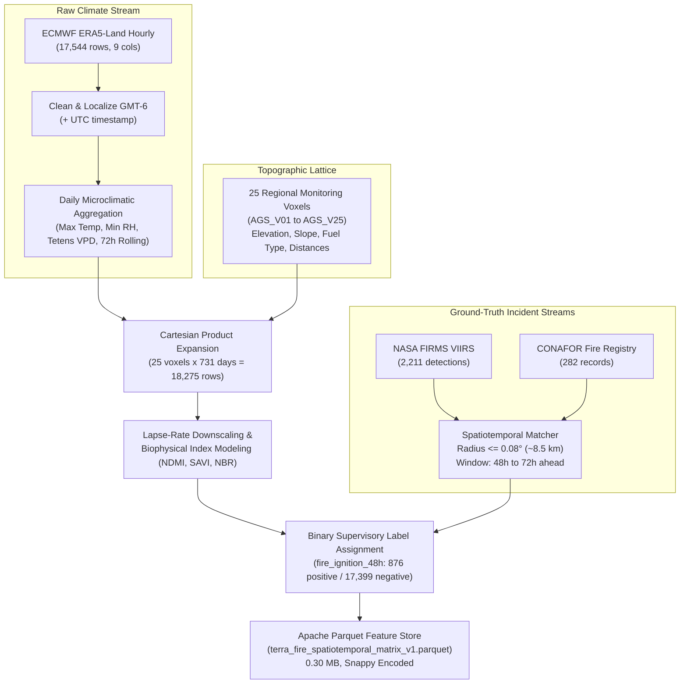

# 🔗 Data Integration Record & Diagram (TERRA-FIRE)

This document formalizes the multi-source dataset fusion, granularity alignment, and spatiotemporal integration performed during **Activity 3. Data Engineering Lab (Step 5 & 6)**.

---

### Data Integration Record Table

| Source Dataset | Integration Key | Integration Method | Records Before Integration | Records After Integration | Identified Granularity & Integration Issues | Applied Mitigation Rule |
| :--- | :--- | :--- | :---: | :---: | :--- | :--- |
| **ECMWF ERA5-Land Reanalysis** | `date` (`YYYY-MM-DD`) | Temporal rolling aggregation + Left Join to Cartesian grid | 17,544 hourly observations | 18,275 space-time observations (731 days × 25 voxels) | **Temporal Granularity Mismatch**: ERA5 is continuous hourly time-series; target matrix requires daily risk horizons. | Transformed hourly records into daily aggregates (daily max temp, min RH, max VPD, cumulative rain, 72h rolling metrics) prior to merging. |
| **Topographic Monitoring Grid (DEM / Landsat baseline)** | `voxel_id` (`AGS_V01` – `AGS_V25`) | Cartesian Space-Time Expansion | 25 spatial nodes | 18,275 space-time observations | **Continuous Field vs Discrete Nodes**: Elevation rasters are continuous floating grids. | Sampled 25 representative benchmark voxels covering key forest and shrub strata of the Aguascalientes / Sierra Fría corridor. |
| **NASA FIRMS VIIRS Active Fire Detections** | Spatial `(latitude, longitude)` + Temporal `timestamp_utc` | Spatiotemporal Radius & Window Intersection | 2,211 regional detections (2023–2024) | 876 positive anticipatory ignition windows flagged | **Event-Driven Asynchrony**: Satellite orbits detect active thermal anomalies irregularly at 01:30 and 13:30 local pass times. | Formulated Euclidean spatial distance buffer ($r \le 0.08^\circ \approx 8.5$ km) and 48–72h forward-looking predictive window ($t+1$ to $t+3$ days). |
| **CONAFOR Historical Forest Fire Registry** | Spatial `(latitude, longitude)` + Temporal `date_start` | Spatiotemporal Radius & Window Intersection | 282 validated state fire records | Included in positive ground-truth target flags | **Administrative Logging Latency**: Official fire reports often record bureaucratic detection/arrival hours rather than ignition initiation. | Fused jointly with NASA FIRMS active fire detections to calibrate ground-truth ignition veracity. |

---

### Spatiotemporal Integration Architecture Diagram

