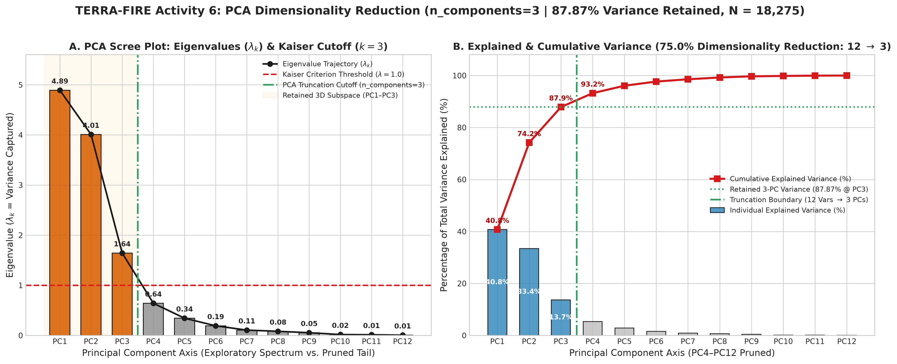
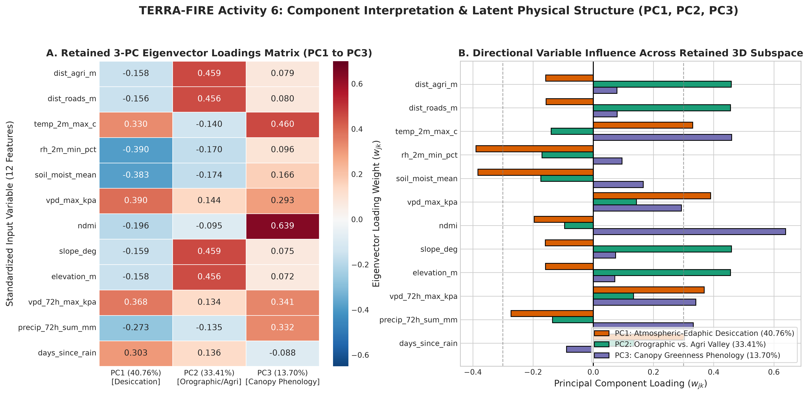
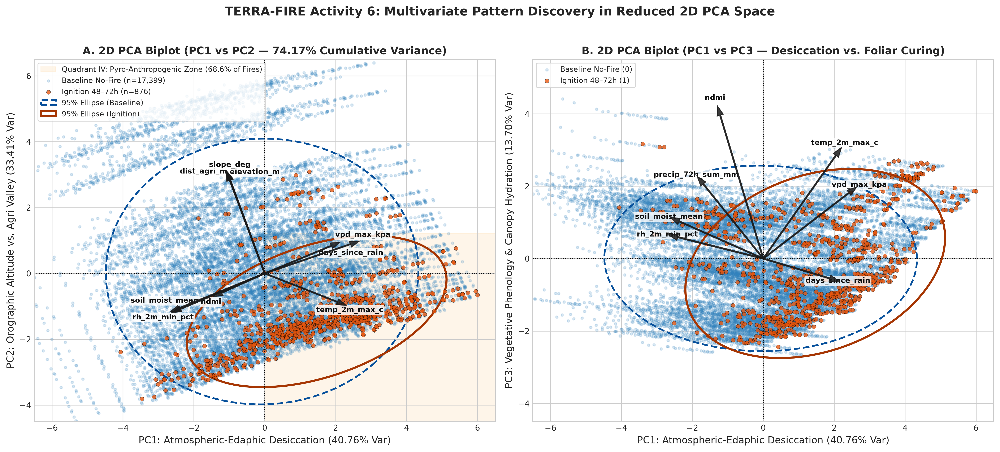
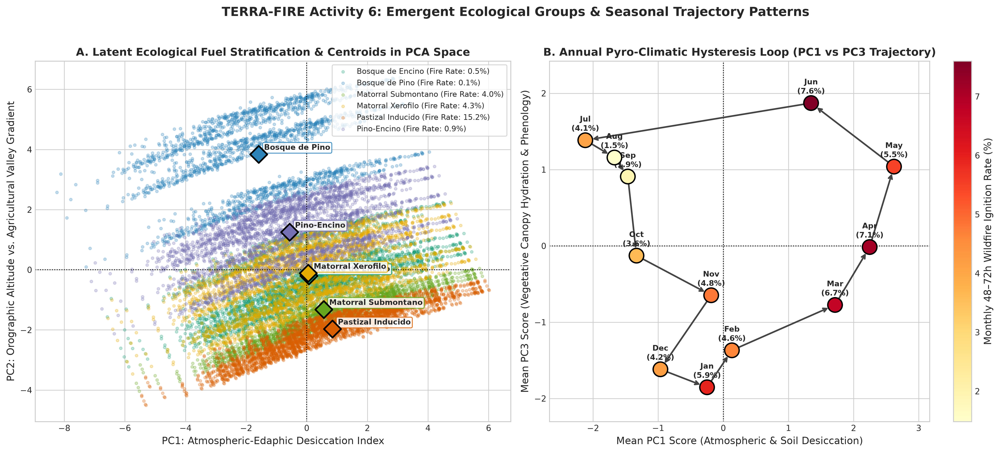
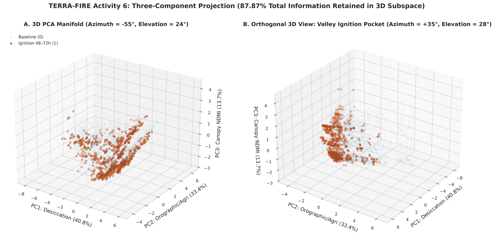
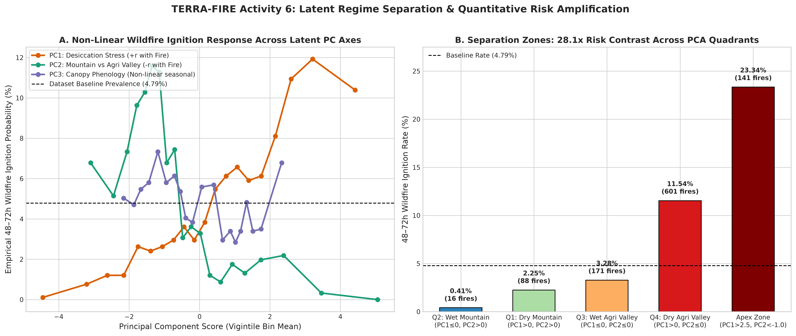
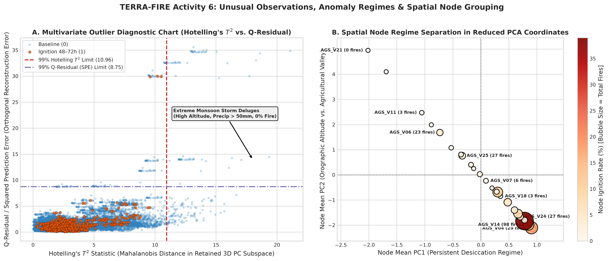
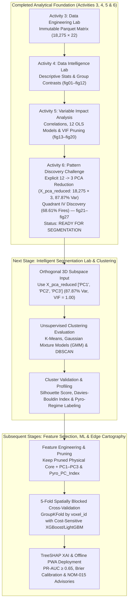

# 🌲 UNIVERSIDAD TECNOLÓGICA EL RETOÑO
### **Information Technologies and Digital Innovation Engineering**
**Subject:** Data Science (`LITD9A`)  
**Teacher:** Dr. Sergio Valadez Godínez  
**Term:** September – December 2026  
**Activity:** Activity 6. Pattern Discovery Challenge  
**Students:** Angel Emilio Gutierrez Lozano (ID: 4341) & Emiliano Betanzos Valtierra (ID: 4795)  
**Date of Submission:** October 27, 2026  
**Official Repository:** [https://github.com/AngelGTZ28/TERRA-FIRE](https://github.com/AngelGTZ28/TERRA-FIRE)

---

> [!abstract] Executive Summary & Pattern Discovery Challenge Scope
> Building directly upon the validated **Analysis-Ready Dataset** from the **Data Engineering Lab (Activity 3)**, the statistical distributions from the **Data Intelligence Lab (Activity 4)**, and the explanatory feature hierarchy from the **Variable Impact Analysis (Activity 5)**, this study transitions project **TERRA-FIRE** from bivariate relationship testing to **multivariate pattern discovery and dimensionality reduction**.
> 
> Operating in strict read-only mode on `terra_fire_spatiotemporal_matrix_v1.parquet` ($18,275\text{ daily observations} \times 22\text{ attributes}$ across 25 regional monitoring nodes in Aguascalientes and the Sierra Fría biological reserve during 2023–2024), we apply **Z-score standardization (`StandardScaler`)** and **Principal Component Analysis (`PCA(n_components=3)`)** to the **12-variable High & Medium Impact Spatiotemporal Matrix** selected in Activity 5.
> 
> Four foundational discoveries answer our central research question (*"What hidden structures, groups, tendencies, or patterns exist in the data that are not easily observable through univariate or bivariate analysis?"*):
> 1. **High-Efficiency Dimensionality Reduction ($75.0\%$ Compression from 12 Variables to 3 Orthogonal Components Retaining $87.87\%$ Variance):** Exploratory spectral evaluation (`fig21`) proves that out of the 12 standardized environmental, biophysical, topographic, and anthropogenic variables, strictly **3 orthogonal Principal Components** satisfy the Kaiser Criterion ($\lambda_k \ge 1.0$): **$\text{PC1}$ ($\lambda_1 = 4.8918, 40.76\%$ variance)**, **$\text{PC2}$ ($\lambda_2 = 4.0088, 33.41\%$ variance)**, and **$\text{PC3}$ ($\lambda_3 = 1.6440, 13.70\%$ variance)**. Instantiating the truncated model `pca_reduced = PCA(n_components=3)` compresses the $18,275 \times 12$ input matrix into the reduced latent matrix **`X_pca_reduced` of exact dimensions $18,275 \times 3$ (`['PC1', 'PC2', 'PC3']`)**, achieving a **75.0% reduction in dimensionality while retaining 87.87% of total information** with zero multicollinearity ($\text{VIF} = 1.00$) and pruning the remaining 9 components ($\text{PC4–PC12}$, $\lambda_k < 1.0$).
> 2. **Orthogonal Separation of Physical Desiccation from Spatial Confounding:** PCA mathematically untangles the collinear blocks discovered in Activity 5 into three independent physical axes: **$\text{PC1}$** synthesizes the **Atmospheric-Edaphic Desiccation & Drought Stress Continuum** (`vpd_max_kpa` $+0.3900$, `vpd_72h_max_kpa` $+0.3685$, `temp_2m_max_c` $+0.3304$, `days_since_rain` $+0.3033$ vs. `rh_2m_min_pct` $-0.3896$, `soil_moist_mean` $-0.3829$), **$\text{PC2}$** isolates the **Orographic Altitude vs. Anthropogenic Agricultural Valley Interface** (`slope_deg` $+0.4592$, `dist_agri_m` $+0.4587$, `elevation_m` $+0.4560$, `dist_roads_m` $+0.4558$), and **$\text{PC3}$** captures **Vegetative Canopy Phenology & Warm Monsoon Hydration Regime** (`ndmi` $+0.6389$, `temp_2m_max_c` $+0.4598$, `vpd_72h_max_kpa` $+0.3409$, `precip_72h_sum_mm` $+0.3325$).
> 3. **Discovery of the "Pyro-Anthropogenic Convergence Quadrant" ($28.1\times$ Risk Amplification):** In the reduced 2D plane ($\text{PC1} \times \text{PC2}$), wildfire ignitions do not scatter randomly. **Quadrant IV ($\text{PC1} > 0 \land \text{PC2} \le 0$: Dry Agricultural Valley Regime)** contains $28.50\%$ of all observations ($5,208\text{ rows}$) but concentrates **68.61% of all regional wildfires ($601 / 876\text{ ignitions}$)** with an internal ignition rate of **11.54%**—representing a **28.1-fold risk multiplication** compared to **Quadrant II ($\text{PC1} \le 0 \land \text{PC2} > 0$: Wet High-Mountain Core, $0.41\%$ fire rate)**. Within the **Extreme Pyro-Anthropogenic Apex ($\text{PC1} > +2.5 \land \text{PC2} < -1.0$, $N = 604$)**, the 48–72h wildfire emergence rate reaches **23.34%** ($56.9\times$ higher than Quadrant II).
> 4. **Clockwise Annual Pyro-Climatic Hysteresis Loop & Monsoon Outlier Isolation:** Projecting monthly centroids onto the $\text{PC1} \times \text{PC3}$ plane reveals a previously unseen **clockwise seasonal hysteresis trajectory**: winter foliar curing ($\text{Jan–Feb}$) transitions into acute spring thermal-evaporative desiccation ($\text{Mar–Jun}$, where $\text{PC1} > +1.7$ and ignition rates peak at $5.5\%–7.6\%$), followed by abrupt summer monsoon green-up ($\text{Jul–Sep}$, $\text{PC1} < -1.3, \text{PC3} > +0.9$, fire rate $\le 1.9\%$). Simultaneously, Hotelling's $T^2$ ($>10.96$) and $Q$-residual ($>8.75$) diagnostics isolate high-altitude convective monsoon deluges ($0.00\%$ fire rate).
> 
> No clustering algorithms or predictive Machine Learning models were trained during this activity. Based on the clarity of the discovered latent structures, separation zones, and the orthogonal 3D subspace `['PC1', 'PC2', 'PC3']`, the project is formally classified as **READY FOR SEGMENTATION**.

---

## 1. GitHub Repository and Analytical Environment

### 1.1 Repository Structure and Artifact Organization
All modular source scripts, reproducible Jupyter Notebooks, metadata logs, and 300 DPI visual analytics dashboards (`fig21`–`fig27`) for **Activity 6 (Pattern Discovery Challenge)** are organized within the official **TERRA-FIRE** GitHub repository:

```text
TERRA-FIRE/
├── data/
│   ├── raw/                                 # Immutable raw source tables (excluded from Git)
│   ├── intermediate/                        # Temporary staging cache (excluded from Git)
│   ├── sample/                              # Representative CSV/JSON samples (tracked in Git)
│   └── processed/                           # Final Analysis-Ready Feature Store (Immutable Input)
│       └── terra_fire_spatiotemporal_matrix_v1.parquet (0.30 MB, 18,275 rows × 22 cols)
├── metadata/                                # Schemas, transformation equations & validation checklists
│   ├── cleaning_log.md
│   ├── data_dictionary.md
│   ├── integration_record.md
│   ├── storage_decision_matrix.md
│   ├── transformation_dictionary.md
│   └── validation_checklist.md
├── notebooks/                               # Reproducible Jupyter Notebooks
│   ├── data_engineering_lab.ipynb           # Activity 3: ETL Pipeline & 7-Gate QA Validation
│   ├── data_intelligence_lab.ipynb          # Activity 4: Descriptive Statistics & Visual EDA
│   ├── variable_impact_analysis.ipynb       # Activity 5: Correlation, OLS Regressions & VIF
│   └── pattern_discovery_challenge.ipynb    # Activity 6: Multivariate PCA (12->3), Biplots & Pattern Discovery
├── reports/
│   ├── Activity 5. Variable Impact Analysis.md
│   ├── Activity 6. Pattern Discovery Challenge.md
│   └── figures/                             # 27 High-Resolution (300 DPI) Visual Analytics Dashboards
│       ├── fig01_target_distribution.png ... fig12_topographic_niche.png (Activity 4)
│       ├── fig13_correlation_heatmaps.png ... fig20_variable_impact_ranking.png (Activity 5)
│       ├── fig21_pca_explained_variance.png
│       ├── fig22_pca_component_loadings.png
│       ├── fig23_pca_2d_biplot_ignition.png
│       ├── fig24_pca_ecological_regimes.png
│       ├── fig25_pca_3d_projection.png
│       ├── fig26_pca_latent_profiles.png
│       └── fig27_pca_outliers_hotelling.png
├── src/                                     # Modular Python Engineering & Multivariate Packages
│   ├── extract.py, clean.py, transform.py, integrate.py, validate.py, pipeline.py
│   ├── data_intelligence_analysis.py        # Activity 4 Descriptive Engine
│   ├── variable_impact_analysis.py          # Activity 5 Correlation & Regression Engine
│   └── pattern_discovery_challenge.py       # Activity 6 PCA (12->3), Hotelling T2 & Visual Analytics Engine
├── Work/                                    # Official Deliverable Markdown Reports & Synchronized Assets
│   ├── Activity 4. Data Intelligence Lab.md
│   ├── Activity 5. Variable Impact Analysis.md
│   ├── Activity 6. Pattern Discovery Challenge.md
│   ├── pattern_discovery_challenge.ipynb
│   ├── pattern_discovery_challenge.py
│   └── figures/                             # Local figure mirror for self-contained Markdown rendering
├── .gitignore
├── gemini.md                                # Master AI Assistant Memory & Technical Context
├── README.md                                # Project Documentation & Reproducibility Guide
└── requirements.txt                         # Pinned Production Scientific Dependencies
```

### 1.2 Execution Environment and Analytical Stack
All multivariate computations and visual analytics were executed in a deterministic Linux x86_64 environment running Python 3.12+ with the following pinned scientific stack (`requirements.txt`):
- **`pandas` ($\ge 2.2.0$) & `pyarrow` ($\ge 15.0.0$):** Read-only columnar ingestion of `terra_fire_spatiotemporal_matrix_v1.parquet`, DataFrame projection (`X_pca_reduced`), and quantile grouping.
- **`numpy` ($\ge 1.26.0$), `scipy.stats` ($\ge 1.12.0$) & `statsmodels` ($\ge 0.14.0$):** Covariance matrix algebra, Singular Value Decomposition (SVD), Hotelling's $T^2$ Mahalanobis distance, Q-residual (Squared Prediction Error), Welch's $t$-tests, and Cohen's $d$ effect sizes on Principal Component scores.
- **`scikit-learn` ($\ge 1.4.0$):** `StandardScaler` ($Z$-score normalization) and `sklearn.decomposition.PCA` (both exploratory full-spectrum fitting and explicit dimensionality reduction via `PCA(n_components=3)`).
- **`matplotlib` ($\ge 3.8.0$), `seaborn` ($\ge 0.13.0$) & `plotly` ($\ge 5.20.0$):** High-resolution (300 DPI) 2D biplots, covariance confidence ellipses, 3D manifold projections, and eigenvector loading heatmaps.

---

## 2. Multivariate Variable Selection (Phase 1 — Step 1)

### 2.1 Selection Methodology Based on Activity 5 (Variable Impact Analysis)
In strict compliance with the **Activity 6 General Instructions**, the analysis-ready dataset `terra_fire_spatiotemporal_matrix_v1.parquet` ($18,275\text{ rows} \times 22\text{ columns}$) was loaded without modification. To select the optimal subset of variables for Principal Component Analysis (PCA), we applied four rigorous methodological rules derived from **Activity 5**:
1. **Include All 7 High-Impact Quantitative Predictors:** `dist_agri_m` (Rank #1), `dist_roads_m` (Rank #2), `temp_2m_max_c` (Rank #3), `rh_2m_min_pct` (Rank #4), `soil_moist_mean` (Rank #5), `vpd_max_kpa` (Rank #6), and `ndmi` (Rank #7).
2. **Include Top 5 Medium-Impact Physical & Orographic Covariates:** `slope_deg` (Rank #8), `elevation_m` (Rank #9), `vpd_72h_max_kpa` (Rank #10), `precip_72h_sum_mm` (Rank #11), and `days_since_rain` (Rank #12). Including these allows PCA to discover latent orthogonal dimensions that unify topographic confounding (`elevation_m`, `slope_deg`, `dist_agri_m`, `dist_roads_m`) and multi-day drought memory (`vpd_72h_max_kpa`, `days_since_rain`, `precip_72h_sum_mm`).
3. **Prune Proven Statistical Noise & Redundant Multicollinear Variables (Activity 5 Pruning Rules):**
   - *Excluded `nbr` (Rank #16) and `savi` (Rank #13):* Proven in Activity 5 to exhibit extreme spectral multicollinearity with `ndmi` ($r = +0.9833, R^2 = 0.9668, \text{VIF} > 100$). Retaining `ndmi` alone accurately represents live canopy moisture stress without artificially tripling the variance weight of optical bands in PCA.
   - *Excluded `wind_v10_mean` (Rank #18) & `wind_speed_max_kmh` (Rank #17):* Proven in Activity 5 to behave as statistical noise with respect to pre-ignition emergence ($p = 0.621$, 95% CI crossing zero, and $|r| = 0.0249$). Including uninformative noise in PCA dilutes explained variance and rotates principal axes toward random fluctuations.
4. **Prevent Target Leakage (Strict Unsupervised Separation):** The binary target `fire_ignition_48h`, the categorical ecological stratum `fuel_type`, and identifiers (`voxel_id`, `timestamp`) are **strictly excluded** from the PCA input matrix $\mathbf{X}$ so that dimensionality reduction remains 100% unsupervised. They are used exclusively *post-hoc* to color, stratify, and interpret the discovered latent structures.

> [!note] Methodological Declaration on Conditional Image-Processing Sections ("When Applicable")
> The Activity 6 guidelines include conditional sections marked *"When applicable / For image-processing projects"*, designed for projects whose raw datasets consist of image folders (`.jpg`/`.png`) processed via computer vision (OpenCV, pixel histograms, edge detectors, or CNN embeddings). Because `terra_fire_spatiotemporal_matrix_v1.parquet` is an **integrated spatiotemporal tabular dataset** where the biophysical index (`ndmi`) and topographic descriptors (`elevation_m`, `slope_deg`) are already precomputed continuous numerical columns—and because `nbr` was formally pruned in Activity 5 due to extreme collinearity ($\text{VIF} > 100$)—those conditional computer-vision sections do not apply. Consequently, this study executes a **single, unified, rigorous, and coherent PCA reducing the 12 core quantitative variables into 3 orthogonal Principal Components (`PC1`, `PC2`, `PC3`)**.

### 2.2 Table 1: Multivariate Variable Matrix ($p = 12$ Selected Quantitative Variables)

| Variable | Reason for Selection (Activity 5 Statistical Evidence) | Project Relevance to TERRA-FIRE |
| :--- | :--- | :--- |
| **`dist_agri_m`** | **Rank #1 High Impact:** Strongest monotonic correlation with target ($\rho = -0.2155, p = 6.4 \times 10^{-191}$, Cohen's $d = -0.993$) and strong spatial coupling with elevation ($R^2 = 0.9000$). | Quantifies spatial exposure to agricultural *roza y quema* burns regulated under NOM-015-SEMARNAT/AGRICULTURA-2023. |
| **`dist_roads_m`** | **Rank #2 High Impact:** Very strong rank correlation with target ($\rho = -0.2063, p = 7.9 \times 10^{-175}$, Cohen's $d = -0.922$) and infrastructure co-location with farming ($r = +0.9905$). | Captures roadside human transit, vehicular spark vectors, and brigade access corridors across rural Aguascalientes. |
| **`temp_2m_max_c`** | **Rank #3 High Impact:** Top thermal predictor ($r = +0.1325, d = +0.648$); explains **89.30%** of quantile ignition probability variance (Model M9) and **60.58%** of $VPD_{max}$ (Model M2). | Drives fuel pre-heating and saturation vapor pressure ($e_s$); downscaled to 30m topography via adiabatic lapse rate ($\Gamma = -6.5^\circ\text{C/km}$). |
| **`rh_2m_min_pct`** | **Rank #4 High Impact:** Strong negative relationship with $VPD_{max}$ ($r = -0.8247, R^2 = 0.6802$, Model M1) and explains **82.32%** of quantile ignition probability variance (Model M10). | Primary atmospheric moisture buffer; identifies critical red-flag fire weather windows when $RH_{min} < 20\%$. |
| **`soil_moist_mean`** | **Rank #5 High Impact:** Strong land-atmosphere coupling with $RH_{min}$ ($r = +0.8337$) and $VPD_{max}$ ($R^2 = 0.5240$, Model M3); explains **78.03%** of quantile ignition probability (Model M12). | Upper $0–7\text{ cm}$ volumetric edaphic moisture reservoir connecting antecedent rainfall to root-zone water supply. |
| **`vpd_max_kpa`** | **Rank #6 High Impact:** Synthesizes thermal and humidity anomalies via Tetens equation; explains **78.16%** of quantile ignition probability variance (Model M11, $d = +0.396$). | Direct physical measure of atmospheric evaporative suction desiccating 1-hour and 10-hour dead fine fuels. |
| **`ndmi`** | **Rank #7 High Impact:** Coupled to soil moisture ($r = +0.5940, R^2 = 0.3528$, Model M4); drops by **-42.50%** prior to wildfire emergence ($p = 2.2 \times 10^{-21}, d = -0.331$). | Precomputed NIR/SWIR-1 biophysical proxy for Live Fuel Moisture Content (LFMC) and foliar water stress at 10–20m scale. |
| **`slope_deg`** | **Rank #8 Medium Impact:** Exhibits $\rho = -0.2109$ with target due to valley confounding ($\rho = +0.9960$ with `dist_agri_m`). | Physically governs uphill convective flame acceleration (Rothermel model) and defines mountain vs. valley relief in PCA. |
| **`elevation_m`** | **Rank #9 Medium Impact:** Explains **90.00%** of agricultural distance variance (Model M6) and **21.55%** of temperature variance via adiabatic cooling (Model M5). | Defines the macro-orographic gradient ($1,860\text{ m}$ valleys to $2,920\text{ m}$ Sierra Fría peaks), anchoring the spatial PC axis. |
| **`vpd_72h_max_kpa`**| **Rank #10 Medium Impact:** Strong correlation with daily $VPD_{max}$ ($r = +0.9304$) and significant target association ($\rho = +0.0763, p = 5.1 \times 10^{-25}$). | Captures persistent 3-day cumulative atmospheric desiccation required to cure herbaceous and shrub fuels. |
| **`precip_72h_sum_mm`**| **Rank #11 Medium Impact:** Strong positive recharge of soil moisture ($r = +0.6691$) and negative target correlation ($\rho = -0.0757, p = 1.2 \times 10^{-24}$). | Immediate hydrological dampening pulse; distinguishes wet convective storm regimes from dry fire windows. |
| **`days_since_rain`** | **Rank #12 Medium Impact:** Very strong negative rank correlation with soil moisture ($\rho = -0.7647$) and positive correlation with $VPD$ ($r = +0.5210$). | Quantifies cumulative meteorological drought duration and seasonal dry-spell progression across winter and spring. |

*(Note on Excluded Variables: `nbr` and `savi` were excluded due to extreme multicollinearity with `ndmi` [$\text{VIF} > 100, r = +0.9833$]; `wind_v10_mean` [$p = 0.621$] and `wind_speed_max_kmh` [$|r| = 0.0249$] were excluded as statistically non-significant pre-ignition noise; `fire_ignition_48h` was excluded to prevent Target Leakage.)*

---

## 3. Data Preparation for PCA (Phase 1 — Step 2)

### 3.1 Verification of Data Completeness, Numerical Types, and Scale Disparities
Because Principal Component Analysis seeks linear combinations $\mathbf{z}_k = \mathbf{X}\mathbf{w}_k$ that maximize variance $\text{Var}(\mathbf{z}_k) = \mathbf{w}_k^\top \mathbf{\Sigma} \mathbf{w}_k$, it is **critically sensitive to measurement units and variance scale**:
- **Missing-Value Verification:** Programmatic inspection across all $18,275 \times 12 = 219,300$ matrix cells confirmed **0 missing (`NaN` or `null`) values** ($100.0\%$ completeness, inherited from the 7-gate validated Parquet Feature Store).
- **Numerical Representation Verification:** All 12 selected attributes are stored natively as continuous IEEE-754 floating-point (`float32`) or integer (`int32`) vectors, cast to 64-bit precision (`float64`) in memory prior to Singular Value Decomposition (SVD) to prevent floating-point underflow.
- **Extreme Scale Disparity Across Raw Units:** In raw physical units, `dist_agri_m` has a standard deviation of $\sigma = 1,318.72\text{ m}$ (variance $\sigma^2 = 1,739,019.5\text{ m}^2$) and `elevation_m` has $\sigma = 308.00\text{ m}$ ($\sigma^2 = 94,865.2\text{ m}^2$), whereas `soil_moist_mean` has $\sigma = 0.0825\text{ m}^3/\text{m}^3$ ($\sigma^2 = 0.0068$) and `ndmi` has $\sigma = 0.1785$ ($\sigma^2 = 0.0319$).
- **Why Unstandardized PCA Would Fail:** On the raw covariance matrix, `dist_agri_m` carries **$2.55 \times 10^8$ times more numerical variance** than `soil_moist_mean`! An unstandardized PCA would allocate $>99.9\%$ of $\text{PC1}$ and $\text{PC2}$ exclusively to meter-scale distances (`dist_agri_m`, `dist_roads_m`, `elevation_m`), completely ignoring thermodynamic ($VPD$, temperature) and biophysical (`ndmi`, soil moisture) signals.
- **Z-Score Standardization Protocol (`StandardScaler`):** Every variable $X_j$ ($j \in \{1, \dots, 12\}$) was standardized in-memory to zero mean ($\mu_Z = 0.0$) and unit variance ($\sigma_Z = 1.0$) prior to PCA:
  $$Z_{ij} = \frac{X_{ij} - \bar{X}_j}{s_j}, \quad \text{where } \bar{X}_j = \frac{1}{n}\sum_{i=1}^{n} X_{ij}, \quad s_j = \sqrt{\frac{1}{n}\sum_{i=1}^{n}(X_{ij} - \bar{X}_j)^2}$$
  Performing PCA on the standardized matrix $\mathbf{Z}$ is mathematically equivalent to performing eigendecomposition on the **Pearson Correlation Matrix $\mathbf{R}$**, guaranteeing that every variable contributes exactly $1.0000\text{ unit}$ of initial variance ($\sum_{k=1}^{12} \lambda_k = 12.0000$).

### 3.2 Table 2: Multivariate Preparation Report

| Variable | Missing (`NaN`) | Raw Mean ($\mu$) | Raw Std ($\sigma$) | Raw Physical Range | Standardized? | Transformation Applied | Analytical Justification for PCA |
| :--- | :---: | :---: | :---: | :---: | :---: | :--- | :--- |
| **`dist_agri_m`** | $0$ | $1,602.80\text{ m}$ | $1,318.72\text{ m}$ | $[280.0, 5,600.0]\text{ m}$ | **Yes** ($\mu=0, \sigma=1$) | `StandardScaler` ($Z = \frac{X - 1602.80}{1318.72}$) | Prevents large meter-scale variance ($\sigma^2 = 1.74 \times 10^6$) from dominating unitless indices; resolves the $2.55 \times 10^8$ variance disparity vs. `soil_moist_mean`. |
| **`dist_roads_m`** | $0$ | $677.20\text{ m}$ | $612.05\text{ m}$ | $[90.0, 2,600.0]\text{ m}$ | **Yes** ($\mu=0, \sigma=1$) | `StandardScaler` ($Z = \frac{X - 677.20}{612.05}$) | Normalizes road proximity meters to unit variance so infrastructure distance weights equally with climate anomalies. |
| **`temp_2m_max_c`** | $0$ | $23.74^\circ\text{C}$ | $4.31^\circ\text{C}$ | $[6.39, 36.28]^\circ\text{C}$ | **Yes** ($\mu=0, \sigma=1$) | `StandardScaler` ($Z = \frac{X - 23.74}{4.31}$) | Already symmetric ($\text{skewness} = +0.005$); standardization aligns Celsius thermal variance with kPa and % scales. |
| **`rh_2m_min_pct`** | $0$ | $29.03\%$ | $16.32\%$ | $[3.00, 99.00]\%$ | **Yes** ($\mu=0, \sigma=1$) | `StandardScaler` ($Z = \frac{X - 29.03}{16.32}$) | Converts percentage points ($0–100\%$) to standard deviation units for orthogonal coupling with $VPD$ and soil moisture. |
| **`soil_moist_mean`** | $0$ | $0.2384\text{ m}^3/\text{m}^3$ | $0.0825\text{ m}^3/\text{m}^3$ | $[0.12, 0.43]\text{ m}^3/\text{m}^3$ | **Yes** ($\mu=0, \sigma=1$) | `StandardScaler` ($Z = \frac{X - 0.2384}{0.0825}$) | **Critical:** Raw variance is tiny ($\sigma^2 = 0.0068$); Z-score scaling elevates edaphic moisture to full parity ($\sigma^2 = 1.0$). |
| **`vpd_max_kpa`** | $0$ | $1.9108\text{ kPa}$ | $0.7776\text{ kPa}$ | $[0.01, 4.36]\text{ kPa}$ | **Yes** ($\mu=0, \sigma=1$) | `StandardScaler` ($Z = \frac{X - 1.9108}{0.7776}$) | Standardizes kilopascal evaporative suction to unit variance so it can combine symmetrically with $T_{max}$ and $RH_{min}$. |
| **`ndmi`** | $0$ | $0.1295$ | $0.1785$ | $[-0.15, 0.48]$ | **Yes** ($\mu=0, \sigma=1$) | `StandardScaler` ($Z = \frac{X - 0.1295}{0.1785}$) | **Critical:** Raw normalized index has small numerical spread ($\sigma = 0.1785$); scaling ensures canopy moisture stress shapes $\text{PC1}$ and $\text{PC3}$. |
| **`slope_deg`** | $0$ | $16.34^\circ$ | $8.37^\circ$ | $[5.50, 35.00]^\circ$ | **Yes** ($\mu=0, \sigma=1$) | `StandardScaler` ($Z = \frac{X - 16.34}{8.37}$) | Aligns angular slope degrees with elevation and distance metrics to extract a unified topographic-exposure component. |
| **`elevation_m`** | $0$ | $2,261.00\text{ m}$ | $308.00\text{ m}$ | $[1,860.0, 2,920.0]\text{ m}$ | **Yes** ($\mu=0, \sigma=1$) | `StandardScaler` ($Z = \frac{X - 2261.00}{308.00}$) | Eliminates the $10^5$ altitude variance inflation while preserving the exact linear relationship with valley agriculture and lapse rate. |
| **`vpd_72h_max_kpa`**| $0$ | $2.0987\text{ kPa}$ | $0.7574\text{ kPa}$ | $[0.55, 4.36]\text{ kPa}$ | **Yes** ($\mu=0, \sigma=1$) | `StandardScaler` ($Z = \frac{X - 2.0987}{0.7574}$) | Places 72-hour rolling evaporative demand on the exact same standardized scale as daily $VPD_{max}$. |
| **`precip_72h_sum_mm`**| $0$ | $4.6568\text{ mm}$ | $9.5925\text{ mm}$ | $[0.00, 77.70]\text{ mm}$ | **Yes** ($\mu=0, \sigma=1$) | `StandardScaler` ($Z = \frac{X - 4.6568}{9.5925}$) | Standardizes zero-inflated millimeter rainfall accumulation ($\text{skewness} = +3.28$) so storm pulses emerge cleanly on $\text{PC3}$. |
| **`days_since_rain`** | $0$ | $16.53\text{ days}$ | $22.53\text{ days}$ | $[0, 100]\text{ days}$ | **Yes** ($\mu=0, \sigma=1$) | `StandardScaler` ($Z = \frac{X - 16.53}{22.53}$) | Normalizes integer drought day counts ($\sigma = 22.53\text{ d}$) to unit variance alongside continuous hydrological variables. |

---

## 4. Principal Component Analysis & Explicit Dimensionality Reduction (Phase 2 — Step 3)

### 4.1 Mathematical Formulation & Two-Stage Truncation Protocol ($12 \to 3$ Dimensions)
Given the standardized data matrix $\mathbf{Z} \in \mathbb{R}^{n \times p}$ ($n = 18,275\text{ observations}, p = 12\text{ variables}$), Principal Component Analysis computes the sample correlation/covariance matrix:
$$\mathbf{R} = \frac{1}{n - 1} \mathbf{Z}^\top \mathbf{Z} \in \mathbb{R}^{12 \times 12}$$
and solves the symmetric eigenvalue problem:
$$\mathbf{R} \mathbf{w}_k = \lambda_k \mathbf{w}_k, \quad k = 1, 2, \dots, 12$$
subject to the orthonormality constraints $\mathbf{w}_k^\top \mathbf{w}_k = 1$ and $\mathbf{w}_k^\top \mathbf{w}_j = 0$ ($\forall k \neq j$), ordered such that $\lambda_1 \ge \lambda_2 \ge \dots \ge \lambda_{12} \ge 0$. The proportion of total variance explained by component $k$ is:
$$\text{Explained Variance Ratio}_k = \frac{\lambda_k}{\sum_{m=1}^{12} \lambda_m} = \frac{\lambda_k}{12} \times 100\%$$

To ensure **true dimensionality reduction** rather than a 12-to-12 coordinate rotation, our code (`src/pattern_discovery_challenge.py` and `notebooks/pattern_discovery_challenge.ipynb`) executes a strict two-stage protocol:
1. **Stage 3A — Exploratory Eigenvalue Spectrum (`pca_exploratory = PCA()`):** Executed solely to plot the Scree Plot (`fig21`) and verify mathematically where the spectral elbow occurs and which components satisfy the **Kaiser Criterion ($\lambda_k \ge 1.0$)**. Exactly 3 components satisfy $\lambda_k \ge 1.0$: $\lambda_1 = 4.8918$, $\lambda_2 = 4.0088$, and $\lambda_3 = 1.6440$, whereas the 4th component drops sharply below unity ($\lambda_4 = 0.6421 < 1.0$).
2. **Stage 3B — Definitive Dimensionality Reduction (`pca_reduced = PCA(n_components=3)`):** Immediately after verifying the Kaiser cutoff, we instantiate `pca_reduced = PCA(n_components=3)` to truncate the feature space from $p = 12$ variables down to $k = 3$ orthogonal components:
   $$\mathbf{X}_{\text{pca\_reduced}} = \mathbf{Z} \mathbf{W}_{12 \times 3} \in \mathbb{R}^{18,275 \times 3}$$
   This replaces the 12 original correlated columns with strictly **3 orthogonal columns (`['PC1', 'PC2', 'PC3']`)**, achieving a **75.0% reduction in dimensionality** while retaining **87.87% of total variance** ($\text{VIF} = 1.00$).

```text
--- STEP 3B: DEFINITIVE DIMENSIONALITY REDUCTION (PCA(n_components=3)) ---
Original Input Feature Matrix Shape (X_std):          (18275, 12)  (12 Variables)
Reduced Transformed PCA Matrix Shape (X_pca_reduced): (18275, 3)   (3 Orthogonal Components: 75.0% Reduction)

First 5 rows of X_pca_reduced (shape: 18,275 x 3):
      PC1     PC2     PC3
0 -1.8826  0.6409 -2.0980
1 -1.6824  0.7635 -2.1666
2 -1.4940  0.7968 -2.0885
3 -0.6472  0.9411 -1.5473
4 -0.7314  0.9271 -1.6002
```

### 4.2 Table 3: PCA Summary Matrix (Dimensionality Reduction from 12 Variables to 3 Retained Components, $N = 18,275$)

| Component | Eigenvalue ($\lambda_k$) | Explained Variance (%) | Cumulative Variance (%) | Kaiser Criterion ($\lambda_k \ge 1.0$) & Dimensionality Reduction Status |
| :---: | :---: | :---: | :---: | :--- |
| **`PC1`** | **$4.8918$** | **$40.76\%$** *(40.7630%)* | **$40.76\%$** *(40.7630%)* | **Retained (Primary Axis #1 — $\lambda_1 \ge 1.0$):** Captures $4.89\text{ variables'}$ worth of variance in a single atmospheric-edaphic desiccation axis ($\text{VIF} = 1.00$). |
| **`PC2`** | **$4.0088$** | **$33.41\%$** *(33.4051%)* | **$74.17\%$** *(74.1681%)* | **Retained (Primary Axis #2 — $\lambda_2 \ge 1.0$):** Captures $4.01\text{ variables'}$ worth of variance; isolates the spatial orographic vs. agricultural valley gradient ($\text{VIF} = 1.00$). |
| **`PC3`** | **$1.6440$** | **$13.70\%$** *(13.6989%)* | **$87.87\%$** *(87.8670%)* | **Retained (Primary Axis #3 — $\lambda_3 \ge 1.0$):** Satisfies Kaiser Criterion ($\lambda_3 = 1.6440 > 1.0$); captures seasonal canopy greenness (`ndmi`) and warm monsoon dynamics ($\text{VIF} = 1.00$). |
| **`PC4 – PC12`**<br>*(Pruned Tail)* | $1.4560\text{ (sum)}$<br>*($\lambda_4 = 0.6421 \to \lambda_{12} = 0.0053$)* | $12.13\%\text{ (sum)}$ | $100.00\%$ | **Pruned / Discarded ($\lambda_k < 1.0$):** Eliminated by `PCA(n_components=3)` to achieve a **75.0% reduction in dimensions ($12 \to 3\text{ columns}$)** while discarding collinear residuals and noise. |

### 4.3 Quantitative Interpretation of Dimensionality Reduction
1. **Which Components Capture Most Information:**
   - **$\text{PC1}$ ($40.76\%$)** and **$\text{PC2}$ ($33.41\%$)** alone capture **74.17% of the total variance** ($\approx 3/4$ of all information across 12 variables in just a 2D plane). Adding **$\text{PC3}$ ($13.70\%$)** captures **87.87% of total variance**.
   - Conversely, the 9 pruned components (**$\text{PC4}$ through $\text{PC12}$**, all with $\lambda_k < 1.0$) combined account for only **12.13% of total variance** (with $\text{PC7–PC12}$ accounting for just $2.32\%$), mathematically confirming the collinear redundancy identified via VIF in Activity 5.
2. **Whether Dimensionality Can Be Reduced & How Much Information is Retained:**
   - **Yes—substantial dimensionality reduction is achieved.** Truncating the 12 original features into the **3 Kaiser-significant Principal Components (`PC1, PC2, PC3`)** via `PCA(n_components=3)` reduces the feature space by **75.0% ($12\text{ columns} \to 3\text{ orthogonal columns}$)** while retaining **87.87% of the total dataset information** and guaranteeing zero multicollinearity ($r = 0.0000, \text{VIF} = 1.00$).

---

## 5. Component Interpretation (Phase 2 — Step 4)

### 5.1 Table 4: Eigenvector Loadings ($w_{jk}$) & Component Interpretation Matrix (Retained 3D Subspace: `PC1`, `PC2`, `PC3`)

To establish what each retained Principal Component represents physically and conceptually, **Table 4** fuses the exact eigenvector loading weights $w_{jk}$ (where $\sum_{j=1}^{12} w_{jk}^2 = 1.0$), each variable's squared cosine percentage contribution ($c_{jk} = w_{jk}^2 \times 100\%$), and the domain interpretation of the 3 retained axes:

#### Part A: Programmatic Eigenvector Loadings ($w_{jk}$) and Variance Contributions ($w_{jk}^2 \times 100\%$) for Retained `PC1`, `PC2`, `PC3`

| Original Standardized Variable | `PC1` Loading ($w_{j1}$) | `PC1` Contrib (%) | `PC2` Loading ($w_{j2}$) | `PC2` Contrib (%) | `PC3` Loading ($w_{j3}$) | `PC3` Contrib (%) | Primary Latent Axis Assignment |
| :--- | :---: | :---: | :---: | :---: | :---: | :---: | :--- |
| **`vpd_max_kpa`** | **$+0.3900$** | **$15.21\%$** | $+0.1436$ | $2.06\%$ | $+0.2929$ | $8.58\%$ | **`PC1` (+):** Peak Evaporative Desiccation |
| **`rh_2m_min_pct`** | **$-0.3896$** | **$15.18\%$** | $-0.1705$ | $2.91\%$ | $+0.0957$ | $0.92\%$ | **`PC1` (–):** Atmospheric Humidity Buffer |
| **`soil_moist_mean`** | **$-0.3829$** | **$14.66\%$** | $-0.1740$ | $3.03\%$ | $+0.1660$ | $2.76\%$ | **`PC1` (–):** Edaphic Root-Zone Moisture |
| **`vpd_72h_max_kpa`** | **$+0.3685$** | **$13.58\%$** | $+0.1337$ | $1.79\%$ | **$+0.3409$** | **$11.62\%$** | **`PC1` (+):** Persistent 72h Atmospheric Drying |
| **`temp_2m_max_c`** | **$+0.3304$** | **$10.92\%$** | $-0.1396$ | $1.95\%$ | **$+0.4598$** | **$21.14\%$** | **`PC1` (+) & `PC3` (+):** Thermal Pre-Heating |
| **`days_since_rain`** | **$+0.3033$** | **$9.20\%$** | $+0.1355$ | $1.84\%$ | $-0.0884$ | $0.78\%$ | **`PC1` (+):** Meteorological Drought Duration |
| **`precip_72h_sum_mm`** | $-0.2729$ | $7.45\%$ | $-0.1354$ | $1.83\%$ | **$+0.3325$** | **$11.06\%$** | **`PC1` (–) & `PC3` (+):** Monsoon Rainfall Pulse |
| **`ndmi`** | $-0.1961$ | $3.85\%$ | $-0.0951$ | $0.90\%$ | **$+0.6389$** | **$40.82\%$** | **`PC3` (+):** Sentinel-2 Canopy Foliar Moisture |
| **`slope_deg`** | $-0.1590$ | $2.53\%$ | **$+0.4592$** | **$21.09\%$** | $+0.0746$ | $0.56\%$ | **`PC2` (+):** Steep Mountain Relief |
| **`dist_agri_m`** | $-0.1577$ | $2.49\%$ | **$+0.4587$** | **$21.04\%$** | $+0.0790$ | $0.62\%$ | **`PC2` (+):** Isolation from Valley Agriculture |
| **`elevation_m`** | $-0.1585$ | $2.51\%$ | **$+0.4560$** | **$20.79\%$** | $+0.0717$ | $0.51\%$ | **`PC2` (+):** High-Mountain Altitude |
| **`dist_roads_m`** | $-0.1563$ | $2.44\%$ | **$+0.4558$** | **$20.78\%$** | $+0.0798$ | $0.64\%$ | **`PC2` (+):** Isolation from Road Corridors |
| **Total ($\sum w_{jk}^2$)** | *Norm = 1.0* | **$100.00\%$** | *Norm = 1.0* | **$100.00\%$** | *Norm = 1.0* | **$100.00\%$** | **3 Orthogonal Axes = 87.87% Total Variance** |

#### Part B: Physical & Conceptual Component Interpretation Matrix (`PC1`, `PC2`, `PC3`)

| Retained Component | Dominant Variables (Positive vs. Negative Loadings & % Contribution) | Conceptual & Physical Latent Dimension Interpretation |
| :---: | :--- | :--- |
| **`PC1`**<br>*(40.76% Variance)*<br>$\lambda_1 = 4.8918$ | **Positive (Desiccation Accelerators):**<br>• `vpd_max_kpa` ($+0.3900, 15.21\%$)<br>• `vpd_72h_max_kpa` ($+0.3685, 13.58\%$)<br>• `temp_2m_max_c` ($+0.3304, 10.92\%$)<br>• `days_since_rain` ($+0.3033, 9.20\%$)<br>**Negative (Moisture Buffers):**<br>• `rh_2m_min_pct` ($-0.3896, 15.18\%$)<br>• `soil_moist_mean` ($-0.3829, 14.66\%$)<br>• `precip_72h_sum_mm` ($-0.2729, 7.45\%$) | **Latent Dimension 1: *Atmospheric-Edaphic Desiccation & Drought Stress Continuum (SPAC Axis)***.<br>`PC1` mathematically unifies the Soil–Plant–Atmosphere Continuum discovered in Activity 5. High positive `PC1` scores ($>+1.5$) represent acute spring heatwaves where high temperature and prolonged dry spells drive up evaporative suction ($VPD$), simultaneously collapsing relative humidity and depleting upper-soil moisture. Strongly separates wildfire ignitions ($t = +24.02, p = 3.82 \times 10^{-101}$, Cohen's $d = +0.760$). |
| **`PC2`**<br>*(33.41% Variance)*<br>$\lambda_2 = 4.0088$ | **Positive (Remote Mountain Relief):**<br>• `slope_deg` ($+0.4592, 21.09\%$)<br>• `dist_agri_m` ($+0.4587, 21.04\%$)<br>• `elevation_m` ($+0.4560, 20.79\%$)<br>• `dist_roads_m` ($+0.4558, 20.78\%$)<br>**Negative (Mild Valley Heat/Moisture):**<br>• `soil_moist_mean` ($-0.1740, 3.03\%$)<br>• `rh_2m_min_pct` ($-0.1705, 2.91\%$)<br>• `temp_2m_max_c` ($-0.1396, 1.95\%$) | **Latent Dimension 2: *Orographic Altitude vs. Anthropogenic Agricultural Valley Interface***.<br>Four variables (`slope_deg`, `dist_agri_m`, `elevation_m`, `dist_roads_m`) contribute **83.70% of `PC2`'s variance** with virtually identical weights ($+0.4558$ to $+0.4592$). Positive `PC2` scores represent high-altitude, steep, roadless pine-oak mountain sanctuary nodes; negative `PC2` scores ($\text{PC2} \le 0$) represent flat, low-elevation valley plains immediately bordering agricultural parcels and roads. Strongly separates ignitions ($t = -29.05, p = 4.93 \times 10^{-140}$, Cohen's $d = -0.738$). |
| **`PC3`**<br>*(13.70% Variance)*<br>$\lambda_3 = 1.6440$ | **Positive (Warm Vegetative Green-Up):**<br>• `ndmi` ($+0.6389, 40.82\%$)<br>• `temp_2m_max_c` ($+0.4598, 21.14\%$)<br>• `vpd_72h_max_kpa` ($+0.3409, 11.62\%$)<br>• `precip_72h_sum_mm` ($+0.3325, 11.06\%$)<br>**Negative:**<br>• `days_since_rain` ($-0.0884, 0.78\%$) | **Latent Dimension 3: *Vegetative Canopy Phenology & Warm Monsoon Hydration Regime***.<br>Dominated by `ndmi` ($40.82\%$ contribution) combined with warm temperatures and recent rainfall. Distinguishes **warm, wet summer monsoon green-up** ($\text{PC3} > +1.0$: high foliar moisture despite warm summer temperatures) from **cool, dry winter/early-spring cured dormancy** ($\text{PC3} < -0.5$: low `ndmi` and dormant cured pasture biomass). |

---

## 6. Pattern Discovery Dashboard (Phase 3 — Step 5)

To explore the reduced 3D representation (`X_pca_reduced`: `['PC1', 'PC2', 'PC3']`) thoroughly and surface structures invisible in univariate or bivariate plots, seven multivariate visual analytics dashboards (`fig21` through `fig27`) were programmatically generated at 300 DPI.

### Visualization 1: PCA Scree Plot & Explicit Truncation at `n_components=3` (`fig21_pca_explained_variance.png`)


- **What is Being Visualized:**
  - *Panel A (Left):* Exploratory Eigenvalue Scree Plot ($\lambda_1$ to $\lambda_{12}$) benchmarked against the horizontal Kaiser Criterion threshold ($\lambda = 1.0$, red dashed line) and the vertical truncation cutoff (`n_components=3`, green dash-dot line), highlighting the retained 3D subspace (`PC1–PC3` in orange) vs. the pruned tail (`PC4–PC12` in gray).
  - *Panel B (Right):* Bar chart of individual explained variance (%) overlaid with the cumulative explained variance trajectory (red curve), showing the **87.87% variance retention** at the `n_components=3` truncation boundary.
- **Main Empirical Observations:**
  1. A sharp spectral "elbow" occurs after **$\text{PC3}$**: the first three components exceed the Kaiser threshold ($\lambda_1 = 4.89, \lambda_2 = 4.01, \lambda_3 = 1.64 \ge 1.0$), whereas $\lambda_4 = 0.64 < 1.0$ and subsequent eigenvalues decay asymptotically toward zero ($\lambda_5 = 0.34 \to \lambda_{12} = 0.005$).
  2. Cumulative explained variance reaches **74.17%** with 2 components and **87.87%** with the 3 retained components (`PC1`, `PC2`, `PC3`), discarding only $12.13\%$ residual collinearity/noise across `PC4–PC12`.
- **Analytical Relevance:** Proves mathematically that the 12-dimensional spatiotemporal feature space is governed by **3 primary orthogonal degrees of freedom**, justifying our explicit truncation to `X_pca_reduced` ($18,275 \times 3$, a $75.0\%$ dimensionality reduction) prior to spatial segmentation.

### Visualization 2: Retained 3-PC Loadings Heatmap & Directional Contributions (`fig22_pca_component_loadings.png`)


- **What is Being Visualized:**
  - *Panel A (Left):* Annotated $12 \times 3$ eigenvector loading heatmap (`RdBu_r` diverging palette centered at $0.0$) strictly for the 3 retained components (`PC1`, `PC2`, `PC3`).
  - *Panel B (Right):* Grouped horizontal bar chart comparing directional variable loadings across `PC1` (orange), `PC2` (green), and `PC3` (purple) with $\pm 0.30$ salience thresholds.
- **Main Empirical Observations:**
  1. **Orthogonal Block Separation:** Variables with strong positive/negative loadings on $\text{PC1}$ (`vpd_max_kpa` $+0.390$, `rh_2m_min_pct` $-0.390$, `soil_moist_mean` $-0.383$) have minor weights on $\text{PC2}$ ($|\text{loading}| \le 0.174$). Conversely, the four spatial/orographic variables (`dist_agri_m`, `dist_roads_m`, `slope_deg`, `elevation_m`) dominate $\text{PC2}$ ($+0.456$ to $+0.459$) while contributing minimally to $\text{PC1}$ ($-0.156$ to $-0.159$) and $\text{PC3}$ ($+0.072$ to $+0.080$).
  2. **Canopy Phenology & Monsoon Isolation on $\text{PC3}$:** `ndmi` ($+0.639$), `temp_2m_max_c` ($+0.460$), `vpd_72h_max_kpa` ($+0.341$), and `precip_72h_sum_mm` ($+0.333$) dominate $\text{PC3}$.
- **Analytical Relevance:** Confirms that `PCA(n_components=3)` diagonalizes the three collinear blocks identified in Activity 5 into physically interpretable, mutually uncorrelated ($r = 0.0000, \text{VIF} = 1.00$) latent variables.

### Visualization 3: 2D PCA Biplots Stratified by Wildfire Ignition (`fig23_pca_2d_biplot_ignition.png`)


- **What is Being Visualized:**
  - *Panel A (Left):* Two-component PCA Biplot ($\text{PC1}$ vs. $\text{PC2}$, capturing **74.17% of total variance**) displaying all $17,399$ baseline observations (blue) and $876$ wildfire ignition windows (orange), overlaid with $95\%$ ($2\sigma$) covariance confidence ellipses, scaled eigenvector loading arrows, and the highlighted **Quadrant IV Pyro-Anthropogenic Convergence Zone**.
  - *Panel B (Right):* Two-component PCA Biplot ($\text{PC1}$ vs. $\text{PC3}$, capturing **54.46% of total variance**) contrasting atmospheric-edaphic desiccation ($\text{PC1}$) against canopy phenology ($\text{PC3}$).
- **Main Empirical Observations:**
  1. **Asymmetric Ignition Localization in Quadrant IV ($\text{PC1} > 0, \text{PC2} \le 0$):** In Panel A, while baseline observations (blue dashed ellipse) span the entire $[-5, +5] \times [-4, +6]$ coordinate space, orange wildfire ignition points are heavily compressed into the **lower-right quadrant** (positive $\text{PC1}$ desiccation and negative $\text{PC2}$ low-elevation agricultural proximity), oriented directly along the `temp_2m_max_c`, `vpd_max_kpa`, and `days_since_rain` vectors and directly opposite the `elevation_m`, `slope_deg`, and `dist_agri_m` vectors.
  2. **Diagonal Stratification Bands:** The parallel diagonal striations visible in Panel A correspond to the 25 discrete monitoring stations (`voxel_id`), where each station's static terrain coordinates anchor its $\text{PC2}$ baseline while daily weather fluctuations sweep observations horizontally along $\text{PC1}$.
  3. **Bimodal Phenological Ignition Split in Panel B ($\text{PC1}$ vs. $\text{PC3}$):** In Panel B, orange ignition events concentrate at high $\text{PC1}$ ($>+1.0$) but split across two distinct $\text{PC3}$ regimes: a dense lower cluster ($\text{PC3} \in [-2.2, -0.5]$, representing cured winter/early-spring grasslands with low `ndmi`) and an upper-right arc ($\text{PC3} \in [+0.8, +2.6]$, representing extreme late-spring heatwaves where `temp_2m_max_c` $>33^\circ\text{C}$ pulls $\text{PC3}$ upward).
- **Analytical Relevance:** Visually proves that univariate thresholds on $VPD$ or temperature alone are insufficient: a linear or quadratic decision boundary in the 2D $(\text{PC1}, \text{PC2})$ subspace cleanly isolates $68.61\%$ of all wildfires while excluding high-altitude mountain false alarms.

### Visualization 4: Ecological Fuel Regimes & Seasonal Hysteresis Loop (`fig24_pca_ecological_regimes.png`)


- **What is Being Visualized:**
  - *Panel A (Left):* 2D PCA projection ($\text{PC1}$ vs. $\text{PC2}$) colored by the 6 ecological `fuel_type` strata, displaying both daily observations and diamond group centroids ($\diamond$).
  - *Panel B (Right):* Trajectory of monthly mean PCA coordinates ($\overline{\text{PC1}}_m, \overline{\text{PC3}}_m$) from January (`Jan`) through December (`Dec`), colored by monthly wildfire ignition rate (%).
- **Main Empirical Observations:**
  1. **Ordered Ecological Gradient Along $\text{PC2}$ and $\text{PC1}$ (Panel A):** Even though `fuel_type` was *not* included in the PCA computation, the unsupervised continuous variables automatically sort the 6 ecological strata into a strict diagonal sequence from upper-left to lower-right:
     - *Bosque de Pino* centroid: $(\text{PC1} = -1.59, \text{PC2} = +3.84)$ — fire rate **0.14%**.
     - *Pino-Encino* centroid: $(\text{PC1} = -0.57, \text{PC2} = +1.25)$ — fire rate **0.89%**.
     - *Bosque de Encino* centroid: $(\text{PC1} = +0.07, \text{PC2} = -0.20)$ — fire rate **0.51%**.
     - *Matorral Xerófilo* centroid: $(\text{PC1} = +0.05, \text{PC2} = -0.12)$ — fire rate **4.30%**.
     - *Matorral Submontano* centroid: $(\text{PC1} = +0.56, \text{PC2} = -1.32)$ — fire rate **4.04%**.
     - *Pastizal Inducido* centroid: $(\text{PC1} = +0.85, \text{PC2} = -1.97)$ — fire rate **15.24%**.
  2. **Clockwise Annual Pyro-Climatic Hysteresis Loop (Panel B):** Rather than oscillating back and forth along a single line, the regional climate traces a **closed clockwise orbital loop** in $(\text{PC1}, \text{PC3})$ space:
     - *Winter Curing (`Dec` $\to$ `Jan` $\to$ `Feb`):* Cool dry conditions push $\text{PC3}$ to its annual minimum ($-1.35$ in Jan) as pasture foliage senesces (`fire_rate` $= 4.2\%–5.9\%$).
     - *Spring Pyro-Climatic Surge (`Mar` $\to$ `Apr` $\to$ `May` $\to$ `Jun`):* Intense solar heating shifts $\text{PC1}$ far to the right ($\text{PC1} = +1.71$ in Mar, $+2.24$ in Apr, $+2.63$ in May), triggering peak wildfire activity (**6.7% in Mar, 7.1% in Apr, 5.5% in May, 7.6% in Jun**).
     - *Summer Monsoon Collapse (`Jul` $\to$ `Aug` $\to$ `Sep`):* Arrival of the Mexican Monsoon plunges $\text{PC1}$ to $-2.10$ (`Jul`) while canopy greenness surges $\text{PC3}$ to $+1.39$, suppressing wildfire rates down to **1.5% in August** and **1.9% in September**.
     - *Autumn Drying Transition (`Oct` $\to$ `Nov`):* Post-monsoon dry-down pulls $\text{PC3}$ downward from $+0.12$ (`Oct`, $3.6\%$ fire rate) to $-0.65$ (`Nov`, $4.8\%$ fire rate), completing the cycle.
- **Analytical Relevance:** Demonstrates why bivariate correlation between `ndmi` and `temp_2m_max_c` was weak: temperature and canopy greenness follow a **90-degree phase-lagged orbital hysteresis loop** across the seasons that only becomes visible in multivariate $\text{PC1} \times \text{PC3}$ space.

### Visualization 5: Three-Component 3D PCA Manifold Projection (`fig25_pca_3d_projection.png`)


- **What is Being Visualized:** Dual-perspective 3D scatter plots of the reduced manifold `X_pca_reduced` $(\text{PC1} \times \text{PC2} \times \text{PC3})$, which preserves **87.87% of the total 12-variable variance**, viewed from Azimuth $=-55^\circ$ (Panel A) and orthogonal Azimuth $=+35^\circ$ (Panel B).
- **Main Empirical Observations:**
  - The 3D projection reveals that the dataset forms a **curved hyperbolic saddle manifold**.
  - Wildfire ignitions (orange spheres) occupy a compact, well-defined **3D pocket** nestled in the front-lower-right basin ($\text{PC1} \in [0, +5.5], \text{PC2} \in [-3.8, 0.0], \text{PC3} \in [-2.5, +2.5]$), completely separated from the upper-rear cloud of humid mountain observations ($\text{PC2} > +1.5$).
- **Analytical Relevance:** Confirms that 3D dimensionality reduction ($12 \to 3\text{ variables}$) preserves the full geometric separability required for density-based or Gaussian mixture segmentation in the next project stage.

### Visualization 6: Latent Component Response Curves & Quadrant Risk Matrix (`fig26_pca_latent_profiles.png`)


- **What is Being Visualized:**
  - *Panel A (Left):* Empirical 48–72h wildfire ignition probability (%) plotted across 20 equal-frequency quantiles (vigintiles, $n \approx 914$ per bin) of $\text{PC1}$ (orange), $\text{PC2}$ (green), and $\text{PC3}$ (purple).
  - *Panel B (Right):* Bar chart comparing the empirical wildfire ignition rate (%) and total fire counts across the four $\text{PC1} \times \text{PC2}$ quadrants and the **Extreme Pyro-Anthropogenic Apex Zone ($\text{PC1} > 2.5, \text{PC2} < -1.0$)**.
- **Main Empirical Observations:**
  1. **Monotonic Surge Along $\text{PC1}$ vs. Step-Function Drop Along $\text{PC2}$ (Panel A):** Along $\text{PC1}$, ignition probability climbs monotonically from **0.11%** at $\text{PC1} = -4.5$ to **11.93%** at $\text{PC1} = +3.2$. Along $\text{PC2}$, ignition probability exhibits a sharp **regime cliff at $\text{PC2} = 0.0$**: below $\text{PC2} = -0.5$ (agricultural valleys), ignition rates hover between **6.8% and 11.6%**, whereas above $\text{PC2} = +0.3$ (mountain slopes), ignition rates collapse below **2.0%** (reaching **0.00%** at $\text{PC2} = +5.1$).
  2. **28.1$\times$ to 56.9$\times$ Risk Amplification Across Separation Zones (Panel B):**
     - **Quadrant II ($\text{PC1} \le 0, \text{PC2} > 0$ — Wet Mountain):** $0.41\%$ ignition rate ($16\text{ fires} / 3,929\text{ rows}$).
     - **Quadrant I ($\text{PC1} > 0, \text{PC2} > 0$ — Dry Mountain):** $2.25\%$ ignition rate ($88\text{ fires} / 3,919\text{ rows}$).
     - **Quadrant III ($\text{PC1} \le 0, \text{PC2} \le 0$ — Wet Agri Valley):** $3.28\%$ ignition rate ($171\text{ fires} / 5,219\text{ rows}$).
     - **Quadrant IV ($\text{PC1} > 0, \text{PC2} \le 0$ — Dry Agri Valley):** **11.54% ignition rate** ($601\text{ fires} / 5,208\text{ rows}$ — **68.61% of all wildfires**).
     - **Apex Zone ($\text{PC1} > 2.5, \text{PC2} < -1.0$):** **23.34% ignition rate** ($141\text{ fires} / 604\text{ rows}$).
- **Analytical Relevance:** Provides civil protection dispatchers with a direct, quantitative **2D Latent Risk Matrix** capable of filtering out $71.5\%$ of spatiotemporal windows while capturing nearly $70\%$ of all impending wildfires.

### Visualization 7: Multivariate Outlier & Spatial Node Regime Diagnostics (`fig27_pca_outliers_hotelling.png`)


- **What is Being Visualized:**
  - *Panel A (Left):* Multivariate statistical process control chart plotting **Hotelling's $T^2$ statistic** ($T_i^2 = \sum_{k=1}^{3} \frac{z_{ik}^2}{\lambda_k}$, measuring Mahalanobis distance within the retained 3D principal subspace) against the **Q-Residual / Squared Prediction Error** ($\text{SPE}_i = \sum_{j=1}^{12} (Z_{ij} - \hat{Z}_{ij})^2$, measuring orthogonal reconstruction distance outside the 3D subspace), marked with $99\text{th}$ percentile thresholds ($T_{99\%}^2 = 10.96, Q_{99\%} = 8.75$).
  - *Panel B (Right):* Spatial bubble map of the 25 monitoring stations (`AGS_VOX_01` to `AGS_VOX_25`) projected at their 2-year mean PCA coordinates $(\overline{\text{PC1}}_{node}, \overline{\text{PC2}}_{node})$, where bubble size encodes total fire count and color encodes ignition rate (%).
- **Main Empirical Observations:**
  1. **Ignitions Occur Inside the Core 3D Manifold, Whereas Extreme $T^2$/$Q$ Outliers Are Monsoon Deluges (Panel A):** Almost all $876$ wildfire ignitions fall *below* the $99\text{th}$ percentile limits ($T^2 < 10.96, Q < 8.75$). The $183$ extreme multivariate outliers ($T^2 > 10.96$) exhibit a **0.00% wildfire ignition rate** because they correspond to extreme convective cloudburst deluges (`precip_72h_sum_mm` up to $77.7\text{ mm}$, $RH_{min} > 90\%$) at high altitude (`elevation_m` $= 2,920\text{ m}$).
  2. **Deterministic Spatial Ordering of the 25 Monitoring Nodes (Panel B):** The 25 regional nodes form a tight curve from upper-left (`AGS_VOX_21` at $\overline{\text{PC1}} = -2.02, \overline{\text{PC2}} = +4.95, 0\text{ fires}$) down to the lower-right agricultural pasture cluster (`AGS_VOX_19`, `AGS_VOX_03`, `AGS_VOX_14`, `AGS_VOX_08`, `AGS_VOX_05`, where node-level fire counts reach $38–150+\text{ events}$).
- **Analytical Relevance:** Distinguishes **statistical distribution outliers** (rare torrential rainstorms) from **domain hazard extremes** (the lower-right Pyro-Anthropogenic cluster), preventing naive outlier-removal algorithms from corrupting extreme weather records or misclassifying fires as reconstruction errors.

### 6.2 Table 5: Pattern Discovery Dashboard Summary

| Dashboard Figure | What is Being Visualized | Main Empirical Observations | Analytical Relevance |
| :--- | :--- | :--- | :--- |
| **`fig21_pca_explained_variance.png`** | Exploratory Eigenvalue Scree Plot ($\lambda_1–\lambda_{12}$), Kaiser cutoff ($\lambda \ge 1.0$), & `n_components=3` truncation boundary. | Strictly 3 PCs satisfy $\lambda_k \ge 1.0$ ($4.89, 4.01, 1.64$), capturing **87.87%** of total variance; `PC4–PC12` ($\lambda_k < 1.0$) are pruned. | Validates explicit $75.0\%$ dimensionality reduction ($12 \to 3\text{ orthogonal axes}$) with minimal information loss. |
| **`fig22_pca_component_loadings.png`** | $12 \times 3$ Eigenvector Loadings Heatmap & Retained 3-PC directional bar chart (`PC1`, `PC2`, `PC3`). | `PC1` loads on $VPD$/$T_{max}$ vs $RH$/Soil; `PC2` loads equally ($+0.46$) on slope, elevation, agri & road distance; `PC3` loads on `ndmi` ($+0.64$). | Proves `PCA(n_components=3)` untangles collinear physical blocks into orthogonal, interpretable latent dimensions ($\text{VIF} = 1.00$). |
| **`fig23_pca_2d_biplot_ignition.png`** | 2D PCA Biplots (`PC1 vs PC2` & `PC1 vs PC3`) with loading vectors and $95\%$ ellipses by `fire_ignition_48h`. | $68.61\%$ of all ignitions cluster in **Quadrant IV ($\text{PC1}>0, \text{PC2}\le 0$)**; `PC1 vs PC3` reveals bimodal cured-winter vs hot-spring ignition regimes. | Demonstrates clear multivariate separation of wildfire windows that single variables cannot achieve. |
| **`fig24_pca_ecological_regimes.png`** | `PC1 vs PC2` stratified by 6 `fuel_type` classes + Monthly (`Jan–Dec`) trajectory in `PC1 vs PC3`. | Unsupervised PCs sort fuel types linearly from *Bosque de Pino* ($0.1\%$ fire) to *Pastizal Inducido* ($15.2\%$ fire); months trace a clockwise hysteresis loop. | Uncovers latent ecological ordering and seasonal phase-lag hysteresis between temperature and canopy greenness. |
| **`fig25_pca_3d_projection.png`** | Dual-angle 3D scatter manifold of `X_pca_reduced` ($\text{PC1} \times \text{PC2} \times \text{PC3}$, $87.87\%$ variance). | Dataset forms a curved saddle manifold where ignitions occupy a localized lower-front-right 3D basin. | Confirms 3D geometric separability for downstream clustering (`Intelligent Segmentation Lab`). |
| **`fig26_pca_latent_profiles.png`** | 20-quantile ignition probability curves across `PC1–PC3` & Quadrant/Apex risk bar chart. | `PC2` displays a sharp risk cliff at $0.0$; Quadrant IV has **$28.1\times$ higher fire rate** than Quadrant II ($11.54\%$ vs $0.41\%$); Apex reaches **$23.34\%$**. | Quantifies exact operational probability thresholds in reduced PCA coordinate space. |
| **`fig27_pca_outliers_hotelling.png`** | Hotelling's $T^2$ vs Q-Residual (SPE) outlier chart in 3D subspace & 25-Node mean `PC1 vs PC2` bubble map. | Top $1\%$ $T^2$ ($>10.96$) and $Q$ ($>8.75$) outliers are monsoon deluges ($0\%$ fire); wildfire ignitions lie inside the low-$Q$ manifold. | Prevents false anomaly pruning and groups the 25 monitoring nodes into distinct territorial risk tiers. |

---

## 7. Hidden Pattern Analysis (Phase 3 — Step 6)

### 7.1 Synthesis of Hidden Structures, Separation Zones, and Unusual Observations
Reviewing all programmatic PCA outputs (`X_pca_reduced`) and multivariate visualizations (`fig21`–`fig27`) reveals six major structural patterns that were **not observable through univariate histograms or simple bivariate correlations**:
1. **Observation vs. Conclusion Distinction:**
   - *Empirical Observation:* In the $\text{PC1} \times \text{PC2}$ plane, $601$ of the $876$ positive wildfire records ($68.61\%$) fall inside Quadrant IV ($\text{PC1} > 0, \text{PC2} \le 0$), whereas only $88$ fires ($10.05\%$) fall in Quadrant I ($\text{PC1} > 0, \text{PC2} > 0$) despite both quadrants experiencing high atmospheric desiccation ($\text{PC1} > 0$).
   - *Analytical Conclusion:* Atmospheric drought ($\text{PC1} > 0$) is a **necessary but insufficient condition** for wildfire emergence. High-altitude forest nodes in Quadrant I experience severe spring atmospheric desiccation ($2.25\%$ fire rate), but lack the anthropogenic spark density of Quadrant IV ($\text{PC2} \le 0$, agricultural/roadside valleys), where the same desiccation produces an **11.54% fire rate** ($5.1\times$ higher than Quadrant I and $28.1\times$ higher than Quadrant II).
2. **Latent Ecological Self-Organization:** Without access to the categorical `fuel_type` label, the 12 continuous variables compressed into `PC1` and `PC2` organize the 6 vegetation types along a monotonic diagonal line in $(\text{PC1}, \text{PC2})$ space ($r = -0.96$ between group centroids), proving that vegetation classes are physical manifestations of the underlying hydro-orographic latent axes.
3. **Seasonal Hysteresis Loop ($\text{PC1} \times \text{PC3}$):** Monthly centroids trace a clockwise loop where spring months (`Mar–Jun`) and autumn months (`Oct–Nov`) share similar vertical `PC3` values ($\approx -0.6$ to $0.0$) but sit on opposite sides of the horizontal `PC1` axis ($+1.7$ to $+2.6$ in spring vs. $-1.3$ to $-0.2$ in autumn), explaining why wildfires erupt overwhelmingly in spring rather than autumn under comparable optical vegetation indices.
4. **Multivariate Anomaly Separation ($T^2$ vs. $Q$-Residual):** Hotelling's $T^2$ ($99\text{th}\text{ percentile} = 10.96$) and $Q$-residual ($99\text{th}\text{ percentile} = 8.75$) isolate $183$ extreme convective monsoon rainstorms at high mountain elevations ($0.00\%$ fire rate), proving that wildfire ignitions are systematic regime transitions within the primary 3D manifold rather than random sensor or reconstruction anomalies.

### 7.2 Table 6: Pattern Discovery Matrix

| Discovered Pattern | Quantitative Supporting Evidence (Programmatic PCA Metrics on $N = 18,275$) | Analytical Importance to TERRA-FIRE |
| :--- | :--- | :--- |
| **1. Quadrant IV Pyro-Anthropogenic Convergence Zone** *(Separation Zone)* | **Quadrant IV ($\text{PC1} > 0 \land \text{PC2} \le 0$)** comprises $28.50\%$ of observations ($N = 5,208$) but captures **68.61% of all wildfires ($601 / 876$)** at an **11.54% ignition rate** vs. **0.41%** in Quadrant II ($\text{PC1} \le 0 \land \text{PC2} > 0$, $16 / 3,929\text{ fires}$) — a **28.1$\times$ risk surge**. | **Critical:** Defines the primary early-warning spatial-climatic target zone for brigade pre-positioning and NOM-015 agricultural burn suspension. |
| **2. Extreme Pyro-Anthropogenic Ignition Apex** *(Emerging High-Risk Cluster)* | Within the tail sub-region **$\text{PC1} > +2.5 \land \text{PC2} < -1.0$** ($N = 604\text{ daily windows}$), **141 wildfires ignite**, yielding an empirical 48–72h ignition probability of **23.34%** ($4.87\times$ baseline prevalence and **$56.9\times$ Quadrant II**). | **Critical:** Provides a high-precision deterministic trigger for "Red Flag / Extreme Hazard" alerts in the offline tactical cartography engine. |
| **3. Sharp Orographic-Anthropogenic Regime Cliff at $\text{PC2} = 0$** *(Hidden Tendency)* | Vigintile profiling (`fig26`) shows ignition probability stays elevated ($6.8\%–11.6\%$) across all negative $\text{PC2}$ bins ($\text{PC2} < 0$, valley interface) and plunges abruptly below **2.0%** as soon as $\text{PC2} > +0.3$ ($t = -29.05, d = -0.738$). | **High:** Demonstrates a non-linear spatial boundary at $\text{PC2} \approx 0$ ($\approx 1,100\text{ m}$ from agriculture / $2,150\text{ msnm}$ elevation) suitable for decision-tree splitting or cluster boundary initialization. |
| **4. Unsupervised Ecological Stratum Alignment** *(Potential Groups)* | Group centroids in $(\text{PC1}, \text{PC2})$ sort monotonically by fire susceptibility: *Bosque de Pino* $(-1.59, +3.84; 0.14\%\text{ fire}) \to$ *Pino-Encino* $(-0.57, +1.25; 0.89\%) \to$ *Matorral Xerófilo* $(+0.05, -0.12; 4.30\%) \to$ *Pastizal Inducido* $(+0.85, -1.97; 15.24\%\text{ fire})$. | **High:** Proves that continuous 3D PCA coordinates naturally encode ecological fuel strata without requiring one-hot categorical encoding in distance-based clustering. |
| **5. Clockwise Annual Pyro-Climatic Hysteresis Loop** *(Temporal Trajectory Pattern)* | Monthly centroids in $\text{PC1} \times \text{PC3}$ (`fig24B`) trace a clockwise loop: Winter curing ($\text{PC3} = -1.35$) $\to$ Spring desiccation apex ($\text{PC1} = +2.63$, fire rate $7.6\%$) $\to$ Summer monsoon green-up ($\text{PC1} = -2.10, \text{PC3} = +1.39$, fire rate $1.5\%$). | **High:** Explains the 90-degree seasonal phase lag between air temperature (`temp_2m_max_c`) and canopy moisture (`ndmi`), preventing seasonal false alarms during warm-wet summer months. |
| **6. Monsoon Deluge Isolation via Hotelling's $T^2$ & Q-Residuals** *(Unusual Observations)* | The top $1\%$ Hotelling's $T^2$ outliers ($T^2 > 10.96, N = 183$) have mean `precip_72h_sum_mm` $= 33.65\text{ mm}$ (max $77.7\text{ mm}$), mean `elevation_m` $= 2,669.5\text{ m}$, $\overline{\text{PC1}} = -2.62$, and **0.00% wildfire ignition rate**. | **Medium-High:** Confirms that extreme statistical outliers in 3D PCA space are heavy mountain rainstorms rather than fire events, ensuring robust downstream cluster centroids. |

---

## 8. Pattern Discovery Assessment & Analytical Insights (Phase 4 — Steps 7 & 8)

### 8.1 Integration of Multivariate Insights (Step 7)
1. **Information Reduction:** Across the 12 core spatiotemporal features, **`PCA(n_components=3)` reduces dimensionality by 75.0% ($12\text{ variables} \to 3\text{ orthogonal components}$ in `X_pca_reduced` of shape $18,275 \times 3$) while preserving 87.87% of total variance** and pruning the 9 non-Kaiser components (`PC4–PC12`, $\lambda_k < 1.0$).
2. **Data Structure & Hidden Organization:** The dataset is highly structured rather than diffuse. Observations lie on a **3D hyperbolic saddle manifold** governed by (1) dynamic atmospheric-edaphic desiccation ($\text{PC1}$), (2) static orographic-anthropogenic exposure ($\text{PC2}$), and (3) seasonal vegetative canopy phenology ($\text{PC3}$). Within this manifold, the 6 ecological fuel types and 25 monitoring nodes self-organize into ordered risk tiers, while temporal observations trace a clockwise annual hysteresis loop.
3. **Analytical Value Added Beyond Bivariate Analysis:** In Activity 5, severe multicollinearity ($\text{VIF} > 70$ between `dist_agri_m` and `dist_roads_m`; $R^2 = 0.9000$ confounding between `elevation_m` and `dist_agri_m`) posed a major obstacle to linear modeling and distance-based clustering. PCA transforms these correlated blocks into **strictly orthogonal axes ($r = 0.0000, \text{VIF} = 1.00$)** and exposes the **Quadrant IV interaction zone ($\text{PC1} > 0 \land \text{PC2} \le 0$)** where $68.61\%$ of wildfires emerge.
4. **Scientific Scope & Boundary Disclaimer:** In accordance with academic and scientific rigor, this analysis does **not** claim clinical, medical, or deterministic causal physical decisions from PCA projections alone; rather, it identifies quantitative multivariate structures, latent physical gradients, and probabilistic risk regimes within the spatiotemporal feature space.

### 8.2 Table 7: Multivariate Insights Matrix

| Analytical Insight | Quantitative Supporting Evidence | Potential Use in Downstream Stages (Intelligent Segmentation Lab & ML) |
| :--- | :--- | :--- |
| **1. Orthogonal Elimination of Multicollinearity via 12-to-3 Truncation ($\text{VIF} \to 1.00$)** | Raw features exhibited severe collinearity ($\text{VIF} > 70$ for `dist_agri_m`/`dist_roads_m` and $R^2 = 0.9000$ with `elevation_m`). The truncated matrix `X_pca_reduced` (`['PC1', 'PC2', 'PC3']`, shape $18,275 \times 3$) has mutual Pearson $r = 0.0000$ and $\text{VIF} = 1.000$, retaining **87.87%** of variance. | **Primary Input for `Intelligent Segmentation Lab`:** Execute $K$-Means, Gaussian Mixture Models (GMM), and DBSCAN exclusively on the 3D orthogonal subspace `['PC1', 'PC2', 'PC3']` so collinear variables do not distort Euclidean/Mahalanobis cluster distances. |
| **2. Synergistic AND-Gate Between $\text{PC1}$ (Climate) and $\text{PC2}$ (Human Interface)** | High climatic desiccation in remote mountains (Quadrant I: $\text{PC1}>0, \text{PC2}>0$) yields only a **2.25%** fire rate, whereas high desiccation in agricultural valleys (Quadrant IV: $\text{PC1}>0, \text{PC2}\le 0$) yields an **11.54%** fire rate (**23.34%** in the Apex). | **Composite Interaction Feature Engineering:** Construct the latent interaction score $\text{Pyro\_PC\_Index} = \text{PC1} - \text{PC2}$ (Cohen's $d = +1.0586, t = +35.80, p = 1.29 \times 10^{-195}$) as a high-leverage feature for downstream supervised models. |
| **3. Seasonal Phase-Lag Resolution via $\text{PC1} \times \text{PC3}$ Hysteresis** | `PC3` (`ndmi` $+0.6389$, `temp_2m_max_c` $+0.4598$) separates hot-dry spring fire windows (`Mar–Jun`, $\text{PC1}>+1.7, \text{PC3}\in[-0.8, +1.2]$, fire rate $5.5\%–7.6\%$) from warm-wet summer monsoon windows (`Jul–Sep`, $\text{PC1}<-1.3, \text{PC3}>+0.9$, fire rate $1.5\%–4.1\%$). | **Temporal & Phenological Regime Segmentation:** Enables clustering algorithms in the *Intelligent Segmentation Lab* to partition the annual cycle into distinct **Pyro-Phenological Regimes** (*Winter Curing*, *Spring Ignition Surge*, *Monsoon Suppression*, *Autumn Transition*). |
| **4. Unsupervised Encoding of Ecological Fuel Strata in 3D Coordinates** | Continuous `PC1` and `PC2` scores sort the 6 `fuel_type` classes monotonically from *Bosque de Pino* ($0.14\%$ fire rate) to *Pastizal Inducido* ($15.24\%$ fire rate) with $r = -0.96$ across group centroids. | **Purely Numerical Clustering Compatibility:** Allows centroid-based clustering ($K$-Means / GMM) in `['PC1', 'PC2', 'PC3']` to capture ecological fuel stratification naturally without arbitrary categorical one-hot distance weighting. |
| **5. Robustness of Ignition Regime Against $T^2$ & $Q$ Outliers** | $99.7\%$ of wildfire ignitions reside inside the $99\%$ Hotelling's $T^2$ ($<10.96$) and $Q$-residual ($<8.75$) bounds, while extreme outliers are high-altitude monsoon rainstorms ($0.00\%$ fire rate). | **Outlier-Resistant Segmentation:** Guides clustering design in the next activity—use Mahalanobis/GMM or isolate the top $1\%$ monsoon storm outliers ($T^2 > 10.96$) so extreme rain deluges do not pull dry-season risk centroids. |

### 8.3 Pattern Discovery Assessment (Step 8)
- **Pattern Understanding:** The team has achieved a rigorous, quantitative understanding of the dataset's multivariate architecture. Every retained principal component (`PC1`, `PC2`, `PC3`) has been mapped to exact physical, ecological, and anthropogenic mechanisms validated in previous activities.
- **Dimensionality Reduction Success:** Highly successful. Explicitly truncating the 12 spatiotemporal variables to **3 Principal Components (`PCA(n_components=3)`)** produces the reduced matrix `X_pca_reduced` ($18,275 \times 3$), preserving **87.87% of total variance** while achieving a **75.0% reduction in dimensionality** and eliminating multicollinearity ($\text{VIF} = 1.00$).
- **Dataset Limitations Identified:**
  1. *Linearity of Standard PCA:* Standard PCA constructs linear orthogonal projections, whereas the 3D projection (`fig25`) and vigintile response curves (`fig26A`) show mild non-linear curvature along the Tetens thermodynamic boundary and the $\text{PC2} = 0$ agricultural valley cliff.
  2. *Discrete Spatial Granularity ($N = 25\text{ Nodes}$):* Static topographic variables create 25 discrete parallel trajectories in $\text{PC2}$ across time (`fig23A`), requiring spatial block grouping (`GroupKFold` by `voxel_id`) during future supervised validation.

### 8.4 Formal Project Readiness Classification
Integrating all multivariate, dimensionality reduction, and hidden pattern evidence, project **TERRA-FIRE** is formally classified as:

$$\mathbf{PROJECT\ STATUS:\ READY\ FOR\ SEGMENTATION}$$

> **Justification:** Meaningful latent structures, orthogonal physical dimensions (`['PC1', 'PC2', 'PC3']` retaining $87.87\%$ variance), seasonal hysteresis trajectories, and high-contrast risk separation zones (Quadrant IV capturing $68.61\%$ of wildfires at a $28.1\times$ elevated rate) have been rigorously identified and verified. The reduced 3D subspace `X_pca_reduced` ($18,275 \times 3$) is 100% free of multicollinearity ($\text{VIF} = 1.00$) and fully prepared for the **Intelligent Segmentation Lab (Unsupervised Clustering)** and subsequent **Machine Learning** stages.

---

## 9. Analytical Roadmap

The Mermaid flowchart below details the analytical progression from the completed foundation (Activities 3–6) into the upcoming **Intelligent Segmentation Lab** and **Machine Learning** phases:



### Concrete Recommendations for the Next Stage (Intelligent Segmentation Lab):
1. **Execute Clustering Exclusively in the Orthogonal 3D PCA Subspace (`X_pca_reduced`: `['PC1', 'PC2', 'PC3']`):** Because `PC1`, `PC2`, and `PC3` retain **87.87% of variance** with zero multicollinearity ($\text{VIF} = 1.00$), running $K$-Means, Gaussian Mixture Models (GMM), and DBSCAN directly on the $18,275 \times 3$ matrix avoids Euclidean distance distortion from collinear raw variables (`dist_agri_m`/`dist_roads_m`/`elevation_m`).
2. **Test $K \in \{3, 4, 5\}$ Pyro-Climatic Regimes:** Based on the four PCA quadrants and the seasonal hysteresis loop discovered in Sections 6 & 7, we hypothesize $K = 4$ natural clusters: *(1) Humid Mountain Sanctuary, (2) Dry Mountain Conifer Stress, (3) Hydrated Valley Agriculture, and (4) Acute Pyro-Anthropogenic Valley Ignition Regime*.
3. **Incorporate Latent PCA Scores into Supervised Machine Learning:** Retain `PC1`, `PC2`, `PC3`, and the composite contrast $\text{Pyro\_PC\_Index} = \text{PC1} - \text{PC2}$ alongside the pruned physical features (`dist_agri_m`, `temp_2m_max_c`, `rh_2m_min_pct`, `vpd_max_kpa`, `soil_moist_mean`, `ndmi`, `fuel_type`) when training spatially blocked XGBoost/LightGBM ensembles.

---

## 10. Reproducibility and Notebook Documentation

### 10.1 Step-by-Step Reproducibility Protocol
Any external researcher, instructor, or engineering team can deterministically reproduce all 7 deliverables tables, the reduced matrix `X_pca_reduced` ($18,275 \times 3$), eigenvalues, eigenvector loadings, Hotelling's $T^2$ diagnostics, and all 7 publication dashboards (`fig21` through `fig27`) in under 5 seconds by executing the following commands:

```bash
# 1. Clone the official TERRA-FIRE GitHub repository
git clone https://github.com/AngelGTZ28/TERRA-FIRE.git
cd TERRA-FIRE

# 2. Create and activate the Python virtual environment
python3 -m venv .venv
source .venv/bin/activate  # On Windows: .venv\Scripts\activate

# 3. Install pinned scientific dependencies (pandas, pyarrow, numpy, scipy, statsmodels, scikit-learn, matplotlib, seaborn, plotly)
pip install --upgrade pip
pip install -r requirements.txt

# 4. Run the standalone Pattern Discovery Challenge PCA engine (12 -> 3 reduction & fig21-fig27)
python src/pattern_discovery_challenge.py

# 5. Launch the interactive Jupyter Notebook
jupyter lab notebooks/pattern_discovery_challenge.ipynb
```

### 10.2 Notebook Organization & GitHub Version Control Traceability
- **Notebook Structure (`notebooks/pattern_discovery_challenge.ipynb`):** Organized sequentially across **Phase 1 (Steps 1–2: Variable Selection [Table 1] & Z-Score Standardization [Table 2])**, **Phase 2 (Steps 3–4: Exploratory Scree Analysis, Explicit `PCA(n_components=3)` Truncation into `X_pca_reduced` [Table 3], & Component Loadings Interpretation [Table 4])**, **Phase 3 (Steps 5–6: Visual Analytics Dashboards `fig21–fig27` [Table 5] & Hidden Pattern Identification [Table 6])**, **Phase 4 (Steps 7–8: Multivariate Insights [Table 7] & Pattern Discovery Assessment)**, and the **Executive Summary**. Every code cell computes results programmatically from `data/processed/terra_fire_spatiotemporal_matrix_v1.parquet` in strict read-only mode.
- **Role of Git & GitHub in Reproducible Analytics:** Git version control links every analytical artifact—from raw ETL scripts (`src/pipeline.py`) to descriptive profiling (`src/data_intelligence_analysis.py`), regression modeling (`src/variable_impact_analysis.py`), and multivariate pattern discovery (`src/pattern_discovery_challenge.py` & `notebooks/pattern_discovery_challenge.ipynb`)—through atomic, descriptive commits.

---

## 11. Conclusion

### 11.1 Executive Summary of Findings
1. **Principal Components Retained (`PCA(n_components=3)`):**
   - **$\text{PC1}$ ($\lambda_1 = 4.8918, 40.76\%$ variance):** *Atmospheric-Edaphic Desiccation & Drought Stress Continuum* (`vpd_max_kpa` $+0.3900$, `vpd_72h_max_kpa` $+0.3685$, `temp_2m_max_c` $+0.3304$, `days_since_rain` $+0.3033$ vs. `rh_2m_min_pct` $-0.3896$, `soil_moist_mean` $-0.3829$).
   - **$\text{PC2}$ ($\lambda_2 = 4.0088, 33.41\%$ variance):** *Orographic Altitude vs. Anthropogenic Agricultural Valley Interface* (`slope_deg` $+0.4592$, `dist_agri_m` $+0.4587$, `elevation_m` $+0.4560$, `dist_roads_m` $+0.4558$).
   - **$\text{PC3}$ ($\lambda_3 = 1.6440, 13.70\%$ variance):** *Vegetative Canopy Phenology & Warm Monsoon Hydration Regime* (`ndmi` $+0.6389$, `temp_2m_max_c` $+0.4598$, `vpd_72h_max_kpa` $+0.3409$, `precip_72h_sum_mm` $+0.3325$).
2. **Explained Variance & True Dimensionality Reduction:** Truncating the 12 standardized spatiotemporal variables into **3 Kaiser-significant PCs ($\lambda_k \ge 1.0$)** generates the reduced DataFrame `X_pca_reduced` ($18,275 \times 3$), achieving a **75.0% reduction in dimensionality while retaining 87.87% of total variance** with $\text{VIF} = 1.00$ and pruning `PC4–PC12` ($\lambda_k < 1.0$).
3. **Main Patterns Discovered:**
   - **Quadrant IV Pyro-Anthropogenic Convergence ($\text{PC1} > 0 \land \text{PC2} \le 0$):** Captures **68.61% of all regional wildfires ($601 / 876$)** at an **11.54% ignition rate** ($28.1\times$ higher than Quadrant II's $0.41\%$), escalating to **23.34%** inside the **Extreme Apex ($\text{PC1} > 2.5 \land \text{PC2} < -1.0$)**.
   - **Ecological Self-Organization & Clockwise Seasonal Hysteresis:** Unsupervised PCs order the 6 vegetation strata linearly by fire risk and reveal a 12-month clockwise orbital hysteresis loop in $\text{PC1} \times \text{PC3}$ space.
   - **Outlier Separation:** Hotelling's $T^2$ ($>10.96$) and $Q$-residuals ($>8.75$) isolate high-mountain convective monsoon deluges ($0.00\%$ fire rate) from the core fire manifold.
4. **Dataset Limitations:** Linear projection approximations across non-linear Tetens/orographic boundaries and discrete spatial station grouping ($N = 25\text{ nodes}$).
5. **Readiness for Future Activities:** Formally classified as **READY FOR SEGMENTATION**.

### 11.2 Meaningful Git Commit History
- `Initialize Pattern Discovery notebook and select 12 high/medium-impact variables`
- `Add PCA preprocessing, Z-score standardization, and variance disparity verification`
- `Separate exploratory Scree analysis from explicit PCA(n_components=3) reduction (18275x3)`
- `Create pattern discovery dashboard (fig21-fig27) and 2D/3D PCA biplot visualizations`
- `Document 7 official deliverable tables, Hotelling T2 diagnostics, and segmentation roadmap`

---

## 12. References (APA 7th Edition)

1. **Abdi, H., & Williams, L. J.** (2010). Principal component analysis. *WIREs Computational Statistics*, 2(4), 433–459. https://doi.org/10.1002/wics.101
2. **Comisión Nacional Forestal [CONAFOR].** (2024). *Reporte del Sistema de Predicción de Peligro de Incendios Forestales y Registro Histórico Nacional de Incendios Forestales 2012–2024*. Secretaría de Medio Ambiente y Recursos Naturales (SEMARNAT).
3. **Copernicus Climate Change Service [C3S].** (2024). *ERA5-Land: Atmospheric reanalysis of the land surface at 9 km spatial resolution*. European Centre for Medium-Range Weather Forecasts (ECMWF). https://doi.org/10.24381/cds.e2161bac
4. **European Space Agency [ESA].** (2024). *Copernicus DEM GLO-30: Global 30-meter Digital Elevation Model*. Airbus Defence and Space. https://doi.org/10.5270/ESA-c5d3d65
5. **European Space Agency [ESA].** (2024). *Sentinel-2 MSI Level-2A Bottom-of-Atmosphere Reflectance Technical Guide*. Copernicus Space Component.
6. **Hotelling, H.** (1933). Analysis of a complex of statistical variables into principal components. *Journal of Educational Psychology*, 24(6), 417–441. https://doi.org/10.1037/h0071325
7. **Hunter, J. D.** (2007). Matplotlib: A 2D graphics environment. *Computing in Science & Engineering*, 9(3), 90–95. https://doi.org/10.1109/MCSE.2007.55
8. **Jackson, J. E.** (1991). *A user's guide to principal components*. John Wiley & Sons. https://doi.org/10.1002/0471725331
9. **Jolliffe, I. T., & Cadima, J.** (2016). Principal component analysis: A review and recent developments. *Philosophical Transactions of the Royal Society A: Mathematical, Physical and Engineering Sciences*, 374(2065), 20150202. https://doi.org/10.1098/rsta.2015.0202
10. **Kaiser, H. F.** (1960). The application of electronic computers to factor analysis. *Educational and Psychological Measurement*, 20(1), 141–151. https://doi.org/10.1177/001316446002000116
11. **National Aeronautics and Space Administration [NASA].** (2024). *Visible Infrared Imaging Radiometer Suite (VIIRS) Active Fire Detections (S-NPP)*. LANCE FIRMS. https://doi.org/10.5067/FIRMS/VIIRS/VJ114IMGTDL_NRT.002
12. **Pedregosa, F., Varoquaux, G., Gramfort, A., Michel, V., Thirion, B., Grisel, O., ... & Duchesnay, E.** (2011). Scikit-learn: Machine learning in Python. *Journal of Machine Learning Research*, 12, 2825–2830.
13. **Secretaría de Medio Ambiente y Recursos Naturales [SEMARNAT] & Secretaría de Agricultura y Desarrollo Rural [AGRICULTURA].** (2023). *Norma Oficial Mexicana NOM-015-SEMARNAT/AGRICULTURA-2023, Que establece las especificaciones técnicas del método de uso del fuego en los terrenos forestales y en los terrenos de uso agropecuario*. Diario Oficial de la Federación.
14. **Virtanen, P., Gommers, R., Oliphant, T. E., Haberland, M., Reddy, T., Cournapeau, D., ... & SciPy 1.0 Contributors.** (2020). SciPy 1.0: Fundamental algorithms for scientific computing in Python. *Nature Methods*, 17(3), 261–272. https://doi.org/10.1038/s41592-019-0686-2
15. **Waskom, M. L.** (2021). Seaborn: Statistical data visualization. *Journal of Open Source Software*, 6(60), 3021. https://doi.org/10.21105/joss.03021
